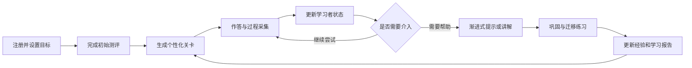
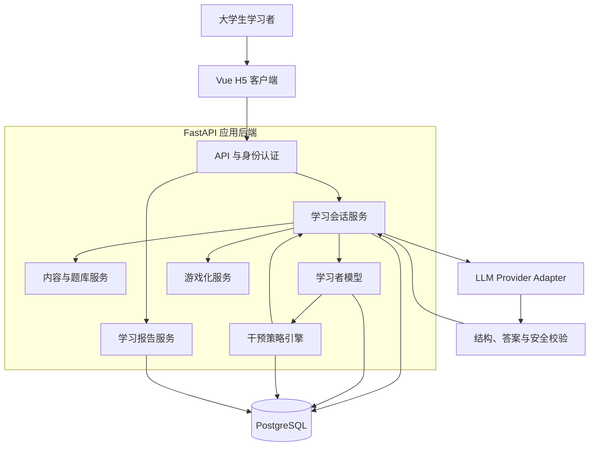

# OwlOWLGo

> 一个会判断“何时帮助、如何帮助”的 AI 游戏化英语学习伙伴。

OwlOwlGo 是面向大学生的 H5 英语学习应用。它不仅根据学习表现调整内容和难度，还会结合正确率、作答时间、尝试次数、求助行为与历史掌握情况，主动决定暂不介入、鼓励再试、提供轻提示、分步支架或完整讲解。

项目希望让 AI 从随时给答案的“答题助手”，转变为能够调控学习节奏、创造适宜挑战并支持有效失败的智能学习伙伴。

## 目录

- [项目介绍](#项目介绍)
- [工程问题定义](docs/requirements/problem_definition.md)
- [核心功能](#核心功能)
- [使用流程](#使用流程)
- [当前进度](#当前进度)
- [技术架构](#技术架构)
- [项目结构](#项目结构)
- [快速开始](#快速开始)
- [配置说明](#配置说明)
- [开发与测试](#开发与测试)
- [协作规范](#协作规范)
- [课程依据](#课程依据)

## 项目介绍

### 项目背景

通用生成式 AI 往往会在学习者提问后直接给出答案。这虽然能快速完成当前任务，却可能减少回忆、推理、自我解释和纠错过程。传统游戏化学习产品能够通过积分、连续学习和关卡提升参与度，但通常只根据答题正误调整难度，很少判断帮助是否出现得过早或过晚。

### 工程问题

本项目需要解决的问题是：

> 如何在网页端英语学习场景中持续估计大学生的学习状态，在合适的时间提供适量帮助，并使任务推荐和干预过程可解释、可评估、可迭代？

### 目标用户

- 主要用户：需要提升英语词汇、语法和阅读能力的大学生；
- 典型场景：每天完成一个 10–15 分钟的学习关卡；
- 初期测试对象：便于在校内招募和开展可用性测试的大学生；
- 产品形态：适配桌面端和移动端浏览器的 H5 应用。

### MVP 范围

首个可验证版本聚焦大学生英语词汇、语法和短篇阅读训练，包括：

- 用户账号、学习目标与个人档案；
- 10 分钟以内的初始能力测评；
- 个性化任务选择和难度调整；
- 作答过程与学习事件采集；
- 学习者知识状态更新；
- 五级自适应干预；
- 经验值、关卡、连续学习和基础成就；
- 学习进度、错误类型和下一步建议；
- 支持研究评估的去标识化数据记录。

首版不包含大模型微调、完整社交系统、多学科课程、付费体系和原生移动端应用。

## 核心功能

| 模块 | 功能说明 | MVP 验收方向 |
| --- | --- | --- |
| 初始测评 | 评估词汇、语法和阅读起点 | 用户在 10 分钟内完成并获得分项结果 |
| 个性化任务 | 根据掌握度、复习需求和难度匹配下一任务 | 每次推荐保存选择原因 |
| 学习过程感知 | 记录正确性、耗时、尝试次数和求助行为 | 学习事件可查询、可回放 |
| 学习者模型 | 更新知识点掌握度和近期困难状态 | 每次作答后更新对应知识状态 |
| 自适应干预 | 判断是否帮助以及帮助程度 | 输出干预级别、原因和策略版本 |
| 有效失败闭环 | 再尝试、渐进提示、讲解和迁移练习 | 多次失败后能得到支架并完成迁移题 |
| 游戏化反馈 | 经验值、关卡、连续学习和成就 | 关卡结束后正确更新进度 |
| 学习报告 | 展示掌握变化、错误类型和后续建议 | 用户能够查看个人学习报告 |

五级干预动作如下：

| 级别 | 系统动作 | 目的 |
| ---: | --- | --- |
| 0 | 暂不介入 | 保持独立思考和作答连续性 |
| 1 | 鼓励再试或提出反思问题 | 促进自我纠错 |
| 2 | 提供轻提示 | 指出方向但不泄露答案 |
| 3 | 提供分步支架 | 拆解任务并降低局部认知负担 |
| 4 | 提供完整讲解 | 结束无效挣扎并建立正确理解 |

## 使用流程



计划中的最终使用方式：

1. 用户注册并设置英语学习目标；
2. 完成初始测评，获得能力起点；
3. 系统生成当天的个性化学习关卡；
4. 用户完成词汇、语法或短篇阅读任务；
5. 系统根据学习过程选择干预动作；
6. 用户完成迁移练习并查看学习报告。

## 当前进度

当前处于课程 **第 1 周：系统分析与仓库构建**。

| 内容 | 状态 |
| --- | --- |
| 项目定位、目标用户和工程问题 | ✅ 已完成 |
| MVP 范围和核心功能方向 | ✅ 已完成 |
| 前端、后端、测试和基础设施目录 | ✅ 已完成 |
| 分支、提交、PR 和安全规范 | ✅ 已完成 |
| 17 周计划进度表 | ✅ 已完成 |
| GitHub Milestone、Issues 和 Project 看板 | ⬜ 待配置 |
| 教师仓库访问权限 | ⬜ 待配置 |
| 第 2 周功能基线和用户故事评审 | ⬜ 待开始 |

完整的周次安排、里程碑、完成度和风险记录见：

> **[查看项目计划进度表](docs/project-plan.md)**

工程问题的 5W1H、痛点映射、产品定位和成功指标见：

> **[查看工程问题定义与产品描述](docs/requirements/problem_definition.md)**

当前仓库已经完成工程骨架，但尚未实现实际业务功能。后端只有应用入口，前端只有基础挂载与路由结构，页面、数据库模型和学习策略将在后续课程阶段逐步实现。

## 技术架构



### 技术栈

| 层次 | 技术 | 用途 |
| --- | --- | --- |
| 前端 | Vue 3、TypeScript、Vite、Pinia、Vue Router | H5 页面、状态管理和用户交互 |
| 后端 | Python 3.12、FastAPI、Pydantic | API、业务编排和输入输出校验 |
| 数据 | PostgreSQL、SQLAlchemy | 业务数据、学习事件和策略记录 |
| AI | 可替换的 LLM Provider Adapter | 生成受约束的提示、讲解和候选内容 |
| 测试 | Pytest、Vitest、Playwright（规划） | 单元、接口、组件和端到端测试 |
| 部署 | Docker Compose、Nginx | 本地编排、反向代理和演示部署 |

关键设计约束：干预策略引擎决定“是否帮助以及帮助多少”，LLM 主要负责提示和讲解的语言表达。计分、权限、掌握度和干预决策不能完全交给 LLM。

## 项目结构

```text
OwlOwlGo-ECNU/
├─ .github/
│  ├─ ISSUE_TEMPLATE/          # 功能和缺陷 Issue 模板
│  ├─ pull_request_template.md # Pull Request 模板
│  └─ workflows/ci.yml         # GitHub Actions 基础检查
├─ backend/
│  ├─ app/
│  │  ├─ api/                  # HTTP API、依赖和版本路由
│  │  ├─ core/                 # 配置、安全和日志
│  │  ├─ db/                   # 数据库会话、模型和仓储
│  │  ├─ domain/               # 学习者、干预、任务和游戏化规则
│  │  ├─ integrations/         # LLM 等外部服务适配
│  │  ├─ schemas/              # 请求、响应和事件结构
│  │  ├─ services/             # 应用用例编排
│  │  └─ main.py               # FastAPI 入口
│  ├─ migrations/              # 数据库迁移
│  ├─ tests/                   # 后端单元和集成测试
│  └─ pyproject.toml           # Python 项目与依赖配置
├─ frontend/
│  ├─ src/
│  │  ├─ app/                  # 路由和全局状态
│  │  ├─ features/             # 测评、学习、干预、游戏化和报告
│  │  ├─ shared/               # API、组件、类型和工具
│  │  ├─ styles/               # 全局样式
│  │  ├─ App.vue
│  │  └─ main.ts
│  ├─ tests/                   # 前端测试
│  ├─ package.json             # 前端依赖和命令
│  └─ vite.config.ts           # Vite 配置
├─ infrastructure/
│  ├─ docker/                  # 前后端 Dockerfile
│  ├─ nginx/                   # Nginx 反向代理配置
│  ├─ deployment/              # 后续部署平台配置
│  └─ compose.yaml             # 服务编排
├─ tests/
│  ├─ ai-evaluation/           # AI 正确性、难度和提示泄露评测
│  ├─ contract/                # 前后端 API 契约测试
│  ├─ e2e/                     # 跨系统用户流程测试
│  └─ fixtures/                # 合成测试数据
├─ docs/
│  ├─ adr/                     # 架构决策记录
│  └─ project-plan.md          # 17 周项目计划进度表
├─ scripts/                    # 开发、检查和数据辅助脚本
├─ .env.example               # 环境变量示例
├─ CONTRIBUTING.md            # 项目协作规范
├─ LICENSE                    # MIT License
└─ README.md                  # 项目入口
```

各模块的具体职责可继续查看 [前端说明](frontend/README.md)、[后端说明](backend/README.md)、[测试说明](tests/README.md)和[基础设施说明](infrastructure/README.md)。

## 快速开始

### 环境要求

- Node.js 22 或更高版本；
- npm 10 或更高版本；
- Python 3.12 或更高版本；
- PostgreSQL 17，或使用 Docker Compose 启动数据库；
- Docker 和 Docker Compose，可选。

### 1. 克隆仓库

```bash
git clone https://github.com/tianyew/OwlOwlGo-ECNU.git
cd OwlOwlGo-ECNU
```

如果仓库为私有状态，需要先配置 GitHub 访问权限。

### 2. 创建本地配置

macOS / Linux：

```bash
cp .env.example .env
```

Windows PowerShell：

```powershell
Copy-Item .env.example .env
```

根据本机环境修改 `.env`。该文件包含本地密钥和连接信息，已被 Git 忽略，禁止提交。

### 3. 启动后端

macOS / Linux：

```bash
cd backend
python -m venv .venv
source .venv/bin/activate
python -m pip install -e ".[dev]"
uvicorn app.main:app --reload
```

Windows PowerShell：

```powershell
cd backend
python -m venv .venv
.\.venv\Scripts\Activate.ps1
python -m pip install -e ".[dev]"
python -m uvicorn app.main:app --reload
```

启动后可访问：

- API 根地址：`http://localhost:8000`
- Swagger 文档：`http://localhost:8000/docs`
- OpenAPI 描述：`http://localhost:8000/openapi.json`

当前后端只建立了 FastAPI 入口，业务接口将在开发阶段补充。

### 4. 启动前端

另开一个终端：

```bash
cd frontend
npm install
npm run dev
```

Windows PowerShell 如果因执行策略无法运行 `npm.ps1`，可以使用：

```powershell
npm.cmd install
npm.cmd run dev
```

Vite 默认访问地址为 `http://localhost:5173`。当前前端只包含应用入口和空路由，业务页面将在后续阶段实现。

### 5. 使用 Docker Compose

创建 `.env` 后，在仓库根目录执行：

```bash
docker compose -f infrastructure/compose.yaml up --build
```

网关计划访问地址为 `http://localhost:8080`。容器配置属于工程骨架，首次正式部署前仍需完成依赖锁定、健康检查和生产配置评审。

## 配置说明

主要环境变量定义在 [.env.example](.env.example)：

| 变量 | 用途 | 示例 |
| --- | --- | --- |
| `APP_ENV` | 当前运行环境 | `development` |
| `APP_DEBUG` | 是否开启调试模式 | `true` |
| `SECRET_KEY` | 会话或令牌签名密钥 | 本地随机字符串 |
| `DATABASE_URL` | PostgreSQL 连接地址 | `postgresql+psycopg://...` |
| `REDIS_URL` | 可选缓存服务地址 | `redis://localhost:6379/0` |
| `VITE_API_BASE_URL` | 前端请求的 API 地址 | `http://localhost:8000/api/v1` |
| `LLM_PROVIDER` | AI 服务供应商标识 | 后续确定 |
| `LLM_API_KEY` | AI 服务密钥 | 仅保存在本地环境 |
| `LLM_MODEL` | 使用的模型名称 | 后续确定 |

不得把真实 API Key、Token、密码、真实学习数据或个人配置提交到 Git。

## 开发与测试

### 前端命令

```bash
cd frontend
npm run dev       # 启动开发服务器
npm run build     # 类型检查并构建
npm run lint      # 代码检查
npm run test      # 执行测试
```

### 后端命令

```bash
cd backend
python -m uvicorn app.main:app --reload
python -m pytest
python -m ruff check .
python -m ruff format --check .
```

### 计划测试范围

- 单元测试：掌握度更新、任务评分、干预规则和游戏化规则；
- 集成测试：认证、API、数据库事务和 LLM 降级；
- 契约测试：前端类型与 OpenAPI 响应一致性；
- 端到端测试：测评、关卡、失败、提示、迁移题和报告；
- AI 评测：答案正确性、格式、难度、提示泄露和内容安全。

当前项目尚未安装依赖或形成依赖锁文件，CI 主要检查仓库结构和 Python 语法。业务功能完成后再逐步启用完整构建和测试门禁。

## 协作规范

- 从最新 `main` 创建 `feature/<topic>`、`fix/<topic>` 或 `docs/<topic>` 分支；
- 使用 GitHub Issues 记录目标、交付物和验收标准；
- 通过 Pull Request 合并变更，并关联对应 Issue；
- 提交信息采用 `feat:`、`fix:`、`docs:`、`test:`、`refactor:`、`chore:`；
- 正式文档放在 `docs/`，会议纪要、FAQ 和讨论过程放在 Wiki；
- 重要技术决定通过 `docs/adr/` 记录；
- `.env`、密钥、真实用户数据和个人配置不得提交。

完整规则见 [CONTRIBUTING.md](CONTRIBUTING.md)。

## 课程依据

本仓库根据以下课程资料建立：

- [智能软件工程实践课程仓库](https://github.com/bettermorn/IntelligentSWEPractice)
- [在 GitHub 中使用 Markdown 和 Wiki](https://github.com/bettermorn/IntelligentSWEPractice/wiki/%E3%80%90%E8%BD%AF%E4%BB%B6%E5%BC%80%E5%8F%91%E3%80%91%E5%9C%A8GitHub%E4%B8%AD%E4%BD%BF%E7%94%A8Markdown%E5%92%8CWiki)

课程将项目分为系统分析、系统设计、系统开发、系统测试和发布五个阶段。本项目的逐周对应关系记录在[项目计划进度表](docs/project-plan.md)中。

## License

本项目采用 [MIT License](LICENSE)。
