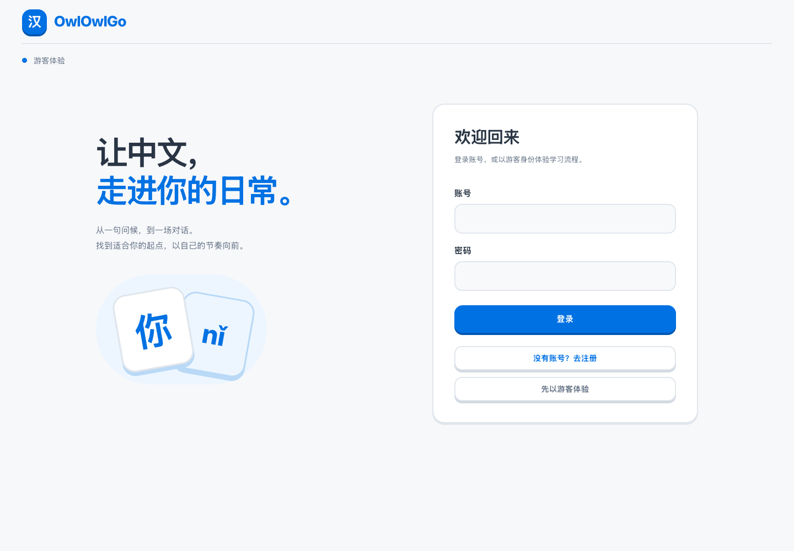
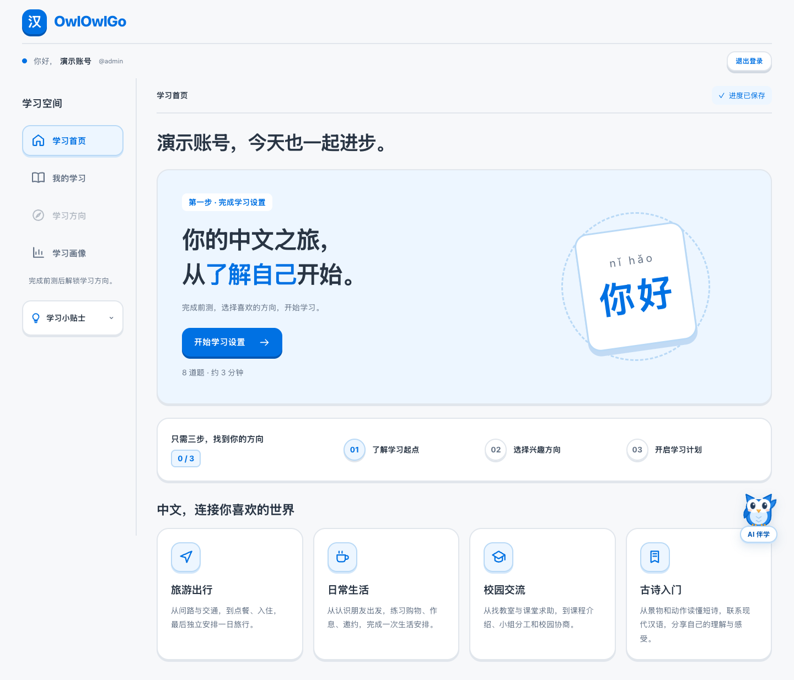
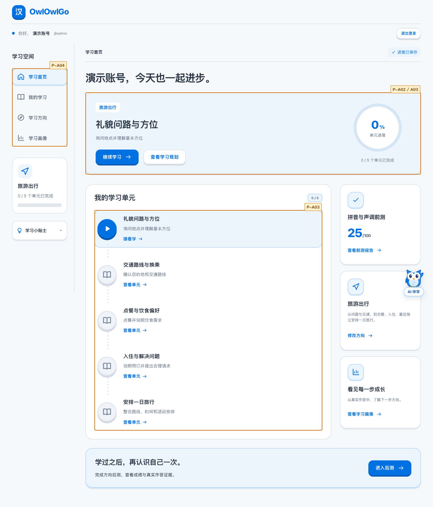

# 管佳欣的需求卡片：以当前真实前端为基线

版本v4，2026-11-17；真实截图采集于2026-11-16。图片来自运行现有代码后的真实浏览器截图，使用独立测试账号与临时JSON数据。没有修改产品布局。**卡片描述的是待完成改动，不代表截图里的页面已经实现这些功能。**

2026-11-17范围更新：[HSK题库上传与审核](question-bank.md)纳入本轮。等级、技能/题型与题量由团队确定；本文旧8题、2题、10题及分数样例仅为旧版兼容测试数据，新测验按已发布规则动态组卷。

[总清单](README.md) · [真实截图图册](screens.md) · [真实跳转与拟新增跳转](navigation.md) · [接口契约](contracts.md)

## P-A01 · 注册、登录和退出自己的学习账号

**HSK题库扩展后，本卡还必须完成：** 普通学习账号不能自行获得题库管理权限；管理角色由Q-A配置。 详见[题库卡片与接口](question-bank.md)。

**这个功能是干什么的**

让学习者创建自己的账号，登录后查看自己的学习记录；退出后，下一位使用者不能看到上一人的答案和成绩。

**一个具体例子**

小林第一次使用系统，注册后进入自己的首页；第二天用同一账号登录，能继续昨天的学习。小王换自己的账号登录后，只看到小王的记录。

**负责人：管佳欣｜复核：周子涵｜类型：迁移+回归｜状态：待实施/验收**

**用户操作与系统结果**

| 用户要做什么 | 用户操作 | 系统必须怎样响应 |
| --- | --- | --- |
| 创建账号 | 点“没有账号？去注册”，填写昵称、账号、密码、确认密码，点“注册并登录” | 检查必填项、账号是否重复和两次密码是否相同；成功后自动登录，首页显示该昵称 |
| 登录已有账号 | 填账号和密码，点“登录” | 正确则进入本人的首页并加载本人的记录；错误则留在登录页，提示“账号或密码不正确” |
| 不注册先看看 | 点“先以游客体验” | 进入前测介绍，可浏览题目与课程；不能提交正式测验或生成个人成绩 |
| 结束本次使用 | 点顶部“退出登录” | 先按A04处理未保存内容；退出成功后清掉屏幕上的个人记录，回到可登录状态 |
| 换另一个账号 | 退出后登录另一账号 | 只显示新账号的数据，加载时也不能短暂显示上一人的报告 |

账号填写规则：3—32位字母、数字或下划线，保存时统一小写；注册密码8—128位；昵称1—40位；确认密码必须与密码相同。请求处理中按钮不可重复点击。网络失败要显示失败原因和可重试提示，不跳入登录成功状态。

**拿什么判断完成**

- [ ] 新账号注册后，首页显示刚填的昵称；退出再登录仍是同一个账号。
- [ ] 两次密码不同或账号被占用时，页面说明具体问题，不创建账号。
- [ ] 账号甲有学习记录，退出并登录账号乙后，页面不出现甲的答案、成绩和昵称。
- [ ] 游客只能浏览，提交按钮不能产生正式成绩。

**先在现有系统找到这里**

- 实际入口：打开应用，未登录时显示。
- 页面/区块：登录/注册表单 .account-card；顶部 .account-bar 的退出按钮。
- 本轮改动：保持账号页现有布局，完成SQL切换后的登录、注册、游客、退出及账号隔离。

相关真实截图：[F01 登录](screens.md#f01) · [F02 注册](screens.md#f02)。新增功能没有现成截图，不用概念图冒充。

开发参考：现有实现、接口、数据库规则与代码位置

**现状与缺口**

账号页和Cookie认证已存在；缺口是SQL迁移后的行为一致性与换账号隔离，不重做整个登录界面。

**实现要点**

1. 登录表单仅账号/密码，注册增加昵称和确认密码。确认密码只用于前端比较，不发送后端；切换模式清密码、确认密码和旧错误。
2. 按K01校验长度和格式；请求期间禁用重复提交；登录或注册成功后清敏感输入，进入首页（F03/F09）。游客进入前测（F04—F06）预览，不能正式提交；登录后的账号数据不接收游客模拟成绩。
3. 退出成功才清用户、诊断、计划、草稿缓存和页面上下文；失败保留登录状态。学习有未确认保存/提交时阻止直接退出，由现有公共导航/保存条处理。共享测试环境不得自动播种admin/admin演示账号。

**异常与边界**

401显示账号或密码不正确；409显示账号已使用；422显示字段要求；断网保留账号/昵称但不显示成功；所有错误不得回显密码或Cookie。

**补充技术检查**

- [ ] 用户名2/3/32/33位、注册密码7/8/128/129位分别得到规定拒绝/接受；大小写归一后重名不能创建第二账号。
- [ ] U1登录查看学习后退出，U2登录不会闪现U1报告；过期Cookie请求受保护数据得到401。
- [ ] SQL重启后原合法会话可恢复，退出后该会话不可继续读取；网络失败的退出不把界面假装成游客。

**依赖与接口交接**

- 依赖：P-A05的账号SQL仓储；可先用现有JSON回归页面。
- 接口：K01（K为已有，N为建议新增，见[字段/事务/错误契约](contracts.md)）。
- 原需求：FR-1.1、8.3；验收编号：AC-A6、UI-A1（[验收清单](../../testing/iteration-01-acceptance.md)）。

**现有代码位置**

- [AccountGate.vue](../../../code/frontend/src/features/auth/AccountGate.vue)
- [auth.ts](../../../code/frontend/src/shared/api/auth.ts)
- [auth.py](../../../code/backend/app/api/endpoints/auth.py)

交付：代码变更、接口样例、测试结果、修改后的真实页面截图；按[共同完成标准](README.md#done)签收。

---

## P-A02 · 首页告诉用户下一步该做什么

**HSK题库扩展后，本卡还必须完成：** 首页已答题数显示n/N，N取当前测验实例的实际总题数。卡中3/8只是示例，不是固定前测长度。 详见[题库卡片与接口](question-bank.md)。

**这个功能是干什么的**

用户每次回到首页，都能从一个主要按钮继续当前步骤：没做前测就开始前测，答到一半就继续答，前测完成后就去制定学习计划。

**一个具体例子**

小林前测已答3题，离开后再次登录，首页显示“前测已作答3/8题”和“继续前测”；点击后恢复已保存的答案和停留题号。

**负责人：管佳欣｜复核：周子涵｜类型：完善现有｜状态：待实施/验收**

**首页应按下面的顺序决定显示什么**

| 用户当前情况 | 首页主要提示/按钮 | 点击后的结果 |
| --- | --- | --- |
| 学习记录尚未加载完 | “正在加载学习状态” | 暂不出现可点击的学习主按钮，避免把老用户当新用户 |
| 本轮前测尚未提交，也没有已保存答案 | “开始前测” | 打开F04前测介绍，用户再点击“开始测评” |
| 本轮前测尚未提交，已有已保存答案 | “前测已作答x/8题”＋“继续前测” | 打开F05，恢复已保存的答案和停留题号 |
| 本轮前测已提交，但尚未接受有效计划 | “选择方向并制定计划” | 打开F07，继续选择方向和填写目标 |
| 已接受有效计划 | 显示A03规定的学习卡片 | 根据计划打开下一课、后测或报告 |
| 用户已确认重新前测 | 按新一轮前测的未开始/答题中状态显示上述按钮 | 先完成新一轮前测，再制定新安排；旧成果保留但不作为新计划已完成的依据 |

“已答题数”和“停留题号”分开读取：答过3题不一定停在第3题。首页只显示已经保存成功的数据。读取失败时显示“未能加载学习状态”和“重试”，不能把失败显示成“你还没有开始学习”。

**拿什么判断完成**

- [ ] 全新账号看到“开始前测”，点击后进入介绍页。
- [ ] 保存第1—3题答案并停留第4题，重新登录后看到3/8；点击“继续前测”停在第4题，前3题答案仍在。
- [ ] 交完前测但没有接受计划，首页带用户去选择方向，不让用户重复交卷。
- [ ] 刷新首页不会增加前测次数或重新生成AI分析。

**先在现有系统找到这里**

- 实际入口：F01登录成功，尚未完成设置。
- 页面/区块：首页上方 .home-welcome / .home-continue 主卡及 .setup-strip 三步进度。
- 本轮改动：按服务端学习阶段决定主按钮文案和去向；不重做首页。

相关真实截图：[F03 新用户首页](screens.md#f03) · [F09 完成设置后的首页](screens.md#f09)。新增功能没有现成截图，不用概念图冒充。

开发参考：现有实现、接口、数据库规则与代码位置

**现状与缺口**

当前有新用户三步引导；需要用正式诊断和已接受计划判定下一步，不用有topic就当计划已完成。

**实现要点**

1. 页面加载前先展示骨架；读取progress、current diagnosis、current plan后计算状态，不在初始空对象上误显示全新用户。
2. 无正式前测且无草稿：按钮“开始前测”到前测（F04—F06）介绍态；有前测草稿：显示已答x/8，按钮“继续前测”到前测（F04—F06）保存页码；有当前诊断无生效计划：按钮“选择方向并制定计划”到F07方向页。
3. 存在有效生效计划则交P-A03渲染；重测后旧计划requires_replanning=true：保留历史完成摘要，但主要入口指向未完成前测或新规划。重新登录/刷新默认首页，不因展示首页产生提交或模型请求。

**异常与边界**

必需数据任一加载失败显示“未能加载学习状态”和重试，不展示0分/0进度冒充真实数据；401转F01/F02；重试成功后重新计算状态。

**补充技术检查**

- [ ] 对未开始、3题草稿、前测已提交未接计划、计划生效、重测中五种fixture，主按钮文案和落点均正确。
- [ ] 点击继续前测恢复第3题答案与页码；刷新首页没有新增submission或analysis请求。

**依赖与接口交接**

- 依赖：B的N02/current；C的N03/current。
- 接口：K03、N02、N03（K为已有，N为建议新增，见[字段/事务/错误契约](contracts.md)）。
- 原需求：FR-2.4、12.2、13.3；验收编号：UI-A1、AC-A2（[验收清单](../../testing/iteration-01-acceptance.md)）。

**现有代码位置**

- [HomeDashboard.vue](../../../code/frontend/src/features/home/HomeDashboard.vue)
- [LearningJourney.vue](../../../code/frontend/src/features/assessment/LearningJourney.vue)

交付：代码变更、接口样例、测试结果、修改后的真实页面截图；按[共同完成标准](README.md#done)签收。

---

## P-A03 · 首页展示已学进度，并打开接下来要学的单元

**HSK题库扩展后，本卡还必须完成：** 完成与通过取该次测验冻结的评分规则，不能把旧2题全对或固定后测题量当成新题库统一规则。 详见[题库卡片与接口](question-bank.md)。

**这个功能是干什么的**

已经有学习计划的用户，可以在首页看到学完了多少、下一课是什么，也可以直接打开任意计划内单元继续学习或复习。

**一个具体例子**

旅游计划有5个单元，小林通过第1单元的小测后，首页显示1/5、20%，主按钮带他去第2单元；点击第1单元则回去复习。

**负责人：管佳欣｜复核：周子涵｜类型：完善现有｜状态：待实施/验收**

**用户在首页要看见什么、能点什么**

| 首页位置 | 要显示的内容 | 点击后的结果 |
| --- | --- | --- |
| 顶部继续学习卡片 | 当前方向、下一未完成单元名称和目标 | “继续学习”打开计划顺序中第一个未完成单元 |
| 顶部进度环 | 已通过单元数/当前计划单元总数，以及对应百分比 | 仅展示进度，不因点击增加完成数量 |
| “我的学习单元”列表 | 当前计划的单元顺序；已通过标“已完成·复习”，下一单元标“接着学”，其余标“查看单元” | 点哪一行就打开哪一课；已完成单元仍可复习 |
| “查看学习规划” | 当前已接受计划的入口 | 打开F08的规划区 |
| 当前计划中的单元均已通过，但方向尚未完成 | 主按钮“进入后测” | 打开当前方向的后测；方向完成与否使用服务端记录 |
| 服务端已确认方向完成 | 主按钮“查看学习报告”，保留单元复习入口 | 打开本方向最近可用的正式后测报告 |

完成数量只在正式小测通过后更新。阅读正文、点击下一课、独立提示练习都不增加完成数；重复做题答错也不取消原先的通过记录。返回首页后同步最新记录；没有有效计划时按A02引导。

**拿什么判断完成**

- [ ] 5单元计划中第1课通过后，首页显示1/5和20%，继续学习打开第2课。
- [ ] 点第1课可复习，重复答错后首页仍显示1/5。
- [ ] 调整后的计划改变单元顺序，继续学习必须打开新顺序里的第一门未完成课程。
- [ ] 单元全部通过但方向未完成时进入后测；方向完成后主按钮能打开真实报告。

本卡负责“在首页展示和打开”，黄云舒负责产生计划，周子涵负责提交小测，郑仲佑负责报告内容。

**先在现有系统找到这里**

- 实际入口：F08 → 完成设置，进入首页。
- 页面/区块：顶部进度环 .home-progress；下方 .learning-path 单元路径；右侧 .home-cards。
- 本轮改动：将预设计划数据替换为已接受计划，保留现有卡片/路径布局。

相关真实截图：[F09 完成设置后的首页](screens.md#f09)。新增功能没有现成截图，不用概念图冒充。

开发参考：现有实现、接口、数据库规则与代码位置

**现状与缺口**

现有首页以预设方向计算nextUnit；本轮改为读取已接受计划里的实际单元顺序。

**实现要点**

1. 主卡展示当前方向、下一未完成单元标题/目标与已通过数量；百分比分母为当前计划包含的单元数，不能写死5。完成映射由内容目录的unit_id与服务端completed/result转换。
2. “继续学习”按计划顺序找首个未完成单元并跳F08课程区；单元路径每行可打开，已完成显示“复习”，不因点击而改完成。若计划单元全通过但后测未通过，主操作“进入后测”；方向已完成则“查看学习报告”并保留复习入口。
3. 从D页面返回或重新聚焦首页时刷新权威progress/plan；内容与计划版本不一致显示更新提示，不用过期本地数组索引打开错误单元。

**异常与边界**

无有效计划交P-A02；无可显示单元提供修改计划；加载失败保留最后成功数据并标为未刷新，不能覆盖为0；正式完成只能由后端响应变化。

**补充技术检查**

- [ ] 服务端一单元通过后首页立即与刷新后均显示1/5；重练答错仍1/5。
- [ ] 使用顺序改变的计划fixture，继续学习进入新顺序的正确unit_id；所有单元通过/后测已通过分别出现不同主按钮。

**依赖与接口交接**

- 依赖：P-C04/P-C05生效计划；K03完成记录。
- 接口：K02、K03、N03（K为已有，N为建议新增，见[字段/事务/错误契约](contracts.md)）。
- 原需求：FR-4.1、13.2、13.3；验收编号：UI-A1、AC-C5、AC-D1（[验收清单](../../testing/iteration-01-acceptance.md)）。

**现有代码位置**

- [HomeDashboard.vue](../../../code/frontend/src/features/home/HomeDashboard.vue)
- [LearningJourney.vue](../../../code/frontend/src/features/assessment/LearningJourney.vue)

交付：代码变更、接口样例、测试结果、修改后的真实页面截图；按[共同完成标准](README.md#done)签收。

---

## P-A04 · 点击菜单到达正确页面，离开前处理未保存的答案

**HSK题库扩展后，本卡还必须完成：** 公共导航增加仅管理角色可见的“题库管理”入口；学习端继续测验携带原实例ID，刷新或返回不得重新抽题。 详见[题库卡片与接口](question-bank.md)。

**这个功能是干什么的**

让侧栏、返回按钮和首页快捷入口都能打开对应内容；用户答题后切页或退出时，明确告诉他答案是否已经保存，避免误以为保存成功。

**一个具体例子**

小林刚选完答案就点击“学习首页”。系统先保存这次选择；成功才回首页。断网保存失败时留在原页，显示重试、留在本页或明确放弃未保存修改的选择。

**负责人：管佳欣｜复核：周子涵｜类型：公共接线+异常完善｜状态：待实施/验收**

**现有导航按钮具体做什么**

| 位置/按钮 | 应打开的内容 |
| --- | --- |
| 侧栏“学习首页”或“返回首页” | 当前账号的首页 |
| 侧栏“我的学习” | 未完成前测则继续前测；前测完成无有效计划则去方向设置；已有有效计划则打开当前学习安排 |
| 侧栏“学习方向” | 四方向选择区；登录用户尚未完成前测时禁用并说明“完成前测后选择学习方向” |
| 侧栏“学习画像” | 当前账号的F16画像；游客不可查看个人画像 |
| 首页“查看前测报告” | 本轮前测报告F10 |
| 后测结果“查看学习报告” | 刚刚那次后测的报告F15；不能误开前测报告 |
| 后续新增复习列表中的“返回” | 回到进入该列表前的画像或指定报告 |

**答题后切页或退出，必须让用户知道保存结果**

| 当前情况 | 页面提示和行为 |
| --- | --- |
| 答案刚改变、还在保存 | 显示“正在保存进度…”；记录用户要去哪里，保存成功后再跳转 |
| 保存成功 | 显示“进度已保存”；执行用户刚才的导航操作 |
| 保存失败 | 留在当前页，显示“进度尚未保存”；提供“重试保存”“留在本页”“放弃未保存修改并离开” |
| 用户选择放弃未保存修改 | 二次说明“本次未保存的选择会丢失”；确认后加载已保存记录再离开，不能后台继续提交被放弃的内容 |
| 另一个窗口已改过记录 | 停止自动保存，提示“另一页面已更新”；用户确认舍弃本地未保存内容后，才重新加载最新记录 |
| 正在提交正式测验/接受计划 | 暂时禁用会冲突的跳转和重复提交，等结果明确后再操作 |
| 登录已过期 | 显示“登录已过期，请重新登录”，回登录入口；重新登录后不自动重交上一次答案 |

关闭浏览器前，若仍有未保存内容，应触发浏览器离开提示；不能承诺断网时也能保存。

**拿什么判断完成**

- [ ] 从首页点击前测报告、规划、画像，分别到正确内容；侧栏高亮与当前内容一致。
- [ ] 刚选完答案就回首页，等待保存成功后才离开；回来能看到刚才的选择。
- [ ] 断网后改答案再切页，页面显示未保存并停留；重试成功才能正常离开，或由用户明确放弃。
- [ ] 两个窗口同时修改时，旧窗口提示冲突，不自动覆盖新窗口已经保存的内容。

A负责公共导航和保存提示；各页面负责人提供自己的按钮事件和目标参数。A不承担报告、课程等页面正文开发。

**先在现有系统找到这里**

- 实际入口：F08 → 完成设置，进入首页。
- 页面/区块：左侧 .workspace-nav；右上 .workspace-toolbar 保存状态；返回首页按钮；顶部账号条。
- 本轮改动：统一现有按钮接线与保存/冲突/登录失效行为。

相关真实截图：[F09 完成设置后的首页](screens.md#f09) · [F05 前测答题](screens.md#f05)。新增功能没有现成截图，不用概念图冒充。

开发参考：现有实现、接口、数据库规则与代码位置

**现状与缺口**

当前页面用view/stage/outcome切换，router无路由；本轮不同时改成全新路由架构。

**实现要点**

1. 按navigation.md维护单一navigate(target,params,return_to)入口；账号切换清导航上下文。侧栏高亮映射为首页、我的学习、方向、画像；前测/后测报告要区分，不复用一个无参数report状态。
2. 保存条严格区分loading/saving/saved/failed/conflict；只在服务端确认后显示已保存。dirty状态切页等待串行保存；失败让用户重试或明确选择放弃未保存更改；关闭浏览器沿用beforeunload，不能承诺离线保存。
3. 前测报告按钮带diagnosis_id或current标识；后测报告必须带submission_id；返回带return_to。统一解析旧detail和新detail/code错误。401清失效个人缓存并到F01/F02，不自动重放旧写请求。
4. 各功能区作者提供最小接线补丁；同页区块可内部提取组件；A只收口导航与保存，不代写页面正文。现有公共导航/保存条在360px和桌面保持主要操作可达。

**异常与边界**

409暂停保存队列，显示“另一页面已更新”，不循环覆盖；用户选择重新加载前提示未保存修改影响。提交期间禁用重复提交与会产生冲突的导航。

**补充技术检查**

- [ ] 从首页分别进入前测报告/画像/当前计划，标题与返回目标正确；从后测进入的是F15报告而非前测报告（F06/F10）。
- [ ] 保存断网时切页不显示已保存；恢复网络重试后才能正常离开；冲突后未自动覆盖新数据。

**依赖与接口交接**

- 依赖：各页面公开props/events；K03保存队列。
- 接口：K01、K03；新接口错误适配见contracts/0（K为已有，N为建议新增，见[字段/事务/错误契约](contracts.md)）。
- 原需求：FR-4.1；NFR-6、9、19；验收编号：UI-A1、G-08、G-09（[验收清单](../../testing/iteration-01-acceptance.md)）。

**现有代码位置**

- [App.vue](../../../code/frontend/src/App.vue)
- [LearningJourney.vue](../../../code/frontend/src/features/assessment/LearningJourney.vue)
- [learning.ts](../../../code/frontend/src/shared/api/learning.ts)

交付：代码变更、接口样例、测试结果、修改后的真实页面截图；按[共同完成标准](README.md#done)签收。

---

## P-A05 · 把账号和学习记录存入PostgreSQL，保留已有数据

**HSK题库扩展后，本卡还必须完成：** 新增Q-A题库/版本/素材/批次/审核/规则/测验实例的基础契约；C/E/D分别完成上传、审核和组卷业务存储，A不包办。 详见[题库卡片与接口](question-bank.md)。

**这个功能是干什么的**

把当前保存在JSON文件里的账号、答题草稿、成绩和学习进度搬进PostgreSQL，并让之后的注册、答题和学习记录都读写数据库。用户重新登录或服务重启后仍能找回记录。

**一个具体例子**

迁移前小林已通过第1单元、前测草稿停在第3题。迁移后他重新登录，仍能看到同一账号、已通过单元和原草稿；新提交的成绩写进数据库。

**负责人：管佳欣｜复核：周子涵｜类型：新增基础设施+迁移｜状态：待实施/验收**

**这是一张数据支撑卡，没有新增前端页面**

用户不需要选择数据库、导入文件或点击迁移按钮。开发者在后台完成切换，账号页、测验和首页是验证结果的入口。

| 要保留/保存什么 | 完成后必须达到的效果 |
| --- | --- |
| 账号 | 迁移前能用的账号和密码，迁移后重新登录仍可使用 |
| 已保存的草稿 | 原来选过的答案和停留题号仍在，用户能继续答 |
| 正式成绩 | 原提交的分数、逐题答案、通过记录和时间保持原意，不能丢失或重复增加 |
| 学习进度 | 已通过的单元仍是已通过；不能因为换存储方式而清零 |
| 新产生的数据 | 切换后的新注册、新保存和新提交都写进PostgreSQL，服务重启后仍能读取 |
| 同时提交/保存 | 同一次提交重复发送只算一次；保存一半失败不能留下“有成绩但没更新进度”的半条记录 |

**按四个可交付的小任务实施**

1. **DB-01：建立可使用的数据库。** 准备配置、核心表和建表命令；其他成员能用同一套方式启动自己的测试库。
2. **DB-02：让现有功能读写数据库。** 完成注册、登录、保存草稿、交卷和读取进度；用新账号走通一次实际流程。
3. **DB-03：搬运已有记录。** 先用旧JSON的副本导入并逐账号核对。输出导入数量、错误记录和差异；重复运行不会重复导入。旧登录会话作废，用户需要重新登录。
4. **DB-04：验证出故障能恢复。** 在测试副本上做备份与恢复，恢复后验证账号、草稿、成绩仍可用；再按迁移计划安排实际切换。

**拿什么判断完成**

- [ ] 准备一个含旧账号、草稿和已通过单元的数据副本；迁移后逐项保持一致，旧密码能重新登录。
- [ ] 切换后新注册账号并完成前测，重启服务后账号、成绩仍在；运行时JSON文件没有新增写入。
- [ ] 同一次交卷重复发送只保留一条正式记录；中途写入失败时成绩和进度一起撤销。
- [ ] 备份恢复到另一个测试库后，能登录并找到同一份记录。

A负责账号、会话、进度、正式作答的公共存储和迁移工具。B负责诊断表，C负责偏好/计划表，D负责练习/提示记录；各自完成对应数据读写和测试。

**先在现有系统找到这里**

- 实际入口：打开应用，未登录时显示。
- 页面/区块：无新增页面；账号表单、答题草稿和首页进度是数据库迁移回归入口。
- 本轮改动：只改这些页面依赖的存储链路；不创建数据库配置页面。

相关真实截图：[F01 登录](screens.md#f01) · [F05 前测答题](screens.md#f05) · [F09 完成设置后的首页](screens.md#f09)。新增功能没有现成截图，不用概念图冒充。

开发参考：现有实现、接口、数据库规则与代码位置

**现状与缺口**

只有SQLAlchemy/psycopg依赖和可选数据库服务；应用直接创建JSON仓储，模型/session/Alembic未实现。

**实现要点**

1. DB-01：初始化连接配置、健康检查、独立测试库、Alembic与users/sessions/learning_progress/submissions；create_app改为注入仓储而非依赖账号文件path。配置连接失败明确失败，不落回JSON。
2. DB-02：替换核心仓储；一次提交、progress revision和B诊断hook同事务。保留同ID同内容重放、不同内容409、过时revision竞争、跨用户隔离。为各包提供真实SQLfixture与迁移范例。
3. DB-03：只读JSON预检、导入批次与幂等、逐用户对账；保留ID/哈希/版本/epoch/草稿/历史通过/来源标记/现有分析；导入的旧会话作废并明确要求重登录。异常条目报告，不静默跳过。
4. DB-04：在副本演练停写切换、备份恢复及回退；数据库已有新写入后不得直接切回旧JSON丢增量。基础完成后B/C/D各自建新业务表，A不代做。

**异常与边界**

重复键、坏JSON、孤立用户关联、事务中断和连接失败均要可定位；不得清空真实数据或自动重建业务库。实现/演练使用副本，真实切换按迁移清单执行。

**补充技术检查**

- [ ] 新空库可upgrade到head；新用户在SQL上注册、前测、正式学单元、重启恢复，运行时JSON文件无新写入。
- [ ] 多连接同ID并发只留一次结果；写提交后注入进度更新失败，事务全部回滚。
- [ ] 同一导入副本跑两遍无重复且成绩/画像对账；备份恢复到独立库后业务可用。

**依赖与接口交接**

- 依赖：先交仓储Protocol/fixture；B提供诊断同事务hook。
- 接口：K01—K05、数据库计划（K为已有，N为建议新增，见[字段/事务/错误契约](contracts.md)）。
- 原需求：FR-1.1、2.4、4.1、4.2、4.5、8.3；验收编号：AC-A1—A6（[验收清单](../../testing/iteration-01-acceptance.md)）。

**现有代码位置**

- [main.py](../../../code/backend/app/main.py)
- [session.py](../../../code/backend/app/db/session.py)
- [accounts.py](../../../code/backend/app/db/repositories/accounts.py)
- [learning.py](../../../code/backend/app/db/repositories/learning.py)
- [README.md](../../../code/backend/migrations/README.md)
- [compose.yaml](../../../infrastructure/compose.yaml)

交付：代码变更、接口样例、测试结果、修改后的真实页面截图；按[共同完成标准](README.md#done)签收。

---

