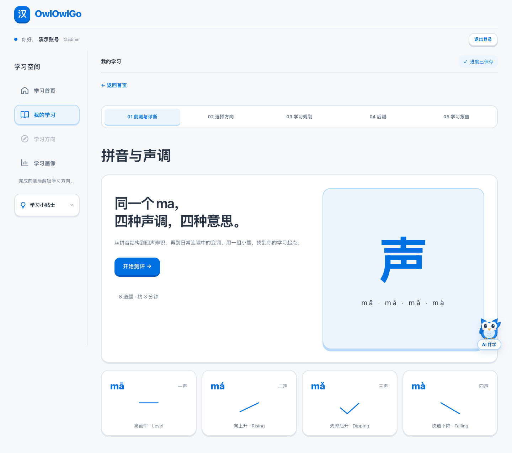
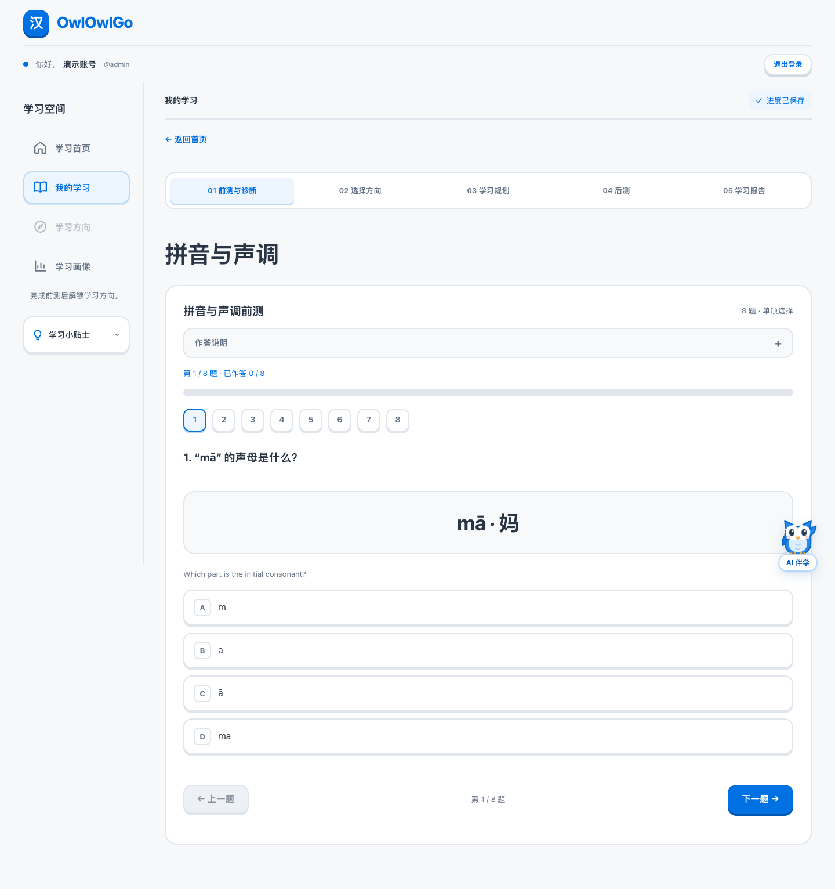
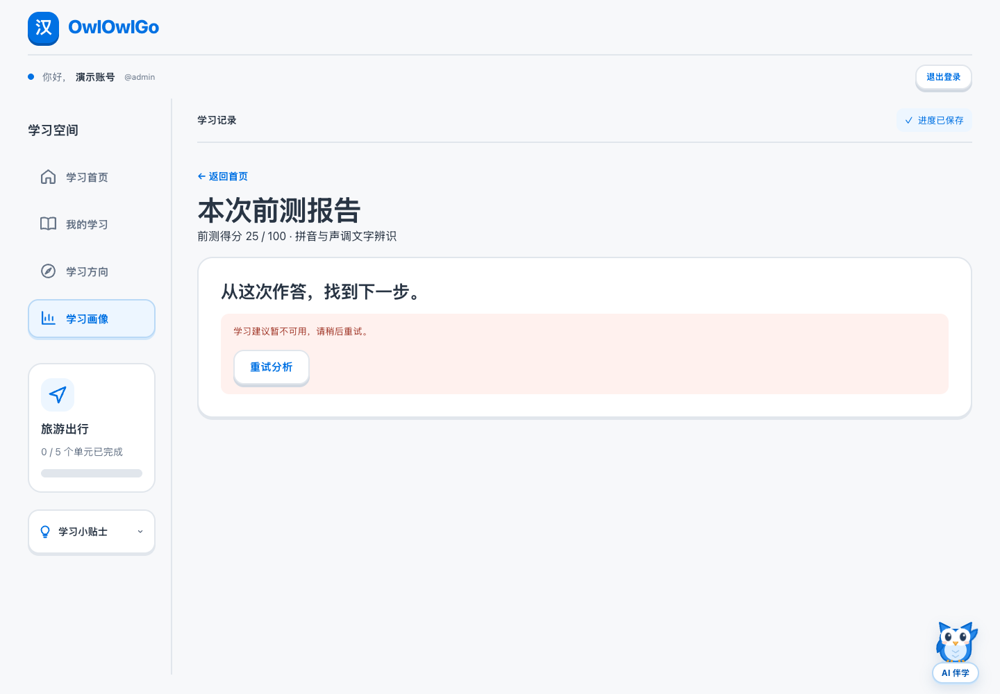
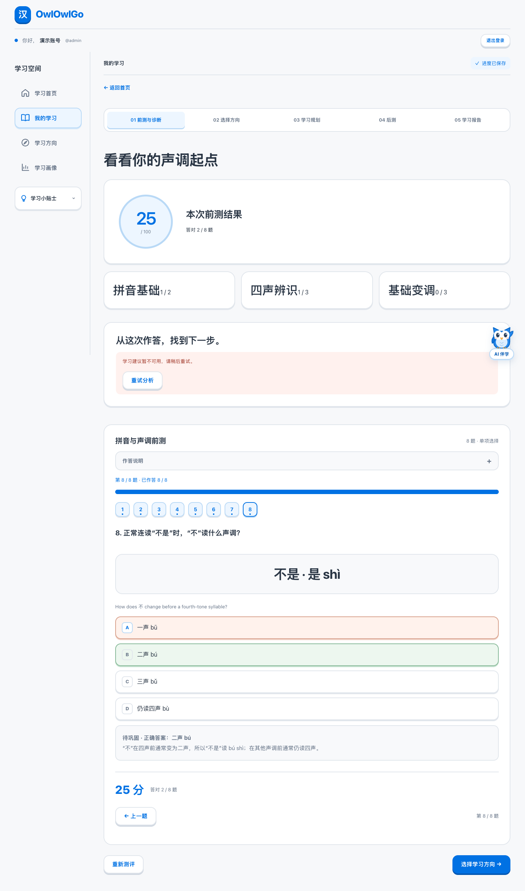

# 钱俊的需求卡片：以当前真实前端为基线

版本v4，2026-11-17；真实截图采集于2026-11-16。图片来自运行现有代码后的真实浏览器截图，使用独立测试账号与临时JSON数据。没有修改产品布局。**卡片描述的是待完成改动，不代表截图里的页面已经实现这些功能。**

2026-11-17范围更新：[HSK题库上传与审核](question-bank.md)纳入本轮。等级、技能/题型与题量由团队确定；本文旧8题、2题、10题及分数样例仅为旧版兼容测试数据，新测验按已发布规则动态组卷。

[总清单](README.md) · [真实截图图册](screens.md) · [真实跳转与拟新增跳转](navigation.md) · [接口契约](contracts.md)

## P-B01 · 按HSK依据准备前测题库和测量规则

**HSK题库扩展后，本卡还必须完成：** 内容工作扩展为Q-B所述HSK题库准备、依据核查和覆盖矩阵；不能只审核当前8道拼音题。当前标准版本、等级、题量由团队确定。 详见[题库卡片与接口](question-bank.md)。

**这个功能是干什么的**

让用户做依据明确HSK标准设计的前测；团队须准备持续扩充、逐题审核的题库，并明确每次前测测什么。

**一个具体例子**

用户看到“拼音与声调文字辨识”，不会把结果误认为口语或HSK等级；答错后能读到对应规则解释。

**负责人：钱俊｜复核：郑仲佑｜类型：内容审核+现有页面完善｜状态：待实施/验收**

**先在现有系统找到这里**

- 实际入口：F03 → 开始学习设置。
- 页面/区块：前测介绍 .welcome；答题 .practice-question 题干、拼音、英文辅助。
- 本轮改动：审核8题内容和测量范围，保留当前介绍页与答题样式。

相关真实截图：[F04 前测介绍](screens.md#f04) · [F05 前测答题](screens.md#f05)。新增功能没有现成截图，不用概念图冒充。

**现状与缺口**

已存在固定8题及声调介绍；现有8题仅为原型；本轮新增题库的范围与审核按Q-B执行。

**具体开发内容**

1. 按Q-B登记大纲版本及考点依据，待团队确定等级、技能、题型与题量后分配内容批次；不能以当前8题审核完成代替新题库交付。
2. 准备题目文件和素材，逐题核对题意、答案、解析、等级及来源，交非作者审核；修改已发布题创建新版本，保留历史引用。
3. 设计前测组卷规则和分项计算依据，与D核对系统能展示与评分的题型；前测介绍显示实际测量范围、题数与估计时长，不将自制诊断称为官方HSK认证。

**异常与边界**

题库加载失败显示重试；游客说明只读，不能显示已生成个人诊断；缺少教学审核证据保持待审核。

**逐项验收**

- [ ] 8题全错/全对/仅错1题分别为0/100/88，分项分母与题库一致。
- [ ] 前测介绍和结果均没有发音评分、HSK等级或未测试能力断言。

**依赖与接口交接**

- 依赖：当前assessment_items与catalog；E交叉审核。
- 接口：K02、K04、N08（K为已有，N为建议新增，见[字段/事务/错误契约](contracts.md)）。
- 原需求：FR-2.1、2.3、2.6、11.1；验收编号：AC-B1、UI-B1（[验收清单](../../testing/iteration-01-acceptance.md)）。

**现有代码位置**

- [PhoneticsDemo.vue](../../../code/frontend/src/features/phonetics/PhoneticsDemo.vue)
- [assessment_items.json](../../../code/backend/app/domain/learner/assessment_items.json)
- [catalog.py](../../../code/backend/app/domain/content/catalog.py)

交付：代码变更、接口样例、测试结果、修改后的真实页面截图；按[共同完成标准](README.md#done)签收。

---

## P-B02 · 从题库开始前测、恢复答题并提交

**HSK题库扩展后，本卡还必须完成：** 从已发布规则创建/恢复前测实例，分页、已答n/N、未答齐限制都以实际题数为准；旧8题只作历史兼容样例。题型与素材按Q-D支持能力展示。 详见[题库卡片与接口](question-bank.md)。

**这个功能是干什么的**

让用户完成从已发布题库组出的前测，中途离开后继续同一份题，答齐后提交并得到本次诊断。

**一个具体例子**

答完3题退出再登录，原3题答案仍在；只答7题不能提交，答齐8题才能生成结果。

**负责人：钱俊｜复核：郑仲佑｜类型：现有流程完善｜状态：待实施/验收**

**先在现有系统找到这里**

- 实际入口：F04 → 开始测评。
- 页面/区块：题号 .question-map；选项 .practice-option；底部 .pagination / .quiz-submit-area。
- 本轮改动：完善分页、草稿恢复和正式提交；提交成功仍在现有前测结果态。

相关真实截图：[F05 前测答题](screens.md#f05) · [F06 前测提交后](screens.md#f06)。新增功能没有现成截图，不用概念图冒充。

**现状与缺口**

已有题号导航、草稿和服务端判分；本卡负责前测用法与完整流程，通用控件内部由D评审合并。

**具体开发内容**

1. 用户开始前测时调用Q-D实例接口，显示实际总题数N及题型；题库或规则不足停在介绍页显示原因，不使用固定旧题冒充。
2. 题号、选项/类型化答案、已答n/N、当前页随实例保存；刷新先恢复实例，不能重新抽卷。所有必答题答齐且保存成功才允许提交，未知结果重试沿用submission_id。
3. 提交按实例冻结的规则判分；有人工评分项时先显示待评分，最终评分完成后才生成诊断。B负责前测流程，共享作答/题型控件由D维护。

**异常与边界**

加载失败可重试；提交失败保留答案和ID；409交现有公共导航/保存条加载最新进度；未完成前测请求诊断时显示继续答题，不生成假结果。

**逐项验收**

- [ ] 答3题等待已保存后重启服务、刷新，恢复相同题和答案；只答7题不能正式提交或产生诊断。
- [ ] 第8题提交丢响应，原ID重试只产生一份前测、一份诊断；刷新结果一致。

**依赖与接口交接**

- 依赖：D维护共用测验控件；A保存队列/SQL。
- 接口：K03、K04、N02（K为已有，N为建议新增，见[字段/事务/错误契约](contracts.md)）。
- 原需求：FR-2.2、2.4、2.6；验收编号：AC-B2、UI-B1（[验收清单](../../testing/iteration-01-acceptance.md)）。

**现有代码位置**

- [PhoneticsDemo.vue](../../../code/frontend/src/features/phonetics/PhoneticsDemo.vue)
- [ServerUnitQuiz.vue](../../../code/frontend/src/features/assessment/ServerUnitQuiz.vue)
- [phonetics.test.ts](../../../code/frontend/tests/phonetics.test.ts)

交付：代码变更、接口样例、测试结果、修改后的真实页面截图；按[共同完成标准](README.md#done)签收。

---

## P-B03 · 诊断结果与AI失败的规则建议

**HSK题库扩展后，本卡还必须完成：** 分项报告按本次实际测到的HSK考点/技能汇总；未测技能明确未测，不能继续把所有新前测固定称为“拼音声调文字辨识”。绑定测验实例和题目快照，不输出未经验证的HSK等级。 详见[题库卡片与接口](question-bank.md)。

**这个功能是干什么的**

让用户看懂这次前测哪些地方会、哪些地方需要练习；AI暂时不可用时也能得到基于实际错题的基本建议。

**一个具体例子**

用户声调题答错，报告指出相应错题和复习规则；AI请求失败后显示“规则建议”，仍可继续选择方向。

**负责人：钱俊｜复核：郑仲佑｜类型：新增回退+证据绑定｜状态：待实施/验收**

**先在现有系统找到这里**

- 实际入口：F09右栏 → 查看前测报告。
- 页面/区块：“从这次作答，找到下一步。” #learning-analysis 分析区。
- 本轮改动：在原分析区补规则回退及来源标识；截图中的真实状态是AI未配置后的失败提示，不能当成已有回退。

相关真实截图：[F10 本次前测报告](screens.md#f10) · [F06 前测提交后](screens.md#f06)。新增功能没有现成截图，不用概念图冒充。

**现状与缺口**

现在有AI逐题建议与失败重试，缺完整确定性规则回退和diagnosis_id绑定。

**具体开发内容**

1. 前测报告（F06/F10）加载诊断显示总分/分项/时间/测量范围，报告文字只能来源于该诊断的正式作答；AI处理中仍可继续F07方向页。
2. 仅当前诊断首次无分析时调用N02分析；已有同证据/版本缓存直接用。展示source=ai或rule，fallback显示“规则建议”，可手动重试模型但不循环自动重试。
3. 模型超时、无Key、非法结构、缺错题或引用不存在题时返回rule_feedback；规则按每道真实错题生成，F8改为巩固建议不能虚构薄弱点。异步返回只更新相同diagnosis_id界面。

**异常与边界**

诊断加载失败不显示默认0分；只有模型故障时才规则回退；存储/认证失败按503/401处理。旧请求不能替换新诊断或修改正式成绩。

**逐项验收**

- [ ] 注入无Key/超时/错误引用均展示正确规则反馈，并能继续选择方向。
- [ ] FX和FY同分异错得到各自建议；分析未返回时重测，旧返回不覆盖新页面。

**依赖与接口交接**

- 依赖：N02诊断；现有DeepSeek适配与校验。
- 接口：N02（K06兼容保留）（K为已有，N为建议新增，见[字段/事务/错误契约](contracts.md)）。
- 原需求：FR-2.3、2.5、2.6、6.7、6.8子集；验收编号：AC-B4、B5、G-10（[验收清单](../../testing/iteration-01-acceptance.md)）。

**现有代码位置**

- [LearningAnalysis.vue](../../../code/frontend/src/features/assessment/LearningAnalysis.vue)
- [assessment.py](../../../code/backend/app/services/agents/assessment.py)
- [deepseek.py](../../../code/backend/app/integrations/llm/deepseek.py)

交付：代码变更、接口样例、测试结果、修改后的真实页面截图；按[共同完成标准](README.md#done)签收。

---

## P-B04 · 新增本人历次前测列表与只读详情

**HSK题库扩展后，本卡还必须完成：** 历史增加大纲版本、测量范围、测验实例及题目版本；题库更新后旧诊断仍按原试卷可追溯。 详见[题库卡片与接口](question-bank.md)。

**这个功能是干什么的**

让用户查看自己以前每次前测的时间、得分和反馈，重新测评后仍能找回旧结果。

**一个具体例子**

用户完成第二次前测后，打开“历次前测”，可以分别查看第一次和第二次记录，旧结果不会变成新分数。

**负责人：钱俊｜复核：郑仲佑｜类型：新增页面+SQL模型｜状态：待实施/验收**

**先在现有系统找到这里**

- 实际入口：F09右栏 → 查看前测报告。
- 页面/区块：本次前测报告标题/返回首页附近；当前没有历次前测入口或历史列表。
- 本轮改动：在现有报告页新增“历次前测”入口与列表/详情子视图；只借用现有样式，不伪造现有截图。

相关真实截图：[F10 本次前测报告](screens.md#f10)。新增功能没有现成截图，不用概念图冒充。

**现状与缺口**

历史正式作答在存储中保留，但没有完整诊断历史接口、页面及不可变快照。

**具体开发内容**

1. 新增DiagnosisHistoryPage及diagnoses模型/迁移（文件名建议，尚未存在）；正式前测事务按submission_id唯一写快照，AI结果独立追加。
2. 前测报告（F06/F10）“查看历次前测”和首页报告内入口进入NEW-HISTORY（待新增历史诊断）；每页20条显示时间、分数、内容/评分版本、当前/历史标识；下一批按next_offset读取，选择一条同页显示只读详情。
3. 历史详情不触发重新分析，不把旧题目套用最新答案；返回当前报告走current诊断。按N02回填可核验旧正式前测，保留回填来源和缺失AI状态。

**异常与边界**

无历史显示去前测；401登录；不存在/他人ID404；某条详情失败保留列表并允许重试。

**逐项验收**

- [ ] D1重测得D2后两条均可读，旧分数/解释不变；选择历史不改当前方向或当前诊断。
- [ ] U2猜D1 ID得到404；多于20条时分页不重复/跳项；页面不调用历史模型分析。

**依赖与接口交接**

- 依赖：A的统一事务和仓储；B正式提交诊断hook。
- 接口：N02（K为已有，N为建议新增，见[字段/事务/错误契约](contracts.md)）。
- 原需求：FR-2.5、2.6、8.3；验收编号：AC-B3、UI-B1（[验收清单](../../testing/iteration-01-acceptance.md)）。

**现有代码位置**

- [LearningAnalysis.vue](../../../code/frontend/src/features/assessment/LearningAnalysis.vue)
- [assessment.py](../../../code/backend/app/services/agents/assessment.py)
- [learning.py](../../../code/backend/app/db/repositories/learning.py)

交付：代码变更、接口样例、测试结果、修改后的真实页面截图；按[共同完成标准](README.md#done)签收。

---

## P-B05 · 前测出口、重测确认与提示模板交接

**HSK题库扩展后，本卡还必须完成：** 提示模板与新题库的稳定题ID/版本绑定；不能把原2题模板套到所有新题。正式前后测不提供解题提示，模板未覆盖的新练习题仍可由D调用模型并校验；仅模型失败且无合格备用模板时说明暂无提示。 详见[题库卡片与接口](question-bank.md)。

**这个功能是干什么的**

让前测结束后有明确出口：继续选方向，或在确认影响后重新前测；另向伴学功能提供经过设计的分级提示内容。

**一个具体例子**

点击“选择学习方向”直接继续；点击重测先说明影响，取消则保留现状。提示模板交给D组用于独立练习，不在正式前测里泄露答案。

**负责人：钱俊｜复核：郑仲佑｜类型：完善跳转+教学资产｜状态：待实施/验收**

**先在现有系统找到这里**

- 实际入口：F05答齐8题 → 提交答案。
- 页面/区块：前测结果底部“重新测评 / 选择学习方向”；方向页底部“重新前测”。
- 本轮改动：明确重测确认与方向出口；另交付D需要的教学提示模板，模板无独立页面。

相关真实截图：[F06 前测提交后](screens.md#f06) · [F07 选择学习方向](screens.md#f07)。新增功能没有现成截图，不用概念图冒充。

**现状与缺口**

选择方向和重测已有；需要与新诊断/计划状态一致，同时交付D可执行的教学标准。

**具体开发内容**

1. “选择方向”带当前diagnosis_id进入F07方向页，不因分析未完成而禁用；历史诊断不能直接当当前规划依据，历史页仅返回当前或开始重测。
2. “重新前测”确认文案说明清当前前测/设置、保留历史成绩与已通过单元；确认后调用K05成功才清当前页面并去前测（F04—F06）；取消原地保留。
3. 为旅游首单元2题交付版本化0—4级模板、逐级帮助判定表和答案泄露反例；这部分不新增前测解题提示，模板由D用于独立练习、E复核。

**异常与边界**

重测409先加载新进度，不直接清页面；失败保留旧成功诊断；缺当前诊断不能进入正式新计划。

**逐项验收**

- [ ] 分析未完成仍可选择方向；重测取消没有任何写请求，确认成功后旧报告可在NEW-HISTORY（待新增历史诊断）查到。
- [ ] 2级模板不含完整答案，4级只在明确请求使用；D状态机测试能逐行对应B判定表。

**依赖与接口交接**

- 依赖：C接diagnosis_id；D接模板；E复核。
- 接口：K05、N02、N08（K为已有，N为建议新增，见[字段/事务/错误契约](contracts.md)）。
- 原需求：FR-2.6、12.2、6.1—6.6教学部分；验收编号：AC-B5、B6、UI-B1（[验收清单](../../testing/iteration-01-acceptance.md)）。

**现有代码位置**

- [PhoneticsDemo.vue](../../../code/frontend/src/features/phonetics/PhoneticsDemo.vue)
- [LearningJourney.vue](../../../code/frontend/src/features/assessment/LearningJourney.vue)
- [assessment.py](../../../code/backend/app/integrations/llm/prompts/assessment.py)

交付：代码变更、接口样例、测试结果、修改后的真实页面截图；按[共同完成标准](README.md#done)签收。

---

