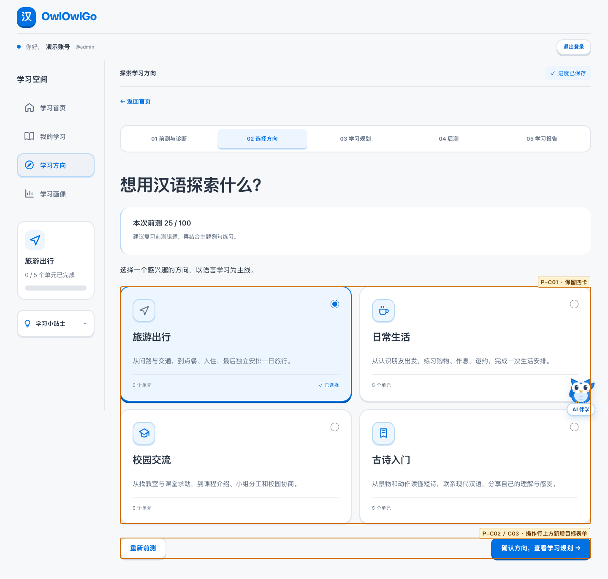
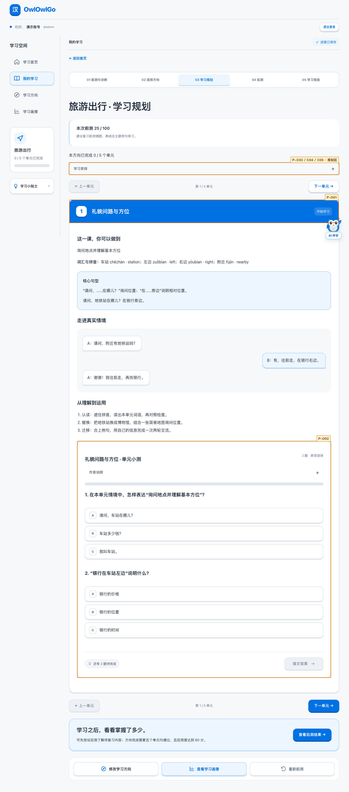

# 黄云舒的需求卡片：以当前真实前端为基线

版本v5，2026-11-17；真实截图采集于2026-11-16。图片来自运行现有代码后的真实浏览器截图，使用独立测试账号与临时JSON数据。没有修改产品布局。**卡片描述的是待完成改动，不代表截图里的页面已经实现这些功能。**

2026-11-17范围更新：[HSK题库上传与审核](question-bank.md)纳入本轮。等级、技能/题型与题量由团队确定；本文旧8题、2题、10题及分数样例仅为旧版兼容测试数据，新测验按已发布规则动态组卷。

[总清单](README.md) · [真实截图图册](screens.md) · [真实跳转与拟新增跳转](navigation.md) · [接口契约](contracts.md)

## P-C01 · 方向卡片只改变候选，不立即替换计划

**HSK题库扩展后，本卡还必须完成：** 方向主题与HSK等级分别标记，项目主题不能自动当成HSK考点。 详见[题库卡片与接口](question-bank.md)。

**这个功能是干什么的**

让用户挑选想学的方向；正在考虑另一个方向时，原来已接受的学习安排仍然保留。

**一个具体例子**

用户已有旅游计划，点选古诗卡片后又取消，首页仍显示旅游计划。

**负责人：黄云舒｜复核：管佳欣｜类型：现有方向卡片行为修改｜状态：待实施/验收**

**先在现有系统找到这里**

- 实际入口：F06 → 选择学习方向；或侧栏学习方向。
- 页面/区块：四张 .topic-card 方向卡；右下“确认方向，查看学习规划”按钮。
- 本轮改动：保留四卡单选，修改确认行为为生成候选；未接受前不覆盖当前方向。

相关真实截图：[F07 选择学习方向](screens.md#f07)。新增功能没有现成截图，不用概念图冒充。

**现状与缺口**

现有confirm会直接写state.topic并进入固定课程；新流程需将预览选择和生效计划分开。

**具体开发内容**

1. 保留LearningJourney.vue中现有四方向卡片（可内部提取组件）；显示title/description及实际单元数量，支持单选。初次默认不选；修改安排时初始化为生效方向。
2. 点卡片只改topicDraft，不发PUT progress，不替换首页方向。点击生成才使用当前草稿作为候选输入；当前方向与准备选择的方向同时可辨认。
3. 正式生成要求当前诊断存在；游客可浏览卡片，按钮改为登录继续；取消返回return_to且不写数据库。未审核课程不足要明确告知，不能用假单元填满。

**异常与边界**

课程加载失败显示重试，不渲染空白像无课程；未选方向禁用生成；诊断过时提示重新完成前测；读取计划失败不能把它当无计划。

**逐项验收**

- [ ] 已有旅游计划时点击古诗卡再取消，首页仍旅游、正式progress.topic不变。
- [ ] 游客浏览不产生计划/提交；有诊断的新用户单选后可以进入P-C03生成。

**依赖与接口交接**

- 依赖：B当前诊断；K02课程目录。
- 接口：K02、N02、N03（K为已有，N为建议新增，见[字段/事务/错误契约](contracts.md)）。
- 原需求：FR-12.1—12.3；验收编号：AC-C1、C5、UI-C1（[验收清单](../../testing/iteration-01-acceptance.md)）。

**现有代码位置**

- [LearningJourney.vue](../../../code/frontend/src/features/assessment/LearningJourney.vue)
- [curriculum.ts](../../../code/frontend/src/shared/api/curriculum.ts)

交付：代码变更、接口样例、测试结果、修改后的真实页面截图；按[共同完成标准](README.md#done)签收。

---

## P-C02 · 保存目标、自报水平和每天学习时间

**HSK题库扩展后，本卡还必须完成：** 自报水平不能直接替代测验分级依据，生成安排须引用已确定标准及当前实际诊断范围。 详见[题库卡片与接口](question-bank.md)。

**这个功能是干什么的**

让用户填写自己的学习目标、自报水平和每天可用时间，保存后用于生成学习安排。

**一个具体例子**

用户填写“学会旅行问路”、初学、每天30分钟；重新登录还能看到这些设置，生成计划也使用30分钟预算。

**负责人：黄云舒｜复核：管佳欣｜类型：新增表单+API+SQL｜状态：待实施/验收**

**先在现有系统找到这里**

- 实际入口：F06 → 选择学习方向；或侧栏学习方向。
- 页面/区块：四方向卡片 .topic-grid 下方、现有 .question-actions 操作行上方（新增区块）。
- 本轮改动：这里现在没有目标/水平/时间输入；新增三字段表单与保存状态，不另画新设置页。

相关真实截图：[F07 选择学习方向](screens.md#f07)。新增功能没有现成截图，不用概念图冒充。

**现状与缺口**

当前缺完整偏好字段；本卡新增独立LearningPreferences表单和API模块，不往旧LearningState塞额外字段。

**具体开发内容**

1. 目标输入去首尾空格后1—200字；水平下拉为不确定/初学/有基础/中级，提交unknown/beginner/basic/intermediate；每日分钟整数10—120。无历史值显示未设置，不静默保存默认值。
2. 提供“保存设置”；“生成安排”若有未保存改动先等待N01 PUT成功，再携返回version生成。保存时保留输入、禁重复提交；成功显示已保存。
3. 初次GET version0，保存返回1；重新登录恢复；新version使旧候选不再可接受。此表单不包含提示开关，不将自报水平当正式诊断。

**异常与边界**

422在对应字段显示说明；409显示设置已被另一页面修改，保留本地输入供查看，用户选择加载最新或取消，不自动强写；断网停在本页不继续生成。

**逐项验收**

- [ ] 9/10/11/119/120/121以及10.5/空值/字符串校验符合N01；空白目标不能保存。
- [ ] U1保存30分钟并重启后恢复；U2数据不同；两个窗口旧version更新只有一个成功。

**依赖与接口交接**

- 依赖：A数据库基础；N01契约。
- 接口：N01（K为已有，N为建议新增，见[字段/事务/错误契约](contracts.md)）。
- 原需求：FR-1.2、12.2；验收编号：AC-C6、C7、UI-C1（[验收清单](../../testing/iteration-01-acceptance.md)）。

**现有代码位置**

- [LearningJourney.vue](../../../code/frontend/src/features/assessment/LearningJourney.vue)
- [learning.ts](../../../code/frontend/src/shared/api/learning.ts)

交付：代码变更、接口样例、测试结果、修改后的真实页面截图；按[共同完成标准](README.md#done)签收。

---

## P-C03 · 生成候选计划，并调用AI说明为什么这样安排

**这个功能是干什么的**

用户生成计划后，既能看到每天学什么，也能看到结合本人诊断、目标和可用时间生成的个性化说明。黄云舒负责本功能的模型API调用、提示词、输出校验和页面展示。

**一个具体例子**

用户目标是旅行问路、每天30分钟，诊断显示方位词需要练习。系统排好课程后，AI解释为何先安排方位词相关单元，并引用这次真实诊断；不能把未测过的听力说成薄弱项。

**负责人：黄云舒｜复核：管佳欣｜状态：待实施/验收**

使用团队统一购买的模型API，由本卡负责人实现业务调用；不新增公共模型调用基础任务。调用在后端完成，密钥不放浏览器。

**页面位置**

F07右下现有确认按钮；F08标题下、课程正文上方（新增候选预览区）。

**现状与缺口**

当前只有预设课程安排，没有候选计划的个性化模型说明。本卡同时实现规则排课和模型说明，模板只作为失败时的后备。

**具体开发内容**

1. 用户在F07点击“生成安排”：先保存目标/时间，再由服务端从已审核课程排出候选计划，并验证先修、时长和课程有效性；无可行计划时直接说明原因，不调用模型编造课程。
2. 候选有效后，由后端调用团队统一购买的模型API。输入为本次诊断摘要及可引用证据ID、目标、每日时间、已完成单元、候选单元及排课依据；编写本功能提示词，要求输出总体说明和逐单元安排理由。
3. 校验返回结构、单元ID和证据ID；课程、顺序、分钟数与完成条件以程序结果为准，模型只能补说明。虚构课程、错引用或超出已测范围的能力判断均拒绝展示，回退为真实规则说明。
4. 在F08候选预览区显示“为什么这样安排”和各单元理由；等待时显示“正在生成说明”。成功标“AI生成说明”，失败显示“AI说明暂不可用，以下为规则说明”及“重试说明”。说明失败不阻止查看或接受合法计划。
5. 说明绑定候选plan_id、输入指纹、提示词/模型版本并保存；刷新读取已保存说明，不反复付费调用。重试只重新生成说明，不新建计划或改变安排；同一请求重放返回同一结果。
6. 本卡完成后才把候选交P-C04接受；返回修改或取消不替换当前生效计划。

**异常与边界**

模型超时、限流、余额不足、返回非法结构或证据引用错误时提供规则说明；不得显示原始供应商错误或密钥。加载/数据库失败与模型失败分别处理；旧候选响应不能写到新候选上。

**逐项验收**

- [ ] 使用两份不同的诊断/目标生成计划，说明引用各自真实依据，不套用另一人的证据。
- [ ] 注入不存在的unit_id、错误证据ID或声称未测技能薄弱的模型结果，被拦截并回退，课程顺序/时长不被修改。
- [ ] 模型失败时合法候选仍可接受；刷新不再次调用供应商；重试说明不新增计划。
- [ ] 在团队提供的有效API配置下完成一次真实生成，保留脱敏请求编号和页面证据；仅模板或mock通过不能签收AI-C。

**接口与协作**

- 依赖：P-C02保存成功；B诊断；E审核白名单。
- 接口：N01、N02、N03（含explanation）、N08，见[接口契约](contracts.md)。
- 原需求：FR-13.1、13.2、12.3；验收：AC-C1、C2、UI-C1；AI-C，见[验收清单](../../testing/iteration-01-acceptance.md)。

**现有代码入口**

- [LearningJourney.vue](../../../code/frontend/src/features/assessment/LearningJourney.vue)
- [catalog.py](../../../code/backend/app/domain/content/catalog.py)

模型调用可参考现有[deepseek.py](../../../code/backend/app/integrations/llm/deepseek.py)，按统一购买服务的实际配置接入；不要求新建通用模型平台。交付包含页面、后端调用、提示词、输出校验、失败处理和脱敏实调证据。

---

## P-C04 · 接受或修改计划，并生成调整理由

**这个功能是干什么的**

用户修改目标或每天时间后，能看懂新旧安排改变了什么、为什么改变，再决定接受或取消。黄云舒负责调用模型生成与真实差异一致的调整理由。

**一个具体例子**

每天学习时间从30分钟改成20分钟，程序将原本同一天的两课拆开。AI说明“为适应新的每日时间，把这两课分开安排”；取消后旧计划仍然生效。

**负责人：黄云舒｜复核：管佳欣｜状态：待实施/验收**

使用团队统一购买的模型API，由本卡负责人实现业务调用；不新增公共模型调用基础任务。调用在后端完成，密钥不放浏览器。

**页面位置**

F08顶部 .setup-finish 首次设置区、.context-help 学习安排附近；底部 .plan-tools 修改方向。

**现状与缺口**

现有选择方向就改进度；本卡改为候选显式接受，保存本人计划版本和接受幂等。

**具体开发内容**

1. F08“修改安排”返回F07并回填现有值。生成新候选时由程序计算旧/新计划的单元、顺序、天数和时长差异；已完成成果保留。
2. 复用P-C03的说明接口，将旧/新计划、真实diff及改变的目标/时间/诊断输入模型，生成调整摘要和逐项理由。没有变化时明确“安排未变化”，不能为凑文案编造调整。
3. 预览区先展示程序计算的差异，再显示AI调整理由；拒绝与diff相矛盾的文案。模型失败显示规则差异说明，旧计划继续使用。
4. 点击“接受计划”时获取最新progress revision，服务端重验候选输入和当前计划版本；同事务使新计划生效并更新进度。接受操作读取已保存说明，不再调用模型。
5. 取消只返回旧计划/首页；重复接受不创建第二版本。说明按原候选和旧计划基线保存，迟到响应不得覆盖其他版本。初次接受成功后才算完成设置。

**异常与边界**

诊断/偏好/成绩/计划已变化时拒绝接受旧候选并要求重新生成；仅模型说明失败不取消合法候选。写入失败保留旧生效计划。

**逐项验收**

- [ ] 30分钟改20分钟后，文案逐项对应程序实际diff；无变化时不能虚构新增课程或学习成果。
- [ ] 生成新候选后取消，旧计划保留；接受后仅新计划生效，重复请求不产生第三版。
- [ ] 模型失败仍可查看差异和接受合法安排；旧模型响应不能覆盖新候选说明。

**接口与协作**

- 依赖：P-C03候选；A同事务progress更新。
- 接口：K03、N03（含explanation），见[接口契约](contracts.md)。
- 原需求：FR-13.3—13.5同步子集；验收：AC-C3、C4、UI-C1；AI-C，见[验收清单](../../testing/iteration-01-acceptance.md)。

**现有代码入口**

- [LearningJourney.vue](../../../code/frontend/src/features/assessment/LearningJourney.vue)
- [learning.py](../../../code/backend/app/db/repositories/learning.py)

模型调用可参考现有[deepseek.py](../../../code/backend/app/integrations/llm/deepseek.py)，按统一购买服务的实际配置接入；不要求新建通用模型平台。交付包含页面、后端调用、提示词、输出校验、失败处理和脱敏实调证据。

---

## P-C05 · 现有规划页的计划信息与单元入口

**HSK题库扩展后，本卡还必须完成：** 打开课程时交接测验用途与规则；由D创建或恢复对应实例，不以旧题目数组位置识别题。 详见[题库卡片与接口](question-bank.md)。

**这个功能是干什么的**

让用户在学习规划区查看当前安排、单元目标和完成情况，并打开想学的单元。

**一个具体例子**

用户在安排中选中“礼貌问路与方位”，同页课程区显示这一课；返回首页后看到的仍是同一份计划。

**负责人：黄云舒｜复核：管佳欣｜类型：现有区块完善+接口衔接｜状态：待实施/验收**

**先在现有系统找到这里**

- 实际入口：F07选方向 → 确认方向，查看学习规划。
- 页面/区块：F08标题、方向完成数、“学习安排”折叠区、上方单元分页；F09计划摘要。
- 本轮改动：负责上方规划信息与打开单元的事件；课程正文和小测由D负责，仍可同页展示。

相关真实截图：[F08 学习规划与单元内容](screens.md#f08) · [F09 完成设置后的首页](screens.md#f09)。新增功能没有现成截图，不用概念图冒充。

**现状与缺口**

学习规划、单元正文和小测当前同页。本卡只负责上方计划信息与单元选择事件；不要求拆成三个独立页面。

**具体开发内容**

1. F08学习规划区读取current plan，显示版本、目标、每天安排与真实完成标记；单元行展示标题/目标/时长，开始/复习按钮。不要以数组索引作为跨页标识。
2. 点击带plan_id/version、unit_id、return_to=F08学习规划区进入F08课程区；仅accepted且不requires_replanning的当前计划允许正式学习。旧版本可查看但标历史，不能伪装当前。
3. 将首页所需plan summary交A；从课程返回保持当前计划，不重新生成；按当前progress合并通过标记。旧用户采用N03 legacy-preset-v0迁移快照并明确标记预设。

**异常与边界**

单元不存在/停用/版本不能读取时显示不可用与返回，不转到相邻错误单元；无计划到F07方向页；重测中主要操作去前测（F04—F06）而不是强行进入正式测验。

**逐项验收**

- [ ] 点击任意单元打开正确unit_id；计划顺序改变后仍正确；课程返回没有新增plan。
- [ ] 改方向再切回原方向后历史通过记录保留；客户端改completed不影响权威完成。

**依赖与接口交接**

- 依赖：P-C04生效计划；D课程组件；A首页。
- 接口：K02、K03、N03（K为已有，N为建议新增，见[字段/事务/错误契约](contracts.md)）。
- 原需求：FR-13.2、13.3、13.4；验收编号：AC-C5、UI-C1（[验收清单](../../testing/iteration-01-acceptance.md)）。

**现有代码位置**

- [LearningJourney.vue](../../../code/frontend/src/features/assessment/LearningJourney.vue)
- [HomeDashboard.vue](../../../code/frontend/src/features/home/HomeDashboard.vue)

交付：代码变更、接口样例、测试结果、修改后的真实页面截图；按[共同完成标准](README.md#done)签收。

---

