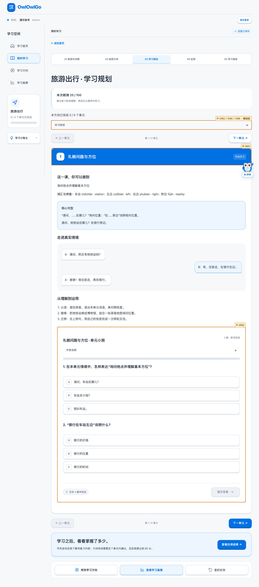
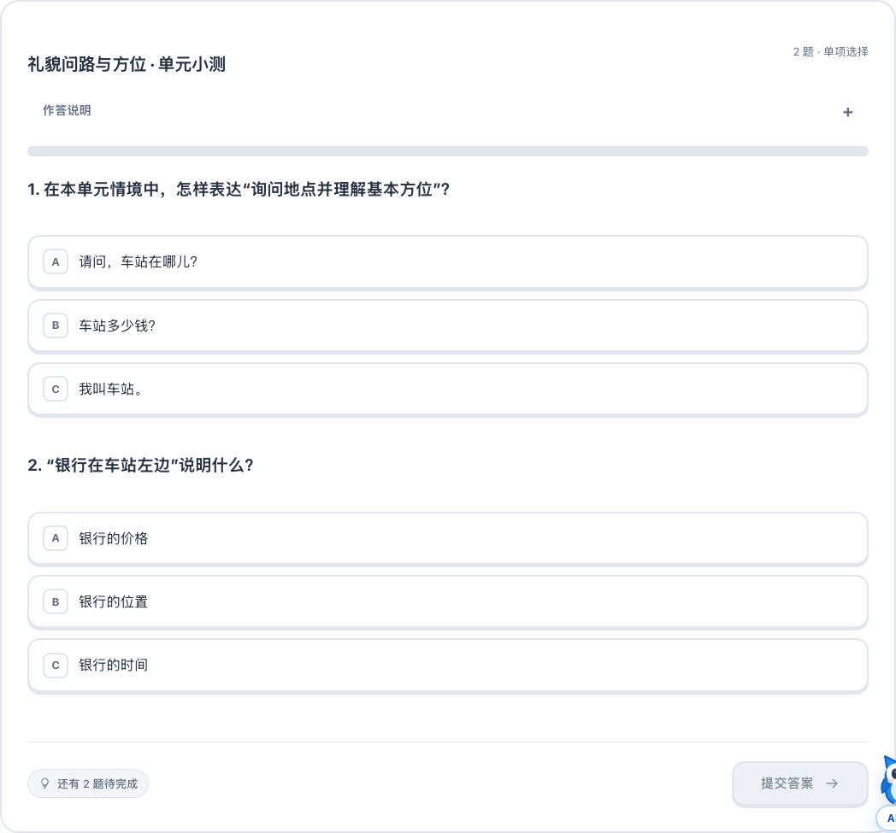
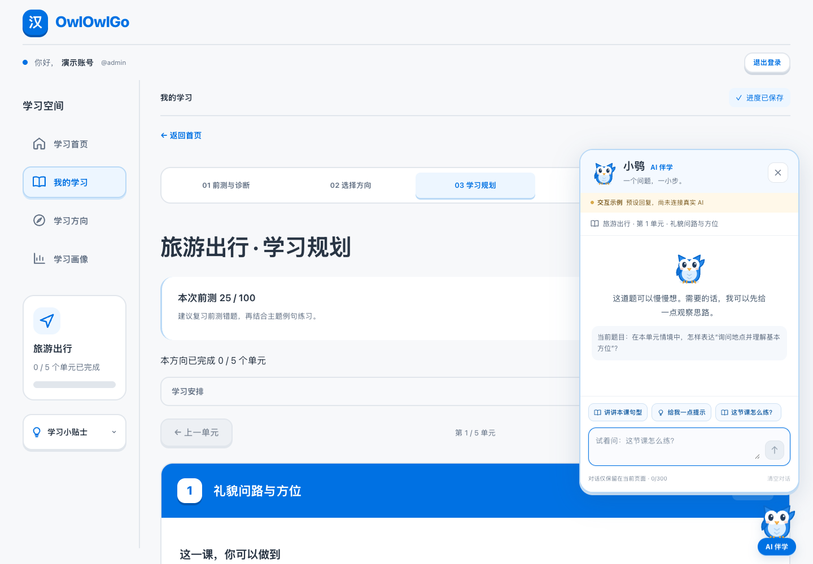
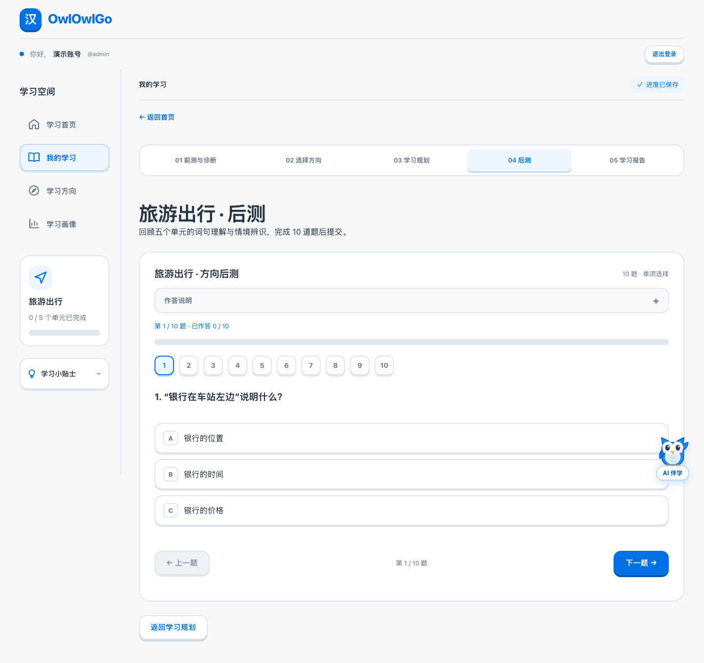

# 周子涵的需求卡片：以当前真实前端为基线

版本v5，2026-11-17；真实截图采集于2026-11-16。图片来自运行现有代码后的真实浏览器截图，使用独立测试账号与临时JSON数据。没有修改产品布局。**卡片描述的是待完成改动，不代表截图里的页面已经实现这些功能。**

2026-11-17范围更新：[HSK题库上传与审核](question-bank.md)纳入本轮。等级、技能/题型与题量由团队确定；本文旧8题、2题、10题及分数样例仅为旧版兼容测试数据，新测验按已发布规则动态组卷。

[总清单](README.md) · [真实截图图册](screens.md) · [真实跳转与拟新增跳转](navigation.md) · [接口契约](contracts.md)

## P-D01 · 现有单元内容区与上下单元导航

**HSK题库扩展后，本卡还必须完成：** 课程内的小测及独立练习读取对应已发布题目与素材；题目暂不可用时保留课程阅读并说明测验状态。 详见[题库卡片与接口](question-bank.md)。

**这个功能是干什么的**

让用户阅读一个单元的目标、词汇、句型和对话，并按当前计划切换上一课或下一课。

**一个具体例子**

用户读完问路课程点击下一单元，标题、正文和小测一起切换；只浏览正文不会被算作已经通过。

**负责人：周子涵｜复核：黄云舒｜类型：完善现有课程区｜状态：待实施/验收**

**先在现有系统找到这里**

- 实际入口：F07选方向 → 确认方向，查看学习规划。
- 页面/区块：蓝色 .unit-page-heading 课程标题；.unit-detail 目标/词汇/句型/对话/练习；上下单元按钮。
- 本轮改动：维护现有课程区和分页，可内部提取组件，但不要求另建课程页面。

相关真实截图：[F08 学习规划与单元内容](screens.md#f08)。新增功能没有现成截图，不用概念图冒充。

**现状与缺口**

课程正文位于LearningJourney.vue的规划页内；缺口是与真实计划和稳定unit_id的衔接。

**具体开发内容**

1. 维护现有课程区（可内部提取UnitLesson组件）；通过unit_id查课程，显示目标、词汇拼音、句型/例句、对话、练习任务；展示内容版本依据，不把正文任务列表当已判分作答。
2. 上一/下一按当前计划顺序，不跨方向；当前单元发生变化时清旧题目面板上下文，保留已保存草稿；返回走return_to，默认F08学习规划区。
3. 旅游首单元提供“独立练习（不计正式成绩）”到NEW-PRACTICE（待新增练习区，复用F12面板）；其他单元不显示已接入提示的假入口。正式小测可内嵌F11内嵌小测，共用同一quiz_id。复习跨方向只读预览时明确限制，正式学习需C显式切换计划。

**异常与边界**

课程请求失败可重试；ID/版本不存在显示返回规划；离开前尚未保存由现有公共导航/保存条处理；只浏览、上下页不写完成。

**逐项验收**

- [ ] 从计划和首页分别打开travel-0，正文和小测都对应旅游首单元；从错题来源打开时不会误跳当前数组下标。
- [ ] 阅读、翻页、返回不会新增正式提交或改变已通过记录。

**依赖与接口交接**

- 依赖：C计划/导航参数；K02课程；E元数据。
- 接口：K02、K03、N03、N08（K为已有，N为建议新增，见[字段/事务/错误契约](contracts.md)）。
- 原需求：FR-3.1、4.1、13.2；验收编号：UI-D1、AC-C5（[验收清单](../../testing/iteration-01-acceptance.md)）。

**现有代码位置**

- [LearningJourney.vue](../../../code/frontend/src/features/assessment/LearningJourney.vue)
- [curriculum.ts](../../../code/frontend/src/shared/api/curriculum.ts)

交付：代码变更、接口样例、测试结果、修改后的真实页面截图；按[共同完成标准](README.md#done)签收。

---

## P-D02 · 展示题库生成的单元小测并记录成绩

**HSK题库扩展后，本卡还必须完成：** 共享答题组件支持已发布规则中实际启用的题型、素材和N题；不再固定2题/8题/10题。新增实例组卷、冻结试卷、类型化答案和评分见Q-D。 详见[题库卡片与接口](question-bank.md)。

**这个功能是干什么的**

让用户作答当前单元从题库生成的小测，提交后获得按本次规则判定的成绩和完成结果；共享控件支持前后测启用的题型。

**一个具体例子**

单元小测2题全部答对后显示已完成，首页进度随之增加；再次答错不会撤销此前的通过记录。

**负责人：周子涵｜复核：黄云舒｜类型：现有流程回归+SQL联调｜状态：待实施/验收**

**先在现有系统找到这里**

- 实际入口：F09继续学习 → F08课程正文向下滚动。
- 页面/区块：F08课程下半部 .practice-quiz；共享ServerUnitQuiz的题号、选项、结果与提交。
- 本轮改动：保留内嵌小测，负责共享测验组件和SQL提交回归；B负责前测文案与流程接线。

相关真实截图：[F11 单元小测区块](screens.md#f11) · [F05 前测答题](screens.md#f05) · [F13 方向后测答题](screens.md#f13)。新增功能没有现成截图，不用概念图冒充。

**现状与缺口**

服务端判分、retry ID和草稿已经存在；保留这些行为，修改共用控件必须回归前测/后测。

**具体开发内容**

1. 按Q-D为单元创建或恢复测验实例；保留现有内嵌位置，题目数和题型读实例。新题库无需改前端源码即可用于下一次测验。
2. 实现已发布规则启用的文字/音频/图片及对应答题控件；题型未实现不得选入正式卷。公开题目不得含答案、解析或可泄露答案的音频稿。
3. 草稿/交卷按实例ID和冻结题目校验，返回实际correct/total及规则判定结果。一次提交与进度更新同事务、重复提交幂等；历史通过不因重练失败撤销。

**异常与边界**

断网保留选择、错误提示和原提交ID；409要求加载最新进度；422显示需检查完整答案；提交中锁定会冲突的编辑，避免旧结果覆盖新练习。

**逐项验收**

- [ ] travel-0一对一错50分且不完成，全部正确100分完成；再失败保留完成。
- [ ] 同ID重复只存一次，换答案同ID409；未保存/游客不能提交；前测和后测原有测试继续通过。

**依赖与接口交接**

- 依赖：A核心SQL仓储；B前测调用方。
- 接口：K03、K04（K为已有，N为建议新增，见[字段/事务/错误契约](contracts.md)）。
- 原需求：FR-3.1、4.1—4.5；验收编号：AC-D1、UI-D1、AC-A3（[验收清单](../../testing/iteration-01-acceptance.md)）。

**现有代码位置**

- [ServerUnitQuiz.vue](../../../code/frontend/src/features/assessment/ServerUnitQuiz.vue)
- [learning.ts](../../../code/frontend/src/shared/api/learning.ts)
- [learning.py](../../../code/backend/app/api/endpoints/learning.py)

交付：代码变更、接口样例、测试结果、修改后的真实页面截图；按[共同完成标准](README.md#done)签收。

---

## P-D03 · 调用AI生成小鸮提示、分步讲解、例句与情境练习

**这个功能是干什么的**

在不计正式成绩的学习/独立练习中，小鸮根据当前课程、用户错误和允许的帮助程度，实时生成提示、讲解、例句或情境练习。周子涵负责模型API调用及与现有面板的接线。

**一个具体例子**

用户在问路练习中选错，小鸮先给观察方向词的轻提示；用户再次求助得到分步说明，明确要求讲解后才给完整解释。用户还可点“换个例句”或“情境练习”，得到围绕本课知识点的新材料。

**负责人：周子涵｜复核：黄云舒｜状态：待实施/验收**

使用团队统一购买的模型API，由本卡负责人实现业务调用；不新增公共模型调用基础任务。调用在后端完成，密钥不放浏览器。

**页面位置**

右下小鸮 .companion-panel 与快捷提问；F08“从理解到运用”附近（新增练习入口）。

**现状与缺口**

现有小鸮是本地预设回复，尚未连接真实AI。此次要接入真实模型，保留现有浮窗；首批用旅游首单元验收，已开放练习范围由课程配置控制。

**具体开发内容**

1. 进入独立练习先恢复或创建服务端会话，显示“不计正式成绩”。在F12现有面板接入“给我提示”“再提示”“完整讲解”“换个例句”“情境练习”操作；未开放课程明确说明暂不支持。
2. 服务端先按当前题目、作答和求助历史决定帮助级别，再调用模型。输入限定为当前课程/题目版本、真实选择、知识点、必要会话摘要和允许级别；提示词要求输出对应级别的结构化文本，模型不能自行提高级别。
3. 0不介入；首次错为1并给基础反馈；用户请求提示依次到2和3；明确请求完整讲解才到4。2级不得透露正确选项或完整答案；3级给步骤但仍保留学习者作答空间。连续两错且开关开启只邀请求助，不自动生成完整讲解。
4. “换个例句”围绕本课词汇/句型生成例句和解释；“情境练习”生成角色、场景和任务。两种动作不改变当前题的帮助级别，不能绕过级别限制泄露当前答案。只作为即时学习材料，不写入正式题库、不评分、不更新完成度；若要正式入库必须转E的候选审核流程。
5. 校验返回结构、题目/知识点引用及当前帮助级别；答案泄露或错误知识点反馈不展示，优先返回审核过的模板。保存用户动作、已展示的反馈、来源、题目版本、级别及模型/提示词版本；刷新恢复原记录，同事件重试不重复升级。
6. 仅在允许的学习/独立练习上下文调用；正式前测、单元小测、后测答题过程中禁止解题生成，也不能通过传另一个会话/题号绕过限制。模型输出不修改分数、计划或正式作答。

**异常与边界**

无配置、超时、限流、余额不足及校验失败交P-D04处理；无可用回退时明确暂无提示，不返回答案兜底。异步结果只显示在匹配的会话/题目/级别，旧题返回不能串到新题。

**逐项验收**

- [ ] 四类操作在有效API环境都得到当前课程相关的真实生成内容，有脱敏调用证据；固定字符串不能替代模型调用验收。
- [ ] 提示2级/3级不能泄露完整答案，4级须显式请求；例句/情境动作不能用来绕过当前题限制。
- [ ] 刷新恢复已显示内容，同event_id重试只记一次；独立练习和生成材料不改变正式成绩。
- [ ] 正式前后测及单元小测的解题请求被拒；跨用户会话、错误题目引用和过时响应不展示。

**接口与协作**

- 依赖：B提供教学判定表、提示约束及回退模板；E审核规则和回退内容；使用团队统一购买的API。
- 接口：N04（AI生成及example/scenario动作）、N05，见[接口契约](contracts.md)。
- 原需求：FR-4.4、6.1—6.6；验收：AC-D2—D4、UI-D1；AI-D，见[验收清单](../../testing/iteration-01-acceptance.md)。

**现有代码入口**

- [StudyCompanion.vue](../../../code/frontend/src/features/companion/StudyCompanion.vue)
- [demo.ts](../../../code/frontend/src/features/companion/demo.ts)
- [README.md](../../../code/backend/app/domain/intervention/README.md)

模型调用可参考现有[deepseek.py](../../../code/backend/app/integrations/llm/deepseek.py)，按统一购买服务的实际配置接入；不要求新建通用模型平台。交付包含页面、后端调用、提示词、输出校验、失败处理和脱敏实调证据。

---

## P-D04 · 控制主动提示，并处理AI生成失败与重试

**这个功能是干什么的**

用户能决定小鸮是否主动邀请帮助，并清楚看到AI生成中、生成成功、使用备用提示或暂不可用。周子涵负责开关保存和生成失败后的界面行为。

**一个具体例子**

用户点击“给我提示”后显示生成中；购买的API临时限流时显示“AI暂不可用，已提供备用提示”。没有合格备用提示时显示重试，用户仍可继续学习。

**负责人：周子涵｜复核：黄云舒｜状态：待实施/验收**

使用团队统一购买的模型API，由本卡负责人实现业务调用；不新增公共模型调用基础任务。调用在后端完成，密钥不放浏览器。

**页面位置**

浮窗 .companion-actions 快捷按钮上方（新增开关）；.companion-demo-note / 对话区状态。

**现状与缺口**

当前没有服务端主动提示开关；切换面板开关不等同于允许系统主动教学。

**具体开发内容**

1. 面板新增“允许主动提示”开关，首次默认关闭，读取和保存本人设置；关闭后不主动邀请求助，但仍可主动点各生成操作。保存失败恢复已确认开关值并说明失败。
2. 点击生成时保留用户输入，显示“正在生成…”并禁用同动作重复点击；成功反馈标source=ai。使用模板时标“备用提示”，不能仍显示AI实时生成。
3. API超时/限流/额度不足/返回不合格时优先用与当前题目版本和帮助级别匹配的已审核模板；example/scenario必须有同用途备用内容才可回退。没有备用内容显示“暂时无法生成，请稍后重试”，不提高帮助级别或直接给答案。
4. 未知结果的网络重试使用原event_id查询/重放；服务端已确认失败且无反馈时可重试同事件，已成功或已模板回退的事件只读取原结果，不自动再次付费生成。用户之后明确发起新的生成才产生新事件ID。
5. 切题/关面板不删除已保存记录；迟到响应只写原会话记录，不覆盖当前面板。重试不重复计算尝试次数和帮助升级，打开面板不触发自动生成。

**异常与边界**

区分模型故障、客户端断网、登录过期及数据库失败；后两类不能伪装模板成功。对用户给可操作提示，不展示上游密钥或原始错误。

**逐项验收**

- [ ] 开关关闭时连续答错不自动生成提示；主动点击仍可调用。
- [ ] 分别注入超时、限流、余额不足、非法结构和答案泄露，正确回退或显示不可用，等级与正式成绩不误改。
- [ ] 丢失成功响应后重放只返回原内容；模板回退明确标来源，不能算作真实AI功能验收成功。

**接口与协作**

- 依赖：P-D03会话；N05独立设置。
- 接口：N04（含生成状态和来源）、N05，见[接口契约](contracts.md)。
- 原需求：FR-1.3、6.4、6.8试点；验收：AC-D5、D6、UI-D1；AI-D，见[验收清单](../../testing/iteration-01-acceptance.md)。

**现有代码入口**

- [StudyCompanion.vue](../../../code/frontend/src/features/companion/StudyCompanion.vue)
- [demo.ts](../../../code/frontend/src/features/companion/demo.ts)

模型调用可参考现有[deepseek.py](../../../code/backend/app/integrations/llm/deepseek.py)，按统一购买服务的实际配置接入；不要求新建通用模型平台。交付包含页面、后端调用、提示词、输出校验、失败处理和脱敏实调证据。

---

## P-D05 · 从题库开始后测并打开本次报告

**HSK题库扩展后，本卡还必须完成：** 后测按已发布规则组卷，题数、分布和评分由规则决定；只有本次最终评分完成才打开正式报告，不把10题或60分说成统一HSK标准。 详见[题库卡片与接口](question-bank.md)。

**这个功能是干什么的**

让用户完成当前方向按已发布规则生成的后测，保存和恢复同一试卷，评分完成后查看对应报告。

**一个具体例子**

用户交卷后看到20分和逐题解析，再点“查看学习报告”，报告显示的就是这次20分结果。

**负责人：周子涵｜复核：黄云舒｜类型：现有流程完善｜状态：待实施/验收**

**先在现有系统找到这里**

- 实际入口：F08页底 → 开始后测；F09 → 进入后测。
- 页面/区块：后测 .practice-quiz；页底“返回学习规划 / 查看学习报告”。
- 本轮改动：维护10题正式后测与真实报告出口，不在正式后测启用解题提示。

相关真实截图：[F13 方向后测答题](screens.md#f13) · [F14 方向后测结果](screens.md#f14)。新增功能没有现成截图，不用概念图冒充。

**现状与缺口**

后测10题和报告跳转已有；本轮需要明确结果绑定、草稿与新一次重试的区别。

**具体开发内容**

1. 从课程或首页开始后测时创建/恢复实例；显示范围、实际题数N与题型，缺题说明原因。题数、分值与通过条件取版本化规则，不写死10题或60分。
2. 保存答案和题号，继续时恢复同一卷；正式后测不提供解题提示。所有必答题完成后允许交卷，服务端判分；人工评分未完成时显示待评分。
3. 评分完成才显示正式成绩及“查看学习报告”；向E交接本次submission_id、attempt_id、HSK标准及评分规则版本。重新后测创建新尝试，保留旧报告与已通过成果。

**异常与边界**

加载/提交断网保留选择和ID；重试成功才进入结果；409停止自动覆盖；后测不出现独立练习的解题提示。

**逐项验收**

- [ ] 5/6/7题正确分别50/60/70，单元未全通过即使60分也不宣称方向完成。
- [ ] 刷新恢复未完成草稿但没有新结果；正式提交后F15报告展示相同submission_id成绩，重新测验不删除历史。

**依赖与接口交接**

- 依赖：K04正式提交；E指定结果报告N07。
- 接口：K03、K04、N07（K为已有，N为建议新增，见[字段/事务/错误契约](contracts.md)）。
- 原需求：FR-3.1、4.1、4.2、8.1；验收编号：AC-D1、UI-D1（[验收清单](../../testing/iteration-01-acceptance.md)）。

**现有代码位置**

- [LearningJourney.vue](../../../code/frontend/src/features/assessment/LearningJourney.vue)
- [ServerUnitQuiz.vue](../../../code/frontend/src/features/assessment/ServerUnitQuiz.vue)
- [FinalReport.vue](../../../code/frontend/src/features/assessment/FinalReport.vue)

交付：代码变更、接口样例、测试结果、修改后的真实页面截图；按[共同完成标准](README.md#done)签收。

---

