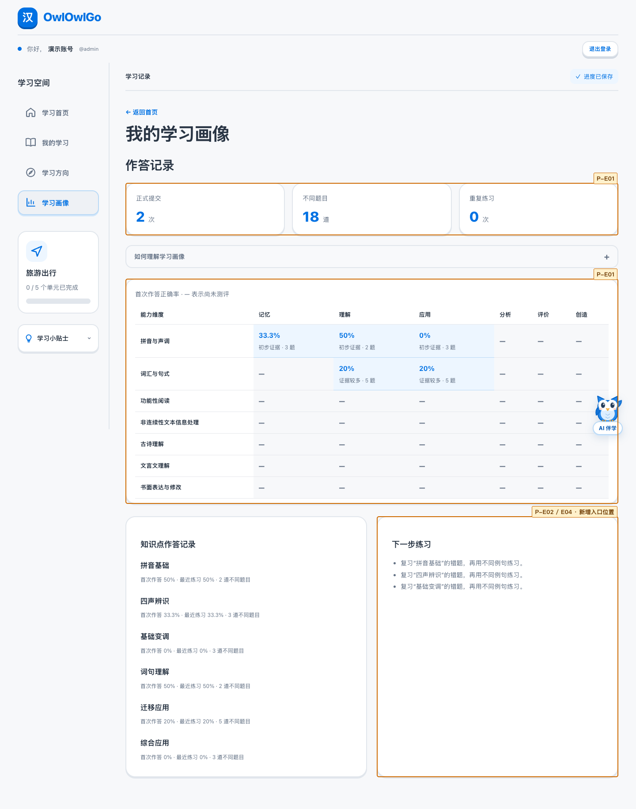
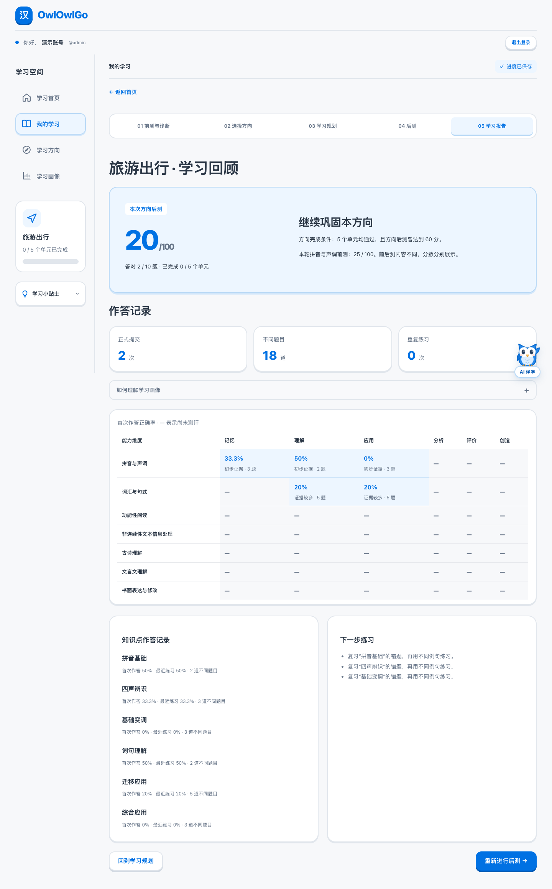

# 郑仲佑的需求卡片：以当前真实前端为基线

版本v5，2026-11-17；真实截图采集于2026-11-16。图片来自运行现有代码后的真实浏览器截图，使用独立测试账号与临时JSON数据。没有修改产品布局。**卡片描述的是待完成改动，不代表截图里的页面已经实现这些功能。**

2026-11-17范围更新：[HSK题库上传与审核](question-bank.md)纳入本轮。等级、技能/题型与题量由团队确定；本文旧8题、2题、10题及分数样例仅为旧版兼容测试数据，新测验按已发布规则动态组卷。

[总清单](README.md) · [真实截图图册](screens.md) · [真实跳转与拟新增跳转](navigation.md) · [接口契约](contracts.md)

## P-E01 · 画像矩阵与证据数量解释

**HSK题库扩展后，本卡还必须完成：** 画像按稳定来源题去重并保留标准/题目版本；题量增大后继续说明覆盖范围，不能仅凭贴了HSK标签就给出认证等级。 详见[题库卡片与接口](question-bank.md)。

**这个功能是干什么的**

让用户看懂学习画像里哪些能力有作答证据、表现如何、哪些尚未测评，避免把空白或少量证据当成准确能力结论。

**一个具体例子**

用户只做过拼音前测，未测过的维度显示“—”；重复做同一道题不会让“不同题目数”增加。

**负责人：郑仲佑｜复核：钱俊｜类型：现有展示完善｜状态：待实施/验收**

**先在现有系统找到这里**

- 实际入口：侧栏学习画像；或F09 → 查看学习画像。
- 页面/区块：作答记录 .evidence-stats；.profile-table-wrap 能力矩阵；左下知识点作答记录。
- 本轮改动：完善现有画像的证据说明和去重；报告复用同一组件。

相关真实截图：[F16 学习画像](screens.md#f16) · [F15 方向学习报告](screens.md#f15)。新增功能没有现成截图，不用概念图冒充。

**现状与缺口**

7×6矩阵、首次/最近统计已实现；本卡完善证据口径和SQL迁移后的正确展示，不新增未经验证能力算法。

**具体开发内容**

1. 汇总卡显示正式提交数、不同题数、重复次数；矩阵每格显示score/evidence_count/evidence_status，null显示“—/尚未测评”。
2. 展开说明：0题未测、1题不足、2—4初步、≥5较多；confidence只是min(1,count/5)数量指标，不是掌握概率。知识点首次与最近表现分别显示，不以最新正确覆盖首次证据。
3. 重复来源题、后测同题变序不增独立题数；独立提示练习和legacy_answers不进入正式矩阵；360px表格可局部横滚，其他主内容不溢出。

**异常与边界**

无正式记录显示去前测入口，不显示全0能力；加载失败不能把旧数据清为无能力；未登录转F01/F02。

**逐项验收**

- [ ] 0/1/2/4/5来源题边界文案正确；首次错再次对，首次统计保留、最近统计变化而不同题数不变。
- [ ] 完成D独立练习不增加正式画像；桌面和360px可读可操作。

**依赖与接口交接**

- 依赖：A正式提交仓储；现有profile规则。
- 接口：K03、N07（现有GET /profile）（K为已有，N为建议新增，见[字段/事务/错误契约](contracts.md)）。
- 原需求：FR-5.1、5.3、11.5、13.6子集；验收编号：AC-E1、E2、UI-E1（[验收清单](../../testing/iteration-01-acceptance.md)）。

**现有代码位置**

- [LearnerProfile.vue](../../../code/frontend/src/features/assessment/LearnerProfile.vue)
- [profile.py](../../../code/backend/app/domain/learner/profile.py)

交付：代码变更、接口样例、测试结果、修改后的真实页面截图；按[共同完成标准](README.md#done)签收。

---

## P-E02 · 下一步建议变成可点击复习入口

**HSK题库扩展后，本卡还必须完成：** 复习入口携带真实来源题和实例，不能根据当前题库数组下标猜题目。 详见[题库卡片与接口](question-bank.md)。

**这个功能是干什么的**

把画像和报告里“下一步练习”的文字建议变成可以点击的复习入口。

**一个具体例子**

用户看到需要巩固声调的建议，点击“去复习”即可查看自己的错题，而不只是读到一句建议。

**负责人：郑仲佑｜复核：钱俊｜类型：新增操作入口｜状态：待实施/验收**

**先在现有系统找到这里**

- 实际入口：侧栏学习画像；或F09 → 查看学习画像。
- 页面/区块：右下 .report-grid 的“下一步练习”卡片（目前只有文字列表）。
- 本轮改动：在建议旁新增可点击“去复习”，并携带来源；不是另做画像页面。

相关真实截图：[F16 学习画像](screens.md#f16) · [F15 方向学习报告](screens.md#f15)。新增功能没有现成截图，不用概念图冒充。

**现状与缺口**

当前下一步是纯文字建议；本轮让用户能从真实错误进入可执行复习。

**具体开发内容**

1. 在“下一步练习”增加去复习按钮，显示“根据最近仍答错的题目”等非技术理由；如果显示数量必须来自N06实际items，不从focus_areas条数猜。
2. 点击到NEW-REVIEW（待新增错题复习）并记录return_to=F16画像；无正式记录主要入口“开始前测”去前测（F04—F06）；有成绩但无错题显示继续学习/查看规划，不凭空推荐薄弱点。
3. 解释资料仅用真实正式结果；不推断母语、态度或未测听说水平；复习列表加载由E页面处理，不在点击时创建新的正式提交。

**异常与边界**

复习数据失败显示重试，不显示0错题冒充成功；接口401回登录；建议过时点击后以最新队列为准。

**逐项验收**

- [ ] 有错误时点去复习进入本人正确列表；全对时显示无符合规则的错题，不生成虚构任务。
- [ ] 点击和阅读都不改成绩/完成数，返回画像保持原统计。

**依赖与接口交接**

- 依赖：P-E04复习API；P-E01画像。
- 接口：N06、N07（K为已有，N为建议新增，见[字段/事务/错误契约](contracts.md)）。
- 原需求：FR-8.1、8.2、3.3复习子集；验收编号：AC-E3、E4、UI-E1（[验收清单](../../testing/iteration-01-acceptance.md)）。

**现有代码位置**

- [LearnerProfile.vue](../../../code/frontend/src/features/assessment/LearnerProfile.vue)
- [profile.py](../../../code/backend/app/domain/learner/profile.py)

交付：代码变更、接口样例、测试结果、修改后的真实页面截图；按[共同完成标准](README.md#done)签收。

---

## P-E03 · 阶段报告绑定正式后测并提供三种出口

**HSK题库扩展后，本卡还必须完成：** 报告显示本次实际题量、标准版本与测量范围；历史分数按冻结规则解释，未完成人工评分时标待评分，不提前形成最终报告。 详见[题库卡片与接口](question-bank.md)。

**这个功能是干什么的**

让用户看懂某一次后测的成绩、方向完成情况，并选择复习、回到规划或重新后测。

**一个具体例子**

本次后测20分，报告就显示20分；报告另行说明目前累计通过的单元，不能拿上次高分替换本次成绩。

**负责人：郑仲佑｜复核：钱俊｜类型：现有报告完善+结果API｜状态：待实施/验收**

**先在现有系统找到这里**

- 实际入口：F14 → 查看学习报告。
- 页面/区块：报告上方 .report-hero 后测分数；下方 .question-actions 返回规划/重新后测。
- 本轮改动：把现有报告绑定明确提交ID；增加复习入口，保留原报告结构。

相关真实截图：[F15 方向学习报告](screens.md#f15) · [F14 方向后测结果](screens.md#f14)。新增功能没有现成截图，不用概念图冒充。

**现状与缺口**

当前报告靠内存中的最近后测结果；本轮按指定submission_id读取，避免跳转/重新测验后显示错结果。

**具体开发内容**

1. 读取N07指定结果并验证kind=posttest；显示本次方向、分数、正确题数、提交时间；当前累计单元完成数与方向完成另标，不能假称都是当时历史值。
2. 前测分数可并列但明确题目范围不同，不算提升百分比；画像复用P-E01。没有诊断不编造前测分数。
3. 去复习到NEW-REVIEW（待新增错题复习）并记return_to=F15报告及submission_id；返回规划到F08学习规划区；重新后测回后测（F13/F14）开启新草稿，不调用重新前测reset，不删除原报告。

**异常与边界**

ID缺失则返回后测提示先提交；不存在/非本人404；类型不为后测不能套报告；加载失败重试，不默认85分。

**逐项验收**

- [ ] 后测60分提交R1后生成另一次结果R2，仍用R1 ID打开时显示R1分数；累计完成单独标明。
- [ ] 三按钮都到正确页面，重新后测不清前测/方向/历史通过；U2不能读R1。

**依赖与接口交接**

- 依赖：D提供submission_id；N07结果读取。
- 接口：N07、K05（仅不得误调用）（K为已有，N为建议新增，见[字段/事务/错误契约](contracts.md)）。
- 原需求：FR-8.1、8.2、8.3；验收编号：AC-E2、E4、UI-E1（[验收清单](../../testing/iteration-01-acceptance.md)）。

**现有代码位置**

- [FinalReport.vue](../../../code/frontend/src/features/assessment/FinalReport.vue)
- [learning.py](../../../code/backend/app/api/v1/endpoints/learning.py)

交付：代码变更、接口样例、测试结果、修改后的真实页面截图；按[共同完成标准](README.md#done)签收。

---

## P-E04 · 新增错题列表、解析和返回原课程

**HSK题库扩展后，本卡还必须完成：** 复习读取原作答的题目/答案/解析快照；已停用题不进入新练习，历史错误记录保留并说明停用，不静默改成另一题。 详见[题库卡片与接口](question-bank.md)。

**这个功能是干什么的**

把用户最近仍答错的题集中列出来，供查看本人答案、正确解释，并在有对应课程时回去复习。

**一个具体例子**

用户打开错题列表，选择一道问路题查看解析，点击回到课程打开对应单元；已经在最近一次答对的题不再列为待复习错题。

**负责人：郑仲佑｜复核：钱俊｜类型：新增页面+查询规则｜状态：待实施/验收**

**先在现有系统找到这里**

- 实际入口：侧栏学习画像；或F09 → 查看学习画像。
- 页面/区块：当前无错题复习列表；入口新增于两页“下一步练习”卡片。
- 本轮改动：新增错题复习子视图，保留现有侧栏；来源为画像/报告，返回原来源。现有截图只说明入口位置。

相关真实截图：[F16 学习画像](screens.md#f16) · [F15 方向学习报告](screens.md#f15)。新增功能没有现成截图，不用概念图冒充。

**现状与缺口**

复习领域和页面目录主要占位；本卡需要实际规则、API、ReviewPage及测试。

**具体开发内容**

1. 按N06实现最新仍错来源题队列，最多10题，稳定排序。列表显示题干摘要、知识点/来源、最近时间；选中同页详情显示本人选择、正确解释、为什么推荐。
2. 回到原课程使用服务端unit_id，不猜题目下标；无unit_id的前测错题只展示前测解析和返回前测报告。跨方向课程只读，若要正式练习，引导C修改计划并用户确认，不能后台暗改topic。
3. 仅practice_available=true展示独立练习入口，带unit_id/source_question_id到D；否则只回课程。没有错题说明规则及继续学习入口；返回恢复原F16画像/F15报告上下文。
4. 查询、选择、看解析不新增成绩/重复次数或通过标记；做完正式新测验回到列表重新查询，最近已纠正的题移出。

**异常与边界**

401登录，空队列和加载失败不同；来源内容不可读时说明暂无原课程入口，不跳到错误课程；旧请求不得覆盖新账号队列。

**逐项验收**

- [ ] 11个不同最新错题只显示10个；同题重复和后测变序只一个，最近已对题不出现，同时间ID排序可复现。
- [ ] 前测错题无课程不造链接；跨方向点击不更改当前计划；U2无U1数据；只读操作不加分。

**依赖与接口交接**

- 依赖：A正式结果查询；D课程/练习入口。
- 接口：N06、N07（K为已有，N为建议新增，见[字段/事务/错误契约](contracts.md)）。
- 原需求：FR-3.3复习子集、8.1、8.3；验收编号：AC-E3、E4、UI-E1（[验收清单](../../testing/iteration-01-acceptance.md)）。

**现有代码位置**

- [README.md](../../../code/backend/app/domain/review/README.md)
- [README.md](../../../code/frontend/src/features/review/README.md)
- [LearnerProfile.vue](../../../code/frontend/src/features/assessment/LearnerProfile.vue)

交付：代码变更、接口样例、测试结果、修改后的真实页面截图；按[共同完成标准](README.md#done)签收。

---

## P-E05 · 调用AI生成候选题、答案和解析，并完成内容审核

**这个功能是干什么的**

内容成员在题库管理端指定HSK版本、等级、考点和题型，让AI生成候选题、答案与解析，再交非作者审核，合格后才能发布。郑仲佑负责生成入口、模型调用、内容校验和审核衔接。

**一个具体例子**

内容成员选择团队已登记的大纲版本、某等级的方位表达考点和单选题，填写本批数量并点“生成候选题”。系统展示每题答案、解析和校验问题，钱俊等非作者审核通过后，发布者才可让它进入正式题库。

**负责人：郑仲佑｜复核：钱俊｜状态：待实施/验收**

使用团队统一购买的模型API，由本卡负责人实现业务调用；不新增公共模型调用基础任务。调用在后端完成，密钥不放浏览器。

**页面位置**

新增“题库管理→AI生成候选题”；现有F07/F08仅为内容使用位置，当前没有生成管理页截图。

AI生成管理页尚未实现，不能用现有学习页截图冒充；入口和审核去向见[Q-E](question-bank.md#q-e)。

**现状与缺口**

当前没有AI出题入口或候选生成接口；Q-E新增管理界面，本卡补齐AI生成来源。已有课程/模板审核仍保留，不能以AI自检替代人工审核。

**具体开发内容**

1. 新增“AI生成候选题”入口，仅内容权限账号可见且后端检查权限。表单包含已登记HSK大纲版本、等级、技能/题型、考点、难度/长度约束、本批数量及可选课程关联；未确定的标准、等级不能填默认值替团队决定。
2. 点生成后由服务端读取标准依据和约束，调用统一购买的模型API；要求返回题干、选项/类型化答案、正确答案、解析、考点引用和素材需求。保存请求人、生成约束、模型和提示词版本，页面显示处理中/完成/部分失败/失败。
3. 逐题校验格式、答案与选项一致性、标准引用、知识点、重复/近似重复和素材完整性；展示实际生成数、合格候选数和问题清单。模型不能凭空证明HSK合规；缺音频/图片的题只能保留为待补材料，不能发布或计入有效题量。
4. 生成结果进入“AI候选草稿”，来源标AI生成；内容成员预览、编辑或丢弃。机器检查全部通过后，明确点击“送审”才进入Q-E待审核；请求生成的人视为内容作者之一，不能审核自己这批题。
5. 钱俊负责标准支持并参与非作者审核；郑仲佑实现审核与发布功能。只有人工审核通过且素材完整的版本可发布，生成成功不能直接入正式题库或计入达标题量。修改已发布题创建新版本。
6. 保留N08课程先修/时长/来源审核和B提示回退模板复核；校验ID唯一、先修无环、来源可追溯。即时小鸮材料若以后需正式入库，也须以候选来源走此审核链。

**异常与边界**

模型超时、限流、额度不足或格式无效时记录失败批次并保留输入；同一请求不重复创建候选。实际只生成部分时显示实际数量，不补造成功数；重新生成是用户明确的新请求。无来源依据/素材不齐/有重复争议保持不可发布。

**逐项验收**

- [ ] 有效API配置下真实生成候选题、答案和解析，能追溯约束及模型版本；只上传人工CSV不能替代AI-E验收。
- [ ] 错误答案、非法引用、重复题、缺音频分别产生明确问题，不能送审/发布为合格题。
- [ ] 普通用户不能生成或读取管理答案；作者不能自审；非作者审核通过后才可发布，发布前新组卷抽不到候选。
- [ ] 重复请求只产生同一批结果，部分成功显示真实数量；旧报告不受题目修改或停用影响。

**接口与协作**

- 依赖：Q-B提供团队确定的标准登记与考点约束；Q-E审核发布流程；使用团队统一购买的API。
- 接口：N08、N09；Q-E题库审核/发布接口，见[接口契约](contracts.md)。
- 原需求：FR-3.2、3.4、11.6、13.6；验收：AC-E5、AC-B6；AI-E，见[验收清单](../../testing/iteration-01-acceptance.md)。

**现有代码入口**

- [curriculum.json](../../../code/backend/app/domain/content/curriculum.json)
- [catalog.py](../../../code/backend/app/domain/content/catalog.py)
- [profile.py](../../../code/backend/app/domain/learner/profile.py)

模型调用可参考现有[deepseek.py](../../../code/backend/app/integrations/llm/deepseek.py)，按统一购买服务的实际配置接入；不要求新建通用模型平台。交付包含页面、后端调用、提示词、输出校验、失败处理和脱敏实调证据。

---

