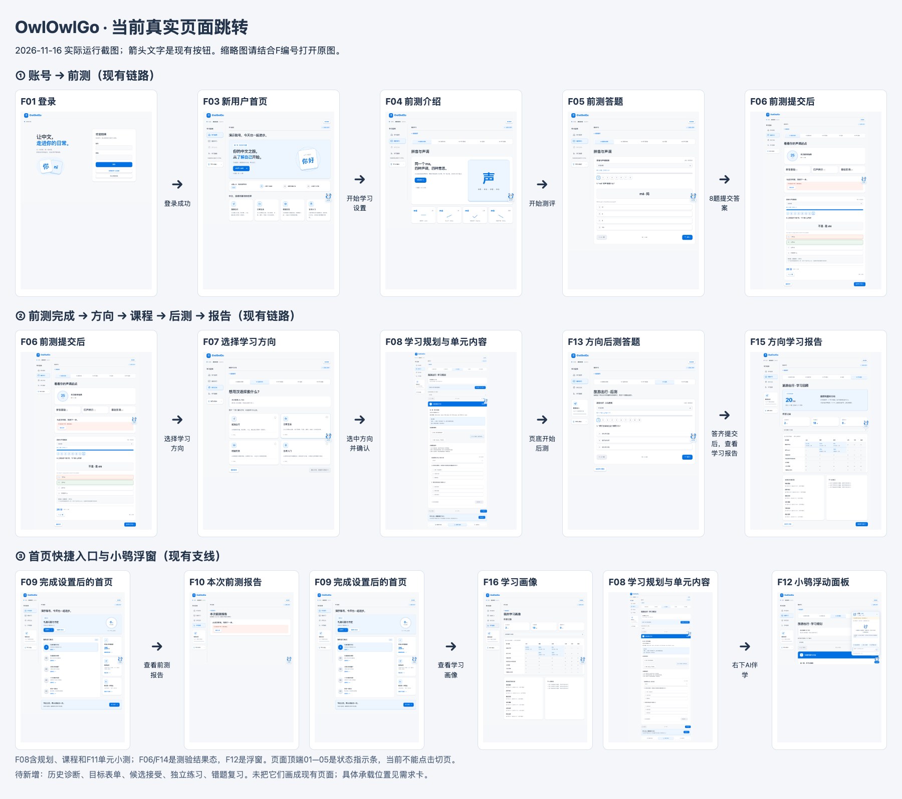

# 真实页面跳转与本轮改动

先看真实截图；下方两张表分别描述“现在点击会发生什么”和“本轮完成后应怎样”。不能用第二张表声称现有产品已经实现。

## 当前实测或代码核对的按钮

| 现在所在位置 | 现在点击什么 | 实际到达/行为 | 本轮责任 |
| --- | --- | --- | --- |
| F01 登录 | 没有账号？去注册 | F02，同一账号组件切模式 | A01 |
| F01/F02 | 登录/注册成功 | 首页，新用户F03、已设置F09 | A01/A02 |
| F03 首页 | 开始学习设置 | F04前测介绍 | A02/B01 |
| F04 | 开始测评 | F05，第1题/已保存草稿 | B02 |
| F05第8题 | 提交答案 | 同页显示F06结果与分析，不另开报告页 | B02/B03 |
| F06结果底部 | 选择学习方向 | F07四方向卡片 | B05/C01 |
| F07 | 选中方向，确认方向，查看学习规划 | 直接更新方向，进入F08；现在没有候选接受 | C01—C04修改此行为 |
| F08初次设置顶部 | 完成设置，进入首页 | F09 | C04/A03 |
| F09 | 继续学习/单元路径某行 | F08指定单元，课程下方包含F11小测 | A03/C05/D01 |
| F09右侧 | 查看前测报告 | F10；与前测结果F06是两个现有展示入口 | B03 |
| F08上下 | 上一单元/下一单元 | 同页换课程与小测 | D01/D02 |
| F08页底 | 开始后测/查看后测结果 | F13/F14 | D05 |
| F13最后一题 | 提交答案 | 同页F14；显式点击查看学习报告才去F15 | D05/E03 |
| F15 | 回到学习规划/重新进行后测 | F08/F13的新尝试；已有通过记录保留 | E03/D05 |
| F09或侧栏 | 查看学习画像/学习画像 | F16 | E01/E02 |
| 各学习页右下 | AI伴学 | F12同类浮窗，当前显示预设回复，不跳独立页面 | D03/D04 |
| 流程条01—05 | 当前不是按钮 | 仅状态提示，不能当可点击导航写验收 | A04 |
| F16/F15 下一步练习 | 当前只有建议文字 | 没有可点击复习列表 | E02/E04新增 |

截图实际跑通登录、前测提交、方向确认、进入课程、后测提交、查看报告/画像和打开浮窗；其他按钮行为已对照现有事件处理代码。上述是采集证据，不代替本轮功能验收。

## 本轮拟实现的导航/状态约定

沿用现有view/stage/outcome状态切换，不要求新建路由或重画现有页面。F08内部规划区、课程区、小测之间可以切单元/滚动定位，无需拆成独立页面。新增历史/复习可用沿用当前外壳的子视图；候选计划可为规划区域的预览态。

导航上下文建议包含`{view,stage,outcome,diagnosis_id?,plan_id?,plan_version?,unit_id?,quiz_id?,submission_id?,return_to?}`；return_to仅限内部已知状态且至多一层。刷新默认首页，再由已保存数据继续，不承诺URL深链接。未保存数据先处理保存队列，失败不冒充成功；正式提交/接受中禁用冲突导航。

以下T编号都是**待实施验收规则**，不是当前截图里的全部现有按钮；新增项已在目标列标明。

| 跳转 | 来源 | 触发动作 | 前置条件 | 目标 | 参数 | 保存与失败语义 | 负责人 |
| --- | --- | --- | --- | --- | --- | --- | --- |
| T01 | F01/F02 | 登录/注册成功 | 服务端确认会话 | F03/F09首页 | 当前用户；不携带密码 | 清旧账号缓存，加载本人状态 | A→A |
| T02 | F01/F02 | 先以游客体验 | 无登录也允许浏览 | F04—F06前测介绍态 | guest=true | 不产生正式成绩；登录入口仍可见 | A→B |
| T03 | F03/F09首页 | 开始/继续前测 | 无当前正式诊断 | F04—F06前测 | 服务端draft | 恢复已保存题号；不提交 | A→B |
| T04 | F03/F09首页 | 继续完成设置 | 当前诊断完成但无有效计划 | F07方向页 | diagnosis_id；已存偏好 | 不把已有topic当新计划已接受 | A→C |
| T05 | F04—F06前测 | 提交答案成功 | 8题完整且保存无冲突 | F06/F10前测报告 | submission_id、diagnosis_id | 正式提交与诊断同事务；失败留F04—F06前测 | B→B |
| T06 | F06/F10前测报告 | 选择学习方向 | 当前有效诊断；AI可仍处理中 | F07方向页 | diagnosis_id；return_to=F06/F10前测报告 | 不重新调用前测提交 | B→C |
| T07 | F06/F10前测报告 | 查看历次前测 | 已登录 | 待新增历史诊断 | selected_diagnosis_id可选；return_to=F06/F10前测报告 | 仅GET，不运行历史模型分析 | B→B |
| T08 | 待新增历史诊断 | 返回本次报告 | 有当前诊断 | F06/F10前测报告 | current diagnosis_id | 无当前诊断则提示去F04—F06前测，不能拿历史当当前 | B→B |
| T09 | F07方向页 | 生成安排成功 | 方向已选、偏好保存、诊断有效 | 待新增候选预览态（沿用F08框架） | candidate plan_id；return_to | 只创建候选；不改变生效计划/方向 | C→C |
| T10 | 待新增候选预览态（沿用F08框架） | 接受计划成功 | 候选有效、来源版本一致 | F08规划区 | accepted plan_id/version、progress | 事务生效；失败留预览并保留原计划 | C→C |
| T11 | 待新增候选预览态（沿用F08框架） | 返回修改 | 非接受请求中 | F07方向页 | 原topicDraft和偏好输入 | 不接受候选；重新生成新动作ID | C→C |
| T12 | 待新增候选预览态（沿用F08框架） | 取消 | 非接受请求中 | 有旧计划F08规划区；否则F03/F09首页 | 旧生效计划上下文 | 不调用accept；不删除旧计划 | C→C/A |
| T13 | F08规划区 | 开始/继续/复习单元 | 真实单元；正式学习要求有效计划 | F08课程区 | plan_id/version、unit_id、return_to=F08规划区 | 只导航；读内容不确认完成 | C→D |
| T14 | F08课程区 | 进入单元小测 | 课程quiz_id有效 | F11内嵌小测（可同页嵌入） | quiz_id、unit_id、plan上下文 | 读取draft；不提前下发答案 | D→D |
| T15 | F08课程区 | 独立练习 | 旅游首单元、已登录且当前方向/前测有效 | 待新增独立练习（复用F12） | unit_id/content_version、return_to=F08课程区 | 读取会话，无则显式创建；不写成绩 | D→D |
| T16 | 待新增独立练习（复用F12） | 退出练习 | 提交事件先完成或明确处理失败 | F08课程区 | 原unit_id、return_to | 保留已保存会话；pause失败不伪装成功 | D→D |
| T17 | 待新增独立练习（复用F12） | 进入正式小测 | 已保存练习动作、正式测验前置满足 | F11内嵌小测 | 原unit quiz_id | 使用独立正式草稿，不带练习答案替用户填题 | D→D |
| T18 | F08课程区/F11内嵌小测 | 进入后测 | 已前测、当前方向确认；不要求5单元全过 | F13/F14后测 | post-{topic}、return_to=F08规划区 | 读正式后测草稿/历史，不自动提交 | D→D |
| T19 | F13/F14后测 | 查看学习报告 | 有明确成功正式后测结果 | F15报告 | submission_id、return_to=F13/F14后测 | 草稿不能作为结果；N07读本人记录 | D→E |
| T20 | F15报告 | 重新后测 | 用户明确开始新尝试 | F13/F14后测新草稿 | topic、new_attempt=true | 旧报告和通过记录保留；不调用前测reset | E→D |
| T21 | F03/F09首页 | 前测报告 / 学习画像 | 已登录；前测报告需当前诊断 | F06/F10前测报告 / F16画像 | diagnosis_id / 本人身份 | 明确两个不同目标，不共用模糊report状态 | A→B/E |
| T22 | F15报告 | 去复习 | 已登录 | 待新增错题复习 | return_to=F15报告、submission_id | 队列基于本人当前全部正式记录，不仅本次后测 | E→E |
| T23 | F16画像 | 去复习 | 有正式记录 | 待新增错题复习 | return_to=F16画像 | 查询不更新画像；空队列有说明 | E→E |
| T24 | 待新增错题复习 | 回到课程 / 独立练习 | unit_id非空；练习另要求practice_available | F08课程区 / 待新增独立练习（复用F12） | unit_id、source_question_id、return_to=待新增错题复习 | 跨方向课程只读，不暗改当前topic；无对应单元只读解析 | E→D |
| T25 | F15报告/F13/F14后测/F08课程区 | 返回规划 | 有当前或可查看旧计划 | F08规划区 | plan_id；无则current | 保留原正式成果；过时计划标需重新规划 | E/D→C |
| T26 | 现有导航/保存条/各页 | 首页/我的学习/方向/画像/退出 | 处理未保存状态；访客按权限限制 | F03/F09首页/按状态F04—F06前测或F08课程区/F07方向页/F16画像/F01/F02 | 有效用户、当前计划、return_to | 跳转不授予完成；401清个人缓存；退出失败保持身份 | A与目标页 |
| T27 | F06/F10前测报告 | 重新前测：确认 | 无未确认提交/保存；用户确认影响 | F04—F06前测介绍态 | K05返回progress与新epoch | 成功才清当前诊断；保留旧成果；取消不写 | B→B |
| T28 | 待新增错题复习 | 返回画像/报告 | 来源仍可访问 | F16画像 / F15报告 | 原return_to与submission_id | 缺参数回F16画像，不猜最近后测代替指定报告 | E→E |
| T29 | F08课程区 | 上一/下一单元 | 索引在当前计划范围内，保存已确认 | F08课程区新单元 | 目标unit_id、原plan、return_to | 清旧面板上下文，保留各题草稿 | D→D |
| T30 | F03/F09首页 | 继续学习 / 全单元通过 / 方向完成 | 当前计划和权威完成已读 | F08课程区 / F13/F14后测 / F15报告 | 首个未完成unit_id / post_id / 最近可用post submission_id | 不以本地分数判断完成；无报告ID先读结果 | A→D/E |
| T31 | F08规划区 | 修改安排 | 当前计划已读 | F07方向页 | 当前方向/偏好、return_to=F08规划区 | 不立即停用旧计划 | C→C |
| T32 | F03/F09首页 | 查看学习规划 | 有效计划存在 | F08规划区 | current plan_id/version | 无计划引导F07方向页；重测中引导F04—F06前测 | A→C |
| T33 | F04—F06前测 | 返回首页 | 已保存或明确处理未保存修改 | F03/F09首页 | 当前账号 | 只存草稿，不生成正式诊断 | B→A |

[返回总清单](README.md) · [真实截图图册](screens.md) · [接口契约](contracts.md)

## HSK题库新增导航（待开发）

有内容权限的账号栏“题库管理”→上传/我的批次→校验结果→确认导入待审核；审核者进入待审核列表→详情→通过/退回；发布者进入已通过列表→确认发布。普通学习者无管理入口且接口拒绝访问。原前测/后测开始按钮改为创建测验实例，继续按钮恢复原实例；题量不足/题型不支持则停留入口并说明原因。详细规则见[Q-A—Q-E](question-bank.md)。
