# 当前真实前端截图图册

2026-11-17新增题库范围：这些截图仍表示当前原型；截图中的题量不是新题库要求。题库管理/上传/审核页面尚未实现，其入口与行为见[新卡片](question-bank.md)。

拍摄日期：2026-11-16。1440px桌面浏览器，直接运行当前Vite/FastAPI；数据为独立临时测试数据。前测25分、后测20分来自实际提交，并非学习效果数据。未启用外部AI调用，相关错误截图如实保留。截图未替换UI布局。卡片中橙色框为截图标注，不是产品控件；下方保留未标注原图。标注版F07/F08在完成设置后再次进入采集，因此账号状态和首次设置提示可能与原始图不同。

F08与F11是同一学习规划页；F11只截取小测区块以便定位。F03/F09是首页两种状态，F05/F06和F13/F14分别是同一测验的答题/结果态。

## F01 · 登录

- 实际进入方式：打开应用，未登录时显示。
- 代码/状态：`AccountGate.vue / showForm=true, mode=login`。
- 卡片：[P-A01](a-管佳欣.md#p-a01) · [P-A05](a-管佳欣.md#p-a05)。

- **P-A01**：登录/注册表单 .account-card；顶部 .account-bar 的退出按钮。保持账号页现有布局，完成SQL切换后的登录、注册、游客、退出及账号隔离。
- **P-A05**：无新增页面；账号表单、答题草稿和首页进度是数据库迁移回归入口。只改这些页面依赖的存储链路；不创建数据库配置页面。

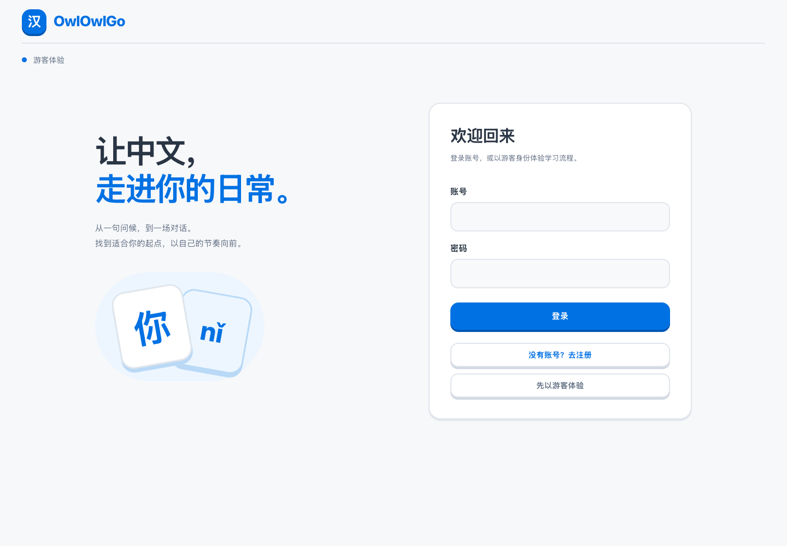

## F02 · 注册

- 实际进入方式：F01 → 没有账号？去注册。
- 代码/状态：`AccountGate.vue / mode=register`。
- 卡片：[P-A01](a-管佳欣.md#p-a01)。

- **P-A01**：登录/注册表单 .account-card；顶部 .account-bar 的退出按钮。保持账号页现有布局，完成SQL切换后的登录、注册、游客、退出及账号隔离。

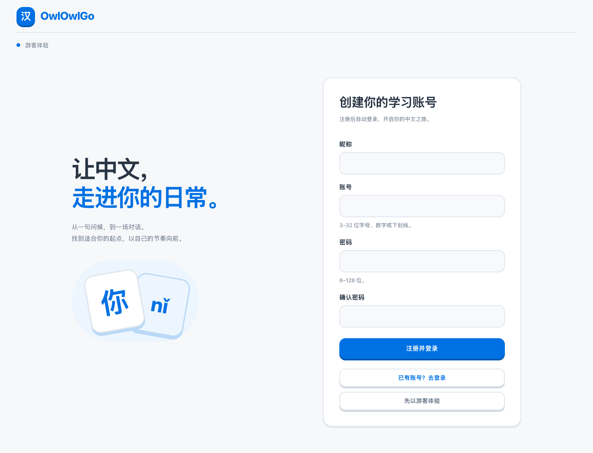

## F03 · 新用户首页

- 实际进入方式：F01登录成功，尚未完成设置。
- 代码/状态：`HomeDashboard.vue / !setupComplete`。
- 卡片：[P-A02](a-管佳欣.md#p-a02)。

- **P-A02**：首页上方 .home-welcome / .home-continue 主卡及 .setup-strip 三步进度。按服务端学习阶段决定主按钮文案和去向；不重做首页。

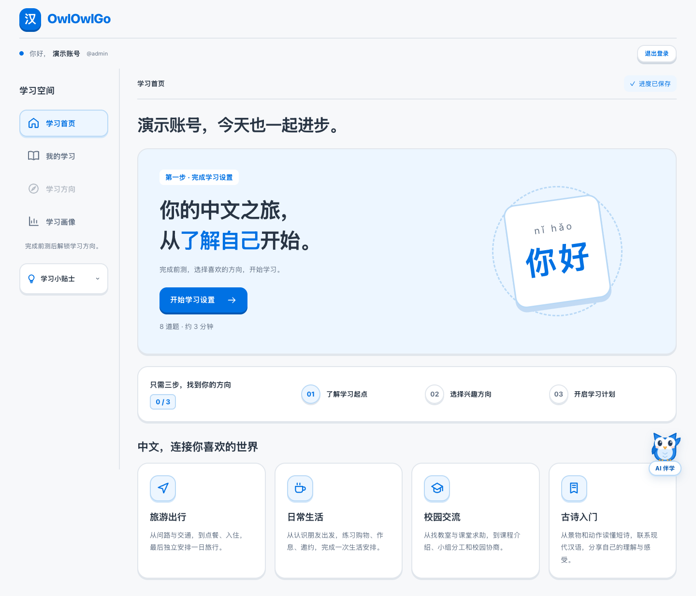

## F04 · 前测介绍

- 实际进入方式：F03 → 开始学习设置。
- 代码/状态：`PhoneticsDemo.vue / !started`。
- 卡片：[P-B01](b-钱俊.md#p-b01)。

- **P-B01**：前测介绍 .welcome；答题 .practice-question 题干、拼音、英文辅助。审核8题内容和测量范围，保留当前介绍页与答题样式。

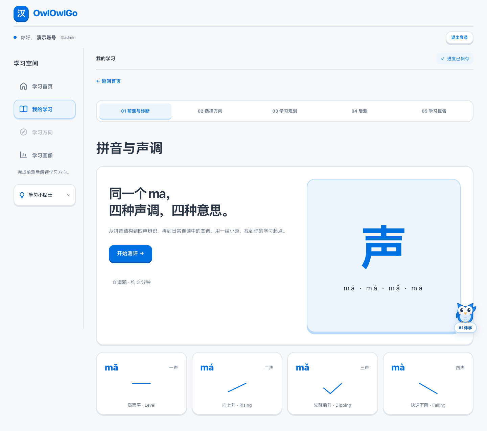

## F05 · 前测答题

- 实际进入方式：F04 → 开始测评。
- 代码/状态：`PhoneticsDemo.vue + ServerUnitQuiz.vue / assessment`。
- 卡片：[P-A04](a-管佳欣.md#p-a04) · [P-A05](a-管佳欣.md#p-a05) · [P-B01](b-钱俊.md#p-b01) · [P-B02](b-钱俊.md#p-b02) · [P-D02](d-周子涵.md#p-d02)。

- **P-A04**：左侧 .workspace-nav；右上 .workspace-toolbar 保存状态；返回首页按钮；顶部账号条。统一现有按钮接线与保存/冲突/登录失效行为。
- **P-A05**：无新增页面；账号表单、答题草稿和首页进度是数据库迁移回归入口。只改这些页面依赖的存储链路；不创建数据库配置页面。
- **P-B01**：前测介绍 .welcome；答题 .practice-question 题干、拼音、英文辅助。审核8题内容和测量范围，保留当前介绍页与答题样式。
- **P-B02**：题号 .question-map；选项 .practice-option；底部 .pagination / .quiz-submit-area。完善分页、草稿恢复和正式提交；提交成功仍在现有前测结果态。
- **P-D02**：F08课程下半部 .practice-quiz；共享ServerUnitQuiz的题号、选项、结果与提交。保留内嵌小测，负责共享测验组件和SQL提交回归；B负责前测文案与流程接线。

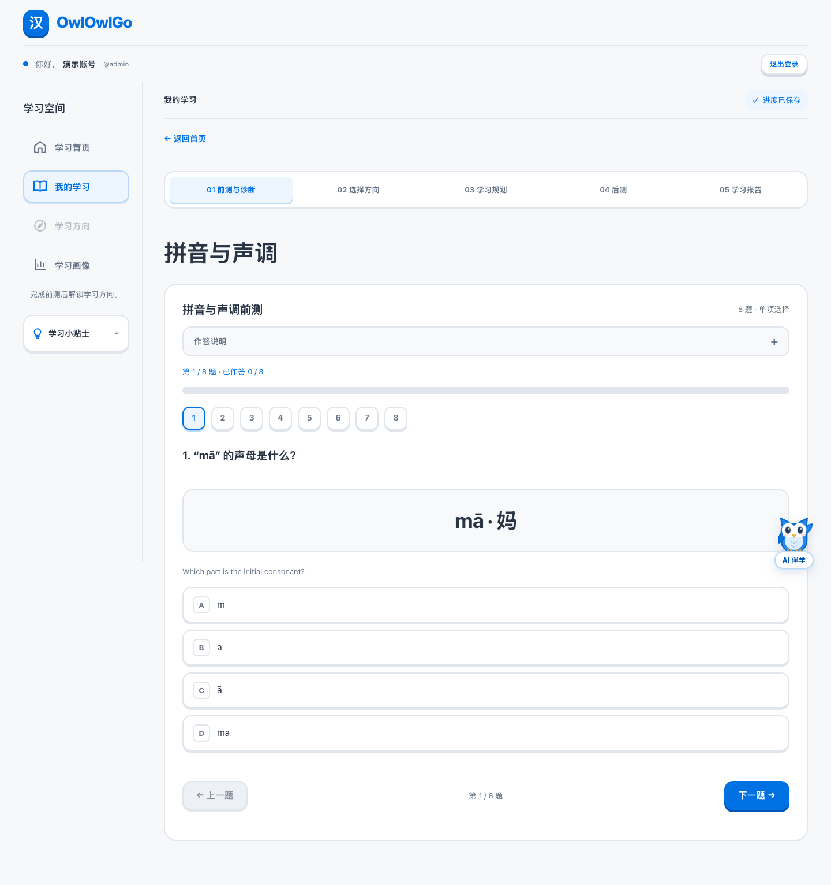

## F06 · 前测提交后

- 实际进入方式：F05答齐8题 → 提交答案。
- 代码/状态：`同一前测页面的result态，并非新路由`。
- 卡片：[P-B02](b-钱俊.md#p-b02) · [P-B03](b-钱俊.md#p-b03) · [P-B05](b-钱俊.md#p-b05)。

- **P-B02**：题号 .question-map；选项 .practice-option；底部 .pagination / .quiz-submit-area。完善分页、草稿恢复和正式提交；提交成功仍在现有前测结果态。
- **P-B03**：“从这次作答，找到下一步。” #learning-analysis 分析区。在原分析区补规则回退及来源标识；截图中的真实状态是AI未配置后的失败提示，不能当成已有回退。
- **P-B05**：前测结果底部“重新测评 / 选择学习方向”；方向页底部“重新前测”。明确重测确认与方向出口；另交付D需要的教学提示模板，模板无独立页面。

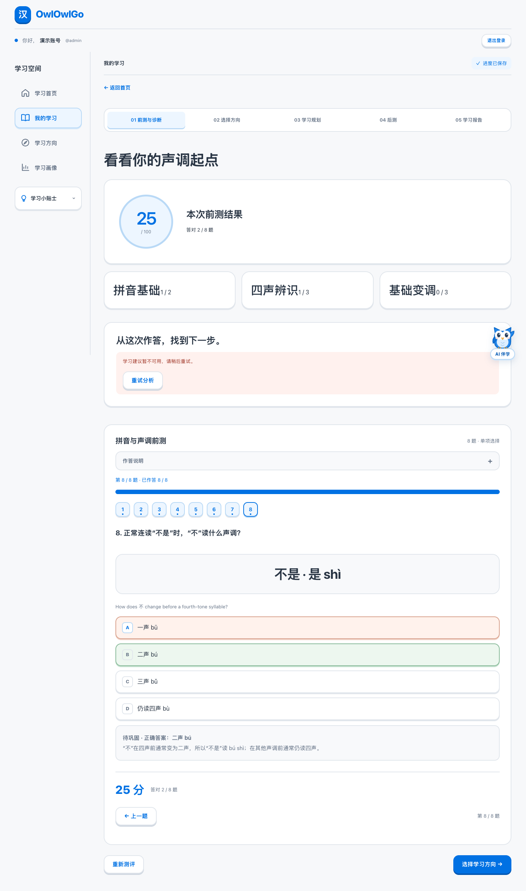

[查看F07需求位置标注图](../../../figures/requirements/actual/F07-directions-marked.png)

## F07 · 选择学习方向

- 实际进入方式：F06 → 选择学习方向；或侧栏学习方向。
- 代码/状态：`LearningJourney.vue / stage=topics`。
- 卡片：[P-B05](b-钱俊.md#p-b05) · [P-C01](c-黄云舒.md#p-c01) · [P-C02](c-黄云舒.md#p-c02) · [P-C03](c-黄云舒.md#p-c03) · [P-C04](c-黄云舒.md#p-c04) · [P-E05](e-郑仲佑.md#p-e05)。

- **P-B05**：前测结果底部“重新测评 / 选择学习方向”；方向页底部“重新前测”。明确重测确认与方向出口；另交付D需要的教学提示模板，模板无独立页面。
- **P-C01**：四张 .topic-card 方向卡；右下“确认方向，查看学习规划”按钮。保留四卡单选，修改确认行为为生成候选；未接受前不覆盖当前方向。
- **P-C02**：四方向卡片 .topic-grid 下方、现有 .question-actions 操作行上方（新增区块）。这里现在没有目标/水平/时间输入；新增三字段表单与保存状态，不另画新设置页。
- **P-C03**：F07右下现有确认按钮；F08标题下、课程正文上方（新增候选预览区）。把按钮改为“生成安排”；成功后在沿用F08框架的预览态显示候选，不自动生效。
- **P-C04**：F08顶部 .setup-finish 首次设置区、.context-help 学习安排附近；底部 .plan-tools 修改方向。新增接受/取消及修订对比状态；复用原规划页面框架，不要求独立新页面。
- **P-E05**：方向内容、课程正文和提示面板的内容来源；无管理后台。审核实际课程/题目/模板并提供元数据；不新增后台页面。

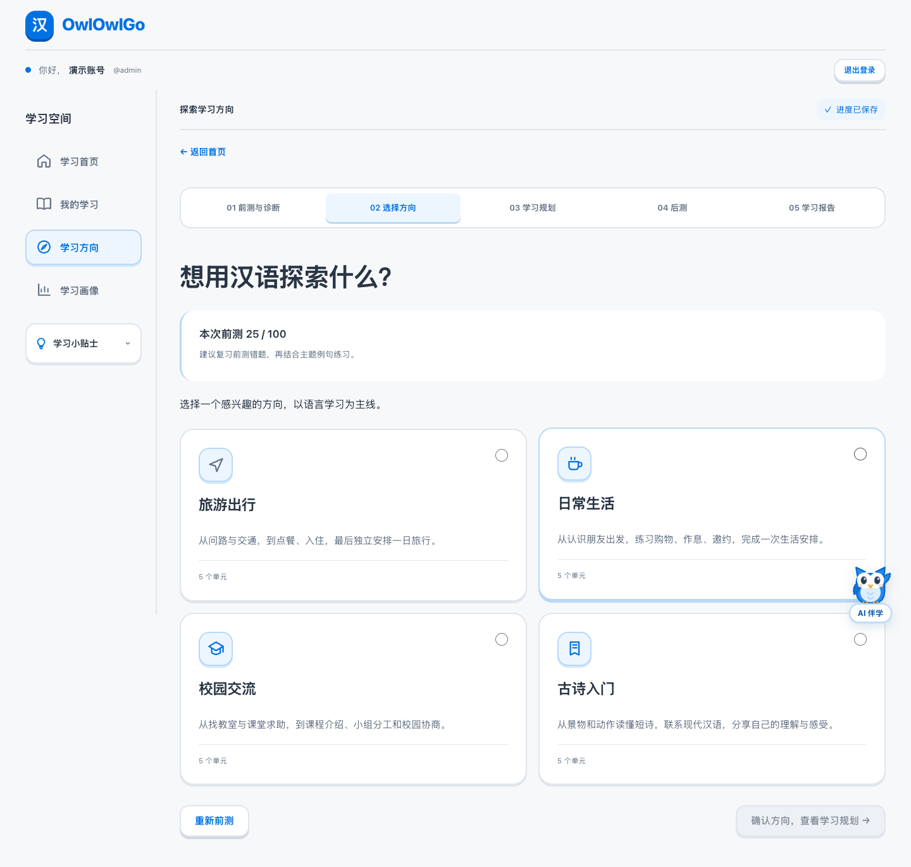

[查看F08需求位置标注图](../../../figures/requirements/actual/F08-plan-unit-marked.png)

## F08 · 学习规划与单元内容

- 实际进入方式：F07选方向 → 确认方向，查看学习规划。
- 代码/状态：`LearningJourney.vue / stage=plan, outcome=plan`。
- 卡片：[P-C03](c-黄云舒.md#p-c03) · [P-C04](c-黄云舒.md#p-c04) · [P-C05](c-黄云舒.md#p-c05) · [P-D01](d-周子涵.md#p-d01) · [P-D03](d-周子涵.md#p-d03) · [P-E05](e-郑仲佑.md#p-e05)。

- **P-C03**：F07右下现有确认按钮；F08标题下、课程正文上方（新增候选预览区）。把按钮改为“生成安排”；成功后在沿用F08框架的预览态显示候选，不自动生效。
- **P-C04**：F08顶部 .setup-finish 首次设置区、.context-help 学习安排附近；底部 .plan-tools 修改方向。新增接受/取消及修订对比状态；复用原规划页面框架，不要求独立新页面。
- **P-C05**：F08标题、方向完成数、“学习安排”折叠区、上方单元分页；F09计划摘要。负责上方规划信息与打开单元的事件；课程正文和小测由D负责，仍可同页展示。
- **P-D01**：蓝色 .unit-page-heading 课程标题；.unit-detail 目标/词汇/句型/对话/练习；上下单元按钮。维护现有课程区和分页，可内部提取组件，但不要求另建课程页面。
- **P-D03**：右下小鸮 .companion-panel 与快捷提问；F08“从理解到运用”附近（新增练习入口）。现有浮窗仅预设回复。复用它承载独立练习的服务端分级提示，新增练习区必须与正式小测分开。
- **P-E05**：方向内容、课程正文和提示面板的内容来源；无管理后台。审核实际课程/题目/模板并提供元数据；不新增后台页面。

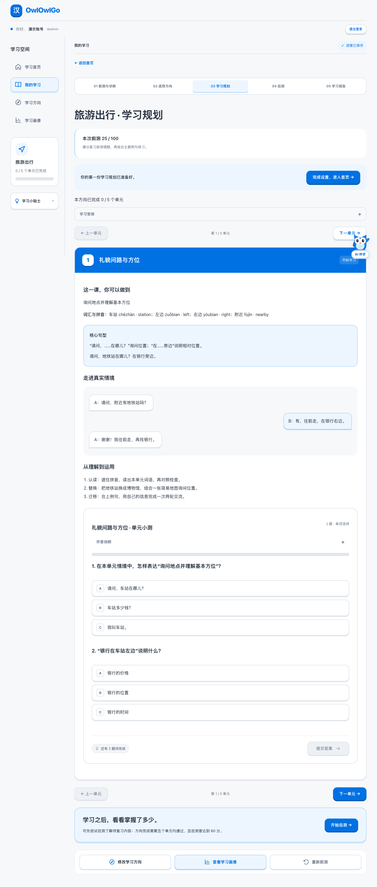

[查看F09需求位置标注图](../../../figures/requirements/actual/F09-home-learning-marked.png)

## F09 · 完成设置后的首页

- 实际进入方式：F08 → 完成设置，进入首页。
- 代码/状态：`HomeDashboard.vue / setupComplete && plan`。
- 卡片：[P-A02](a-管佳欣.md#p-a02) · [P-A03](a-管佳欣.md#p-a03) · [P-A04](a-管佳欣.md#p-a04) · [P-A05](a-管佳欣.md#p-a05) · [P-C05](c-黄云舒.md#p-c05)。

- **P-A02**：首页上方 .home-welcome / .home-continue 主卡及 .setup-strip 三步进度。按服务端学习阶段决定主按钮文案和去向；不重做首页。
- **P-A03**：顶部进度环 .home-progress；下方 .learning-path 单元路径；右侧 .home-cards。将预设计划数据替换为已接受计划，保留现有卡片/路径布局。
- **P-A04**：左侧 .workspace-nav；右上 .workspace-toolbar 保存状态；返回首页按钮；顶部账号条。统一现有按钮接线与保存/冲突/登录失效行为。
- **P-A05**：无新增页面；账号表单、答题草稿和首页进度是数据库迁移回归入口。只改这些页面依赖的存储链路；不创建数据库配置页面。
- **P-C05**：F08标题、方向完成数、“学习安排”折叠区、上方单元分页；F09计划摘要。负责上方规划信息与打开单元的事件；课程正文和小测由D负责，仍可同页展示。

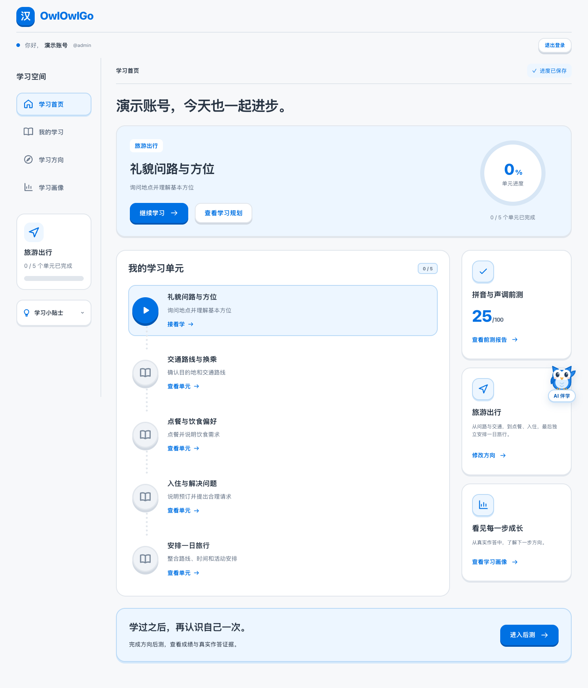

## F10 · 本次前测报告

- 实际进入方式：F09右栏 → 查看前测报告。
- 代码/状态：`LearningJourney.vue / view=report + LearningAnalysis.vue`。
- 卡片：[P-B03](b-钱俊.md#p-b03) · [P-B04](b-钱俊.md#p-b04)。

- **P-B03**：“从这次作答，找到下一步。” #learning-analysis 分析区。在原分析区补规则回退及来源标识；截图中的真实状态是AI未配置后的失败提示，不能当成已有回退。
- **P-B04**：本次前测报告标题/返回首页附近；当前没有历次前测入口或历史列表。在现有报告页新增“历次前测”入口与列表/详情子视图；只借用现有样式，不伪造现有截图。

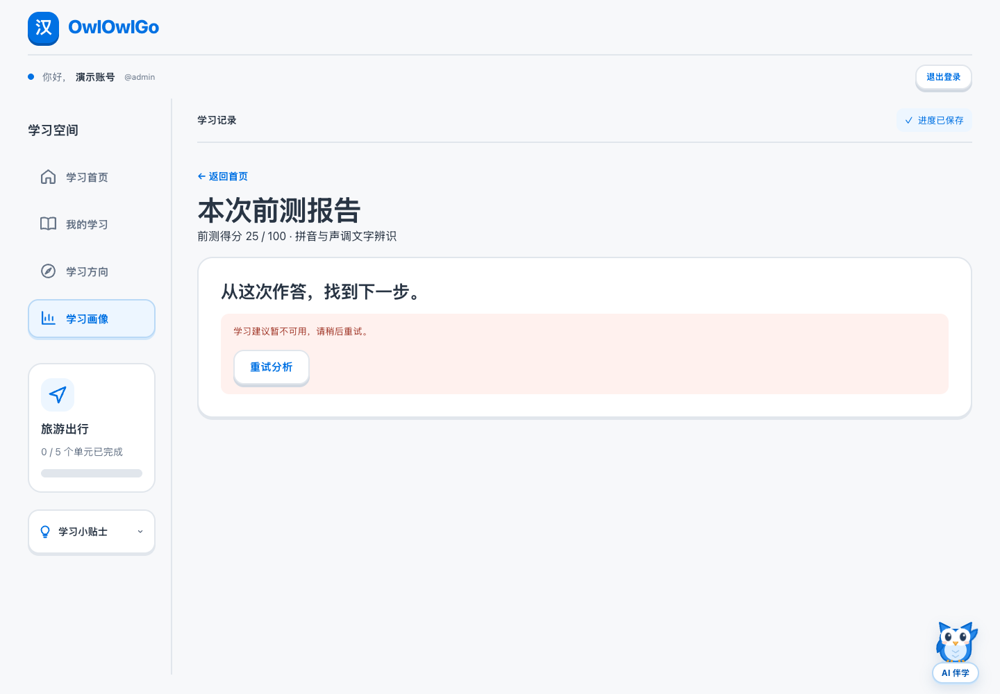

## F11 · 单元小测区块

- 实际进入方式：F09继续学习 → F08课程正文向下滚动。
- 代码/状态：`F08内的ServerUnitQuiz.vue，不是独立页面`。
- 卡片：[P-D02](d-周子涵.md#p-d02)。

- **P-D02**：F08课程下半部 .practice-quiz；共享ServerUnitQuiz的题号、选项、结果与提交。保留内嵌小测，负责共享测验组件和SQL提交回归；B负责前测文案与流程接线。

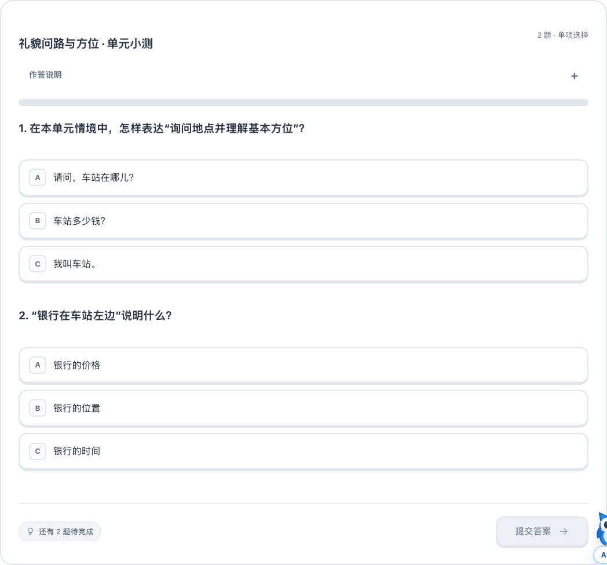

## F12 · 小鸮浮动面板

- 实际进入方式：F08右下角 → AI伴学。
- 代码/状态：`StudyCompanion.vue / open=true；当前为预设回复`。
- 卡片：[P-D03](d-周子涵.md#p-d03) · [P-D04](d-周子涵.md#p-d04) · [P-E05](e-郑仲佑.md#p-e05)。

- **P-D03**：右下小鸮 .companion-panel 与快捷提问；F08“从理解到运用”附近（新增练习入口）。现有浮窗仅预设回复。复用它承载独立练习的服务端分级提示，新增练习区必须与正式小测分开。
- **P-D04**：浮窗 .companion-actions 快捷按钮上方（新增开关）；.companion-demo-note / 对话区状态。新增主动提示开关、请求失败/重试/来源状态；保留原小鸮外观和开合方式。
- **P-E05**：方向内容、课程正文和提示面板的内容来源；无管理后台。审核实际课程/题目/模板并提供元数据；不新增后台页面。

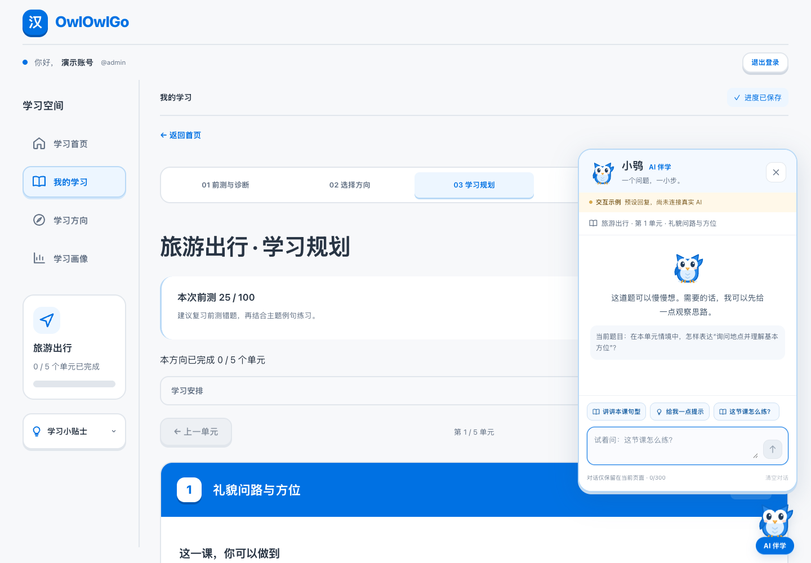

## F13 · 方向后测答题

- 实际进入方式：F08页底 → 开始后测；F09 → 进入后测。
- 代码/状态：`LearningJourney.vue / outcome=posttest`。
- 卡片：[P-D02](d-周子涵.md#p-d02) · [P-D05](d-周子涵.md#p-d05)。

- **P-D02**：F08课程下半部 .practice-quiz；共享ServerUnitQuiz的题号、选项、结果与提交。保留内嵌小测，负责共享测验组件和SQL提交回归；B负责前测文案与流程接线。
- **P-D05**：后测 .practice-quiz；页底“返回学习规划 / 查看学习报告”。维护10题正式后测与真实报告出口，不在正式后测启用解题提示。

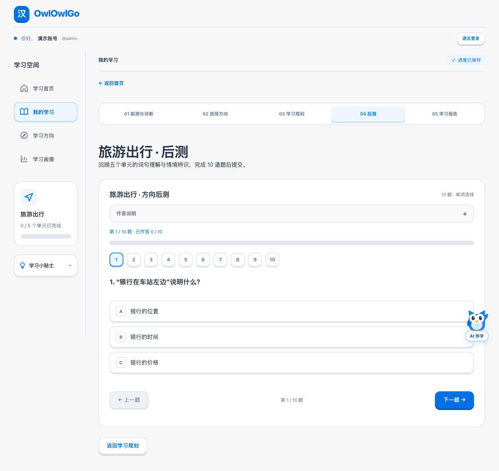

## F14 · 方向后测结果

- 实际进入方式：F13答齐10题 → 提交答案。
- 代码/状态：`同一后测页面的result态`。
- 卡片：[P-D05](d-周子涵.md#p-d05) · [P-E03](e-郑仲佑.md#p-e03)。

- **P-D05**：后测 .practice-quiz；页底“返回学习规划 / 查看学习报告”。维护10题正式后测与真实报告出口，不在正式后测启用解题提示。
- **P-E03**：报告上方 .report-hero 后测分数；下方 .question-actions 返回规划/重新后测。把现有报告绑定明确提交ID；增加复习入口，保留原报告结构。

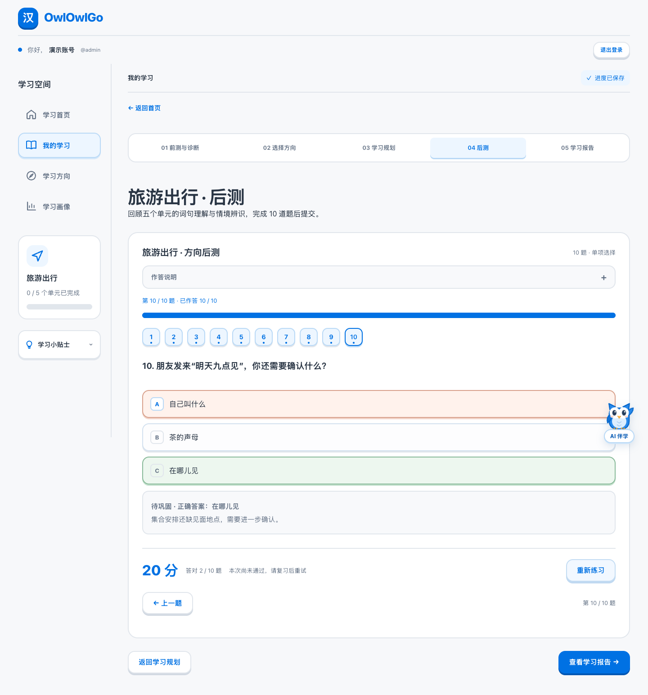

## F15 · 方向学习报告

- 实际进入方式：F14 → 查看学习报告。
- 代码/状态：`LearningJourney.vue / outcome=final + FinalReport.vue`。
- 卡片：[P-E01](e-郑仲佑.md#p-e01) · [P-E02](e-郑仲佑.md#p-e02) · [P-E03](e-郑仲佑.md#p-e03) · [P-E04](e-郑仲佑.md#p-e04)。

- **P-E01**：作答记录 .evidence-stats；.profile-table-wrap 能力矩阵；左下知识点作答记录。完善现有画像的证据说明和去重；报告复用同一组件。
- **P-E02**：右下 .report-grid 的“下一步练习”卡片（目前只有文字列表）。在建议旁新增可点击“去复习”，并携带来源；不是另做画像页面。
- **P-E03**：报告上方 .report-hero 后测分数；下方 .question-actions 返回规划/重新后测。把现有报告绑定明确提交ID；增加复习入口，保留原报告结构。
- **P-E04**：当前无错题复习列表；入口新增于两页“下一步练习”卡片。新增错题复习子视图，保留现有侧栏；来源为画像/报告，返回原来源。现有截图只说明入口位置。

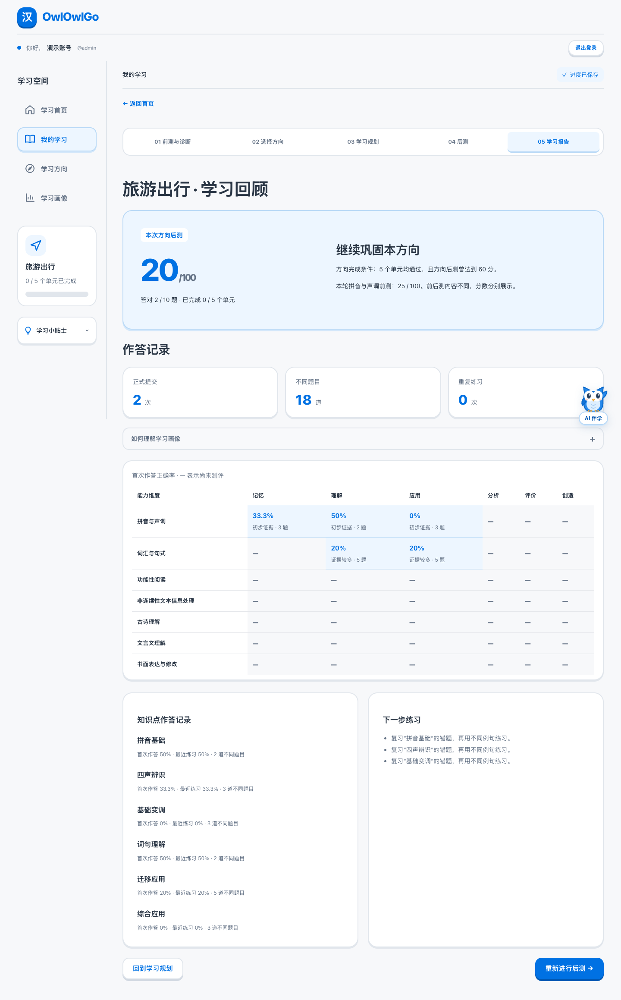

[查看F16需求位置标注图](../../../figures/requirements/actual/F16-profile-marked.png)

## F16 · 学习画像

- 实际进入方式：侧栏学习画像；或F09 → 查看学习画像。
- 代码/状态：`LearningJourney.vue / view=profile + LearnerProfile.vue`。
- 卡片：[P-E01](e-郑仲佑.md#p-e01) · [P-E02](e-郑仲佑.md#p-e02) · [P-E04](e-郑仲佑.md#p-e04)。

- **P-E01**：作答记录 .evidence-stats；.profile-table-wrap 能力矩阵；左下知识点作答记录。完善现有画像的证据说明和去重；报告复用同一组件。
- **P-E02**：右下 .report-grid 的“下一步练习”卡片（目前只有文字列表）。在建议旁新增可点击“去复习”，并携带来源；不是另做画像页面。
- **P-E04**：当前无错题复习列表；入口新增于两页“下一步练习”卡片。新增错题复习子视图，保留现有侧栏；来源为画像/报告，返回原来源。现有截图只说明入口位置。

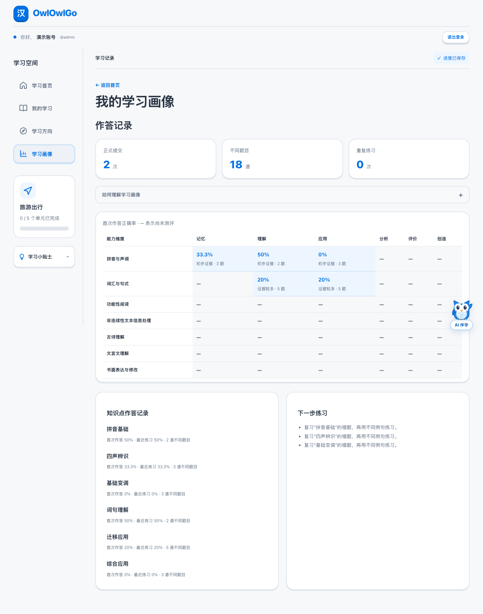

