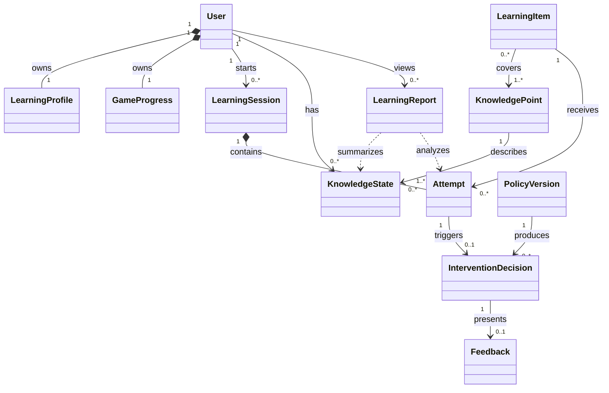

# OwlOWLGo 软件系统功能规格说明书

> 文档版本：v1.0 草案  
> 更新日期：2026-10-09  
> 适用范围：大学生英语词汇、语法与短篇阅读学习 MVP  
> 编号规则：`FR-x.y` 表示功能需求，`UC-x` 表示用例，`BR-x` 表示业务规则  
> 上游文档：[工程问题定义](problem_definition.md)  
> 配套文档：[非功能需求规格](nonfunctional_spec.md)

## 1. 目的与范围

本文定义 OwlOWLGo MVP 应提供的系统角色、功能边界、功能树、核心业务规则、典型流程、领域模型和验收标准，作为原型设计、开发、测试和需求追踪的共同基线。

OwlOWLGo 是面向大学生的 AI 游戏化英语学习 H5 应用。系统根据学习者的知识状态和实时作答过程选择下一任务，并决定暂不介入、鼓励再试、轻提示、分步支架或完整讲解。LLM 只负责在既定约束下生成反馈表达或候选内容，关键学习决策由可测试的策略模块执行。

### 1.1 MVP 范围

- 用户注册、登录、学习目标和提示偏好；
- 词汇、语法、短篇阅读初始测评；
- 个性化任务选择、学习会话与断点恢复；
- 作答过程采集和知识状态更新；
- 五级自适应干预、受约束反馈与迁移练习；
- 经验值、等级、连续学习和基础成就；
- 学习报告、干预解释与个人数据删除；
- 题目和知识点的基础管理、AI 内容审核。

### 1.2 不在 MVP 范围

原生移动应用、多学科课程、付费系统、开放社交、作业代答、大模型微调，以及由 LLM 独立决定掌握度、分数、权限或关键干预策略。

## 2. 术语

| 术语 | 定义 |
| --- | --- |
| 学习任务（Item） | 一道词汇、语法或短篇阅读题及其内容、答案、难度与知识点标签 |
| 学习会话（Session） | 用户一次连续学习过程，从开始关卡到完成或退出 |
| 作答（Attempt） | 用户对某学习任务的一次提交及其正确性、耗时、序号和求助信息 |
| 知识状态 | 用户对某知识点的掌握度、置信度、提示依赖和练习时间等状态 |
| 干预 | 系统根据状态作出的 0–4 级帮助动作 |
| 迁移题 | 在讲解后用于检验同一知识能否应用于新情境的任务 |
| 策略版本 | 生成任务推荐或干预决定时使用的规则与参数版本 |

## 3. 系统角色（Actor）

### 3.1 人类角色

| 角色 | 职责与权限 |
| --- | --- |
| 学习者 | 注册登录、设置目标、完成测评与关卡、请求或关闭主动提示、查看报告、管理个人数据 |
| 内容管理员 | 维护知识点与题目，审核 AI 候选内容，启用或停用内容 |
| 研究分析者 | 在获得授权后查看去标识化聚合数据、策略效果和实验指标，不访问无关身份信息 |

### 3.2 外部系统角色

| 外部角色 | 交互内容 |
| --- | --- |
| LLM 服务 | 根据结构化请求生成候选提示、讲解或迁移题；不直接控制关键业务状态 |
| 数据库服务 | 保存用户、内容、会话、作答、知识状态、策略和游戏进度 |
| 可选缓存服务 | 保存短期会话状态、限流计数或异步任务状态 |

## 4. 功能树（Feature Tree）

- **F1 用户与学习档案**
  - FR-1.1 注册、登录与退出
  - FR-1.2 学习目标与偏好
  - FR-1.3 主动提示开关
  - FR-1.4 个人数据查看与删除申请
- **F2 初始测评**
  - FR-2.1 创建测评会话
  - FR-2.2 提交测评作答
  - FR-2.3 生成分项能力起点
- **F3 内容与任务**
  - FR-3.1 呈现词汇、语法和短篇阅读任务
  - FR-3.2 维护题目难度与知识点标签
  - FR-3.3 选择下一学习任务并记录原因
  - FR-3.4 生成和审核候选内容
- **F4 学习会话与事件采集**
  - FR-4.1 开始、暂停、恢复和完成学习会话
  - FR-4.2 提交作答并判定结果
  - FR-4.3 记录学习过程事件
- **F5 学习者模型**
  - FR-5.1 更新知识点掌握状态
  - FR-5.2 维护个人耗时基线与提示依赖
  - FR-5.3 查询当前学习状态摘要
- **F6 自适应干预与反馈**
  - FR-6.1 生成五级干预决策
  - FR-6.2 支持学习者主动求助
  - FR-6.3 生成并校验提示或讲解
  - FR-6.4 失败降级与模板反馈
  - FR-6.5 安排巩固或迁移任务
- **F7 游戏化激励**
  - FR-7.1 更新经验值与等级
  - FR-7.2 更新连续学习记录
  - FR-7.3 解锁基础成就并防止刷分
- **F8 报告与可解释性**
  - FR-8.1 生成个人学习报告
  - FR-8.2 展示任务推荐与干预原因
  - FR-8.3 导出去标识化研究数据
- **F9 内容运营与审计**
  - FR-9.1 管理知识点与题目生命周期
  - FR-9.2 审核 AI 候选内容
  - FR-9.3 查询策略版本与决策记录

## 5. 功能需求明细

| 编号 | 功能需求 | 触发/前置条件 | 系统行为 | 验收结果 | 优先级 |
| --- | --- | --- | --- | --- | --- |
| FR-1.1 | 注册与认证 | 访客提供合法邮箱和密码 | 创建唯一账号；密码仅保存安全哈希；登录后建立会话；支持主动退出 | 合法账号可登录；重复邮箱和错误凭据返回明确错误；不保存明文密码 | Must |
| FR-1.2 | 学习档案 | 用户已登录 | 保存学习目标、当前水平、自报可用时间和内容偏好 | 重新登录后档案可恢复，修改操作有时间记录 | Must |
| FR-1.3 | 提示偏好 | 用户已登录 | 允许启用/关闭主动提示；关闭后仍允许主动求助和必要的结果反馈 | 关闭后不出现未请求的教学提示，偏好即时生效 | Must |
| FR-1.4 | 数据权利 | 用户已登录并通过再次确认 | 展示主要个人数据类别；受理删除申请并记录状态 | 用户可提交删除请求；完成后无法再查询被删除的个人数据 | Should |
| FR-2.1 | 开始测评 | 用户无有效初始结果或选择重测 | 创建不超过 10 分钟的测评会话，并按词汇、语法、阅读组织任务 | 测评可开始、暂停后恢复，重复提交不生成重复会话 | Must |
| FR-2.2 | 测评作答 | 存在进行中的测评和当前题目 | 校验答案、记录耗时与序号、选择下一测评题 | 每次提交产生一条可追踪作答记录，非法题目或越权提交被拒绝 | Must |
| FR-2.3 | 能力起点 | 测评达到结束条件 | 输出词汇、语法、阅读分项结果，初始化知识状态和学习起点 | 结果与全部测评作答关联，用户可查看分项结果 | Must |
| FR-3.1 | 任务呈现 | 存在有效学习会话 | 呈现任务正文、作答控件、进度和可选求助入口，不提前展示答案 | 三类 MVP 任务均可正常展示和提交，移动端不遮挡主要操作 | Must |
| FR-3.2 | 内容元数据 | 题目进入可用状态前 | 每题具有唯一 ID、题型、难度、标准答案、解析和至少一个知识点标签 | 缺失必填元数据的题目不能启用 | Must |
| FR-3.3 | 下一任务推荐 | 测评完成或上题处理结束 | 综合知识缺口、难度匹配、间隔复习和内容多样性选择任务；保存候选得分与原因 | 返回一个有权访问的可用任务；推荐记录含策略版本和原因 | Must |
| FR-3.4 | AI 候选内容 | 管理员或系统请求生成内容 | 以知识点、难度、题型和长度约束调用 LLM；校验后标记为待审核 | 未校验或未审核内容不得进入正式任务池 | Should |
| FR-4.1 | 学习会话 | 用户已完成测评 | 创建、暂停、恢复、完成关卡；保存最后一个已确认步骤 | 中断后可从最近保存点恢复；已完成会话不能继续写入普通作答 | Must |
| FR-4.2 | 作答处理 | 用户拥有进行中会话和当前任务 | 验证提交、判定正误、写入作答、触发状态更新与干预决策 | 单次请求返回判定、反馈动作、状态摘要和游戏化变化；重复请求不重复计分 | Must |
| FR-4.3 | 事件采集 | 会话内发生展示、作答、求助或干预 | 记录匿名用户标识、会话、题目、事件类型、耗时、尝试序号、干预和时间戳 | 核心学习步骤均有事件，事件顺序可用于回放 | Must |
| FR-5.1 | 掌握状态更新 | 有效作答已持久化 | 按知识点更新掌握度、置信度、近期错误和上次练习时间 | 同一作答仅更新一次；更新前后值和算法版本可追踪 | Must |
| FR-5.2 | 个体行为基线 | 已积累有效作答 | 更新个人耗时基线、连续失败和提示依赖；冷启动使用保守默认值 | 极端或无效数据不直接污染基线，状态可供策略读取 | Must |
| FR-6.1 | 五级干预 | 作答或停滞事件触发策略 | 在 0 暂不介入、1 鼓励再试、2 轻提示、3 分步支架、4 完整讲解中选择动作 | 每次决策保存输入快照、动作、理由、置信度和策略版本 | Must |
| FR-6.2 | 主动求助 | 用户点击求助 | 根据当前尝试和已使用提示返回下一适当级别，用户可明确请求完整讲解 | 求助不会降低到已经展示过的提示级别；请求和结果均记录 | Must |
| FR-6.3 | 反馈生成与校验 | 决策需要文本反馈 | 按动作级别生成结构化反馈，检查格式、答案一致性、难度、泄题和敏感内容 | 轻提示不含完整答案；只有校验通过的内容可以展示 | Must |
| FR-6.4 | 反馈降级 | LLM 超时、不可用或校验失败 | 最多按配置重试，随后使用题库解析或模板反馈并记录降级原因 | 外部 AI 故障不阻塞核心学习流程，用户获得明确且正确的替代反馈 | Must |
| FR-6.5 | 迁移任务 | 用户完成完整讲解或关键纠错 | 从同知识点选择不同表述或情境的任务，并标记为迁移验证 | 迁移题与原题不同且共享目标知识点，结果单独记录 | Must |
| FR-7.1 | 经验与等级 | 有效学习事件完成 | 按掌握、复习和纠错行为发放经验并更新等级 | 重放或重复请求不重复奖励，奖励原因可查询 | Should |
| FR-7.2 | 连续学习 | 用户完成当日有效关卡 | 按用户时区更新连续学习天数，避免同日重复累计 | 跨日规则一致；时区变化不导致异常增加 | Should |
| FR-7.3 | 成就与防刷分 | 达到配置化条件 | 解锁成就；对重复低价值任务限制奖励 | 成就只解锁一次，刷同一道题不能无限获取经验 | Should |
| FR-8.1 | 学习报告 | 用户存在有效学习数据 | 汇总完成量、掌握变化、常见错误、提示依赖和下一步建议 | 用户只能查看自己的报告；指标与原始事件可追溯 | Must |
| FR-8.2 | 决策解释 | 用户查看推荐或干预详情 | 展示简短、非技术化的推荐/干预原因，不暴露敏感内部提示 | 每次可见决策均能给出原因；原因与保存的决策记录一致 | Should |
| FR-8.3 | 研究数据导出 | 研究分析者已获授权并指定范围 | 导出去标识化事件和指标，记录导出时间、范围与用途 | 导出不含邮箱、密码、Token 等直接标识符；操作可审计 | Could |
| FR-9.1 | 内容管理 | 内容管理员已登录 | 新增、编辑、审核、启用、停用知识点和题目；禁止物理删除已被作答引用的内容 | 状态变更可追踪，停用内容不再被新会话推荐 | Should |
| FR-9.2 | AI 内容审核 | 存在待审核候选内容 | 展示生成约束、答案、解析和校验结果；允许批准、驳回或修改 | 只有人工批准的内容可进入正式任务池 | Should |
| FR-9.3 | 策略审计 | 存在推荐或干预记录 | 按策略版本、时间和动作查询决策记录 | 能从一次干预追溯到输入快照、策略配置和反馈结果 | Should |

## 6. 关键业务规则

| 编号 | 规则 |
| --- | --- |
| BR-1 | 首次错误默认先提供再次尝试机会，不直接展示完整答案；规则例外必须由策略配置说明。 |
| BR-2 | 学习者仍在合理时间内持续有效尝试时，0 级“不介入”是合法且必须记录的决策。 |
| BR-3 | 连续错误、超出个人耗时基线、无效修改或主动求助可提高干预级别。 |
| BR-4 | 连续失败达到配置上限或用户明确请求完整讲解时，系统必须结束无效挣扎。 |
| BR-5 | 2 级轻提示不得包含标准答案；3 级支架可以拆分步骤；4 级才可给出完整讲解。 |
| BR-6 | LLM 不得直接修改掌握度、经验值、权限和策略版本。 |
| BR-7 | 讲解后的迁移题必须与原题共享目标知识点，但不得只是原题的完全复制。 |
| BR-8 | 正式题库内容必须具有可验证答案和解析；AI 生成内容须通过机器校验与人工审核。 |
| BR-9 | 所有学习状态和奖励更新必须具备幂等性，同一作答不得重复计算。 |
| BR-10 | 用户关闭主动提示后，系统仍可返回答题结果、用户主动请求的帮助和必要安全信息。 |

## 7. 典型业务流程

### UC-1 初始测评与学习起点

1. 学习者注册登录并设置学习目标。
2. 系统创建初始测评，依次呈现词汇、语法和阅读任务。
3. 学习者提交答案，系统记录正确性、耗时和尝试信息。
4. 测评达到结束条件后，系统计算分项结果并初始化知识状态。
5. 学习者查看结果，系统据此生成首个学习关卡。

### UC-2 自适应学习与渐进干预

1. 系统依据当前知识状态选择下一学习任务并记录推荐原因。
2. 学习者作答，系统原子化保存作答并更新知识状态。
3. 干预策略读取当前尝试、个人基线和历史状态，生成 0–4 级动作。
4. 若需要反馈，系统优先生成并校验受约束内容；失败则回退到模板或题库解析。
5. 学习者再次作答；多次失败或请求完整讲解后，系统提供解释并安排迁移题。
6. 系统更新经验、关卡进度和学习报告。

### UC-3 AI 候选内容审核

1. 内容管理员指定知识点、题型、难度和长度。
2. 系统调用 LLM 生成结构化候选内容。
3. 系统执行格式、答案一致性、难度、泄题与安全检查。
4. 内容管理员审阅候选题、答案、解析和校验结果。
5. 通过的内容进入正式题库；驳回内容保留审计记录但不可推荐。

## 8. 领域模型（Domain Model UML）

完整源文件见 [`figures/owlowlgo-domain-model.mmd`](../../figures/owlowlgo-domain-model.mmd)。

## 9. 验收标准摘要

| 编号 | 验收场景 | 通过标准 |
| --- | --- | --- |
| AC-1 | 新用户完成初始测评 | 80% 以上可用性测试用户无需现场指导，在 10 分钟内完成测评并看到分项结果 |
| AC-2 | 用户首次答错 | 默认不展示完整答案，产生可追踪的 0–2 级决策并允许再次尝试 |
| AC-3 | 用户连续失败 | 达到阈值后逐级提供支架，最终给出讲解并安排迁移题，不允许无限无帮助循环 |
| AC-4 | 用户关闭主动提示 | 后续学习中不出现未请求提示，主动求助仍可用 |
| AC-5 | LLM 返回错误或超时 | 核心流程不中断，系统展示正确的题库解析或模板反馈并记录降级 |
| AC-6 | 推荐和干预追踪 | 100% 决策可追溯到输入快照、理由、动作和策略版本 |
| AC-7 | 重复提交同一请求 | 不重复更新掌握度、经验值或连续学习记录 |
| AC-8 | 未审核 AI 内容 | 无法进入正式任务池，也不能被普通学习会话推荐 |
| AC-9 | 学习报告权限 | 普通用户只能查看自己的报告，研究导出不含直接身份标识 |
| AC-10 | 核心学习流程 | 测评、取题、提交、干预、迁移和报告的成功率不低于 95% |

## 10. 需求追踪

| 上游目标 | 对应功能 | 验证方式 |
| --- | --- | --- |
| 个性化学习路径 | FR-2.3、FR-3.3、FR-5.1、FR-5.2 | 推荐记录检查、状态更新测试、用户任务完成率 |
| 适宜性困难 | FR-3.2、FR-3.3、FR-5.1 | 难度匹配测试、成功概率和主观难度分析 |
| 有效失败 | FR-6.1、FR-6.3、FR-6.5 | 干预回放、迁移题结果、无效挣扎上限测试 |
| AI 不直接代答 | FR-6.1、FR-6.3、BR-5、BR-6 | 提示泄露评测、策略单元测试 |
| 游戏化参与 | FR-7.1、FR-7.2、FR-7.3 | 奖励幂等测试、防刷分测试、参与指标 |
| 可解释与可评估 | FR-4.3、FR-8.1、FR-8.2、FR-9.3 | 事件完整性、报告一致性和审计查询测试 |

## 11. 参考

- [课程参考：AIAgentFunSpec](https://github.com/bettermorn/AIAgent/blob/main/docs/AIAgentFunSpec.md)
- [OwlOWLGo 工程问题定义](problem_definition.md)
- [OwlOWLGo 非功能需求规格](nonfunctional_spec.md)

