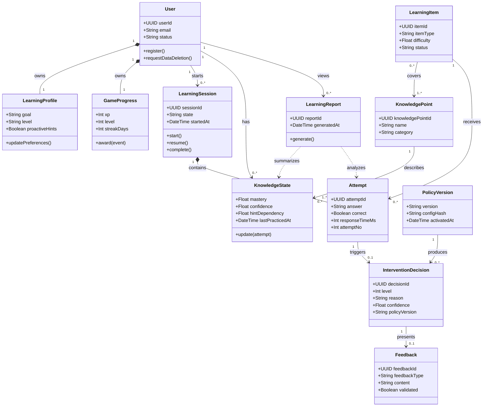

# OwlOWLGo：软件系统功能规格说明书

> 本文描述一个面向大学生英语学习的 AI 游戏化 H5 系统。系统持续感知学习者的知识状态与实时作答过程，动态选择学习任务，并决定何时不介入、何时延迟帮助以及提供何种强度的支架。关键的任务推荐和干预决策由可测试、可解释的策略模块完成，LLM 主要负责在既定约束下生成提示、讲解与候选内容。

## 0. 文档信息

| 项目 | 内容 |
| --- | --- |
| 系统名称 | OwlOWLGo AI 游戏化英语学习伙伴 |
| 文档名称 | 软件系统功能规格说明书 |
| 版本 | v1.1 草案 |
| 更新日期 | 2026-10-09 |
| 适用范围 | 大学生英语词汇、语法和短篇阅读学习 MVP |
| 产品形态 | 支持桌面端与移动端浏览器的 H5 应用 |
| 编号规则 | `FR-x.y` 为功能需求，`NFR-x` 为非功能需求，`AI-x` 为 AI 模块角色 |
| 上游文档 | [工程问题定义](problem_definition.md) |
| 配套文档 | [非功能需求规格](nonfunctional_spec.md) |

MVP 包含用户与学习档案、初始测评、学习任务、过程采集、知识状态、任务推荐、五级干预、游戏化反馈和学习报告。MVP 不包含大模型微调、开放作业代答、多学科课程、完整社交系统、付费系统和原生移动端应用。

## 1. 系统角色（Actor）

### 1.1 人类角色

- **学习者（Learner）**：注册和登录系统，设置学习目标与提示偏好，完成初始测评和日常学习关卡，主动请求帮助，查看学习报告，并管理个人数据。
- **内容管理员（Content Administrator）**：维护知识点和学习题目，查看 AI 生成候选内容及其校验结果，执行审核、修改、启用和停用操作。
- **研究分析者（Research Analyst）**：在获得授权后查看去标识化的学习事件与聚合指标，比较不同任务推荐或干预策略的效果，不访问与研究无关的直接身份信息。

### 1.2 系统外部角色

- **大模型服务（LLM Provider）**：根据结构化请求生成候选提示、讲解或迁移题。大模型服务不得直接修改用户掌握度、经验值、权限或策略配置。
- **数据库服务（Database Service）**：持久化用户、学习内容、学习会话、作答、知识状态、干预决策、策略版本和游戏进度。
- **缓存服务（Cache Service，可选）**：保存短期会话状态、限流计数和异步任务状态。缓存不可作为关键学习数据的唯一存储。

### 1.3 AI 模块角色

| 编号 | AI 模块 | 职责 | 主要输入 | 主要输出 |
| --- | --- | --- | --- | --- |
| AI-1 | 学习者状态模块（Learner Model） | 更新知识点掌握度、置信度、近期错误率、耗时基线和提示依赖 | 测评结果、作答、耗时、求助与干预历史 | 知识状态快照 |
| AI-2 | 任务推荐模块（Task Policy） | 从候选题中选择难度适宜且符合复习需求的下一任务 | 知识状态、题目难度、间隔复习和内容多样性 | 推荐题目、推荐原因、策略版本 |
| AI-3 | 干预策略模块（Intervention Policy） | 判断是否介入以及使用哪一级帮助 | 当前作答、连续错误、个人耗时基线、主动求助和提示依赖 | 0–4 级动作、原因和置信度 |
| AI-4 | 反馈生成模块（Feedback Generator） | 按策略指定的级别生成提示、讲解和迁移题 | 学习任务、错误类型、目标知识点和干预级别 | 结构化候选反馈 |
| AI-5 | 内容质检模块（Content Validator） | 检查格式、答案一致性、难度、提示泄露和内容安全 | AI 候选内容、标准答案、题目约束 | 通过、驳回或降级原因 |

## 2. 功能树（Feature Tree）

- **2.1 用户与学习档案模块（Account & Profile）**
  - **FR-1.1**：支持学习者使用唯一邮箱和密码注册、登录与退出；密码仅保存安全哈希，错误凭据返回明确错误。
  - **FR-1.2**：支持学习者维护英语学习目标、当前水平、自报可用时间和内容偏好。
  - **FR-1.3**：支持学习者启用或关闭主动提示；关闭后仍允许主动求助和必要的答题反馈。
  - **FR-1.4**：支持学习者查看主要个人数据类别并提交数据删除申请，删除过程应可追踪。

- **2.2 初始测评模块（Initial Assessment）**
  - **FR-2.1**：支持创建包含词汇、语法和短篇阅读的初始测评，目标完成时间不超过 10 分钟。
  - **FR-2.2**：测评过程中记录每次作答的题目、答案、正误、耗时、尝试序号和时间戳。
  - **FR-2.3**：测评结束后输出词汇、语法和阅读分项结果，并初始化相应知识点的掌握状态。
  - **FR-2.4**：测评被中断时保存最近一个已确认步骤，恢复后不得重复提交已经确认的答案。

- **2.3 学习内容与任务模块（Content & Task）**
  - **FR-3.1**：支持选择题、填空题和短篇阅读任务的展示、作答和结果反馈。
  - **FR-3.2**：每个正式题目必须具有唯一 ID、题型、难度、标准答案、解析和至少一个知识点标签。
  - **FR-3.3**：任务推荐模块应综合知识缺口、难度匹配、间隔复习和内容多样性选择下一任务，并保存推荐原因和策略版本。
  - **FR-3.4**：缺少必填元数据、已停用或未通过审核的题目不得进入普通学习会话。
  - **FR-3.5**：系统可按知识点、题型、难度和长度约束请求 AI 生成候选内容，候选内容在审核通过前不得进入正式题库。

- **2.4 学习会话与事件采集模块（Learning Session）**
  - **FR-4.1**：支持开始、暂停、恢复和完成学习关卡，并保存最后一个已确认步骤。
  - **FR-4.2**：提交作答时，系统应校验权限和会话状态，判定结果并原子化写入作答记录。
  - **FR-4.3**：一次作答处理应返回判定结果、干预动作、反馈内容、知识状态摘要和游戏化变化。
  - **FR-4.4**：系统应记录题目展示、答案提交、主动求助、干预展示、任务完成和会话退出等学习事件。
  - **FR-4.5**：作答和奖励处理必须具有幂等性，重复请求不得重复更新知识状态或发放经验值。

- **2.5 学习者模型模块（Learner Model）**
  - **FR-5.1**：每次有效作答后，按关联知识点更新掌握度、置信度、近期错误率和上次练习时间。
  - **FR-5.2**：系统应根据有效历史作答维护个人耗时基线、连续失败次数和提示依赖程度。
  - **FR-5.3**：冷启动或数据不足时使用保守默认值，异常耗时和无效事件不得直接污染个人基线。
  - **FR-5.4**：每次状态更新应记录更新前后值和算法版本，以支持回放和策略评估。

- **2.6 自适应干预与反馈模块（Adaptive Intervention）**
  - **FR-6.1**：干预策略必须在 0 暂不介入、1 鼓励再试、2 轻提示、3 分步支架、4 完整讲解中选择一个动作。
  - **FR-6.2**：每次干预决策必须保存输入特征快照、动作、原因、置信度和策略版本，包括 0 级不介入决策。
  - **FR-6.3**：首次错误默认先允许再次尝试，不立即显示完整答案；规则例外必须由策略配置说明。
  - **FR-6.4**：连续错误、超出个人耗时基线、反复无效修改或主动求助时，策略可以提高干预级别。
  - **FR-6.5**：2 级轻提示不得包含完整答案；3 级可拆分步骤；4 级可提供完整讲解。
  - **FR-6.6**：学习者主动求助时，系统根据已使用提示返回下一适当级别，也允许学习者明确请求完整讲解。
  - **FR-6.7**：反馈生成模块应输出结构化内容，并通过格式、答案一致性、难度、提示泄露和敏感内容检查。
  - **FR-6.8**：LLM 超时、不可用或校验失败时，系统应使用题库解析或模板反馈降级，不得阻塞核心学习流程。
  - **FR-6.9**：完整讲解后应安排与原题共享目标知识点、但表述或情境不同的迁移题。

- **2.7 游戏化模块（Gamification）**
  - **FR-7.1**：按有效学习、知识掌握、间隔复习和纠错行为发放经验值并更新等级。
  - **FR-7.2**：完成当日有效关卡后，按用户时区更新连续学习天数，同一天不得重复累计。
  - **FR-7.3**：支持解锁基础成就；同一成就只能解锁一次，重复完成低价值任务不得无限刷取经验。
  - **FR-7.4**：每次奖励应记录奖励原因，并与产生奖励的学习事件关联。

- **2.8 学习报告与可解释性模块（Report & Explainability）**
  - **FR-8.1**：生成个人学习报告，展示完成情况、知识点掌握变化、常见错误、提示依赖和下一步建议。
  - **FR-8.2**：学习者可查看任务推荐或干预的简短、非技术化原因，展示内容应与保存的决策记录一致。
  - **FR-8.3**：普通学习者只能查看自己的报告和学习记录。
  - **FR-8.4**：获得授权的研究分析者可导出去标识化的事件与指标，导出数据不得包含密码、Token 或直接身份标识。

- **2.9 内容管理与审计模块（Administration & Audit）**
  - **FR-9.1**：内容管理员可新增、编辑、审核、启用和停用知识点及题目。
  - **FR-9.2**：已被作答记录引用的内容不得物理删除，应通过状态停用保持历史可追踪性。
  - **FR-9.3**：AI 候选内容审核页面应展示生成约束、答案、解析、模型标识和各项校验结果。
  - **FR-9.4**：支持按策略版本、时间、动作和会话查询任务推荐及干预决策记录。

## 3. 非功能需求（Non-Functional Requirements）

| 编号 | 类别 | 需求描述 |
| --- | --- | --- |
| NFR-1 | 性能 | 普通业务 API 在约定测试环境和正常负载下 P95 响应时间不超过 500 ms，不含外部 LLM 响应时间 |
| NFR-2 | 性能 | 作答提交的本地判定、持久化和策略决策 P95 不超过 800 ms |
| NFR-3 | 可靠性 | 核心学习流程成功率不低于 95%，单次 LLM 故障不得造成会话数据丢失 |
| NFR-4 | 可靠性 | 学习中断后可恢复到最近一个已确认步骤，重复提交不得重复计分 |
| NFR-5 | 可用性 | 不少于 80% 的目标测试用户无需现场指导即可完成初始测评和一个学习关卡 |
| NFR-6 | 安全性 | 密码、API Key、Token 和数据库凭据不得以明文存储、提交或写入普通日志 |
| NFR-7 | 隐私 | 研究数据必须去标识化；用户可提交个人数据删除申请；MVP 不招募未成年人 |
| NFR-8 | 兼容性 | 支持主流 Chromium 浏览器最近两个稳定版本，并适配不小于 360 px 的移动端宽度 |
| NFR-9 | 可维护性 | 学习领域规则与 Web 框架解耦，策略、LLM 适配、提示模板和持久化实现相互独立 |
| NFR-10 | 可观测性 | 记录请求 ID、会话 ID、策略版本、响应延迟、降级原因和错误类型，不记录敏感凭据 |
| NFR-11 | 可追溯性 | 100% 的任务推荐和干预决策可追溯至输入快照、原因、动作和策略版本 |
| NFR-12 | AI 质量 | AI 内容必须经过结构、答案一致性、难度、提示泄露和敏感内容检查后才能展示或入库 |
| NFR-13 | AI 质量 | AI 生成题不得自动进入正式题库，必须经内容管理员审核 |
| NFR-14 | 可扩展性 | 更换 LLM 供应商不应要求修改核心学习领域模型与对外 API 契约 |

更完整的验证方法、发布质量门和待确认参数见[非功能需求规格说明书](nonfunctional_spec.md)。

## 4. 典型业务流程（摘要）

### 4.1 初始测评与学习起点

1. 学习者注册、登录并设置学习目标。
2. 系统创建包含词汇、语法和阅读任务的初始测评。
3. 学习者逐题作答，系统记录答案、正误、耗时、尝试序号和时间戳。
4. 测评达到结束条件后，学习者状态模块生成分项结果并初始化知识状态。
5. 系统根据测评结果推荐首个学习关卡，学习者可查看推荐的简要原因。

### 4.2 自适应学习与渐进干预

1. 任务推荐模块根据知识缺口、难度匹配、间隔复习和内容多样性选择下一题。
2. 学习者作答，系统保存作答并更新对应知识点状态。
3. 干预策略读取当前作答、连续错误、个人耗时基线、主动求助和提示依赖。
4. 策略输出 0–4 级动作、原因和置信度，并保存使用的策略版本。
5. 若动作需要反馈，反馈生成模块按指定级别生成结构化内容，内容质检模块完成校验。
6. 若 LLM 失败或内容未通过校验，系统回退到题库解析或模板反馈。
7. 学习者再次作答；多次失败或明确请求讲解时，系统给出完整解释并安排迁移题。
8. 系统更新经验值、关卡进度和个人学习报告。

### 4.3 AI 候选学习内容审核

1. 内容管理员指定知识点、题型、难度、长度和答案格式。
2. 反馈生成模块调用 LLM 生成结构化候选题、答案和解析。
3. 内容质检模块执行格式、答案一致性、难度、提示泄露和内容安全检查。
4. 内容管理员查看生成约束、模型标识和校验结果，执行批准、修改或驳回。
5. 只有审核通过的内容可以进入正式题库并被任务推荐模块选择。

### 4.4 研究数据导出

1. 获得授权的研究分析者选择时间范围、事件类型和指标。
2. 系统检查访问权限和导出范围，去除直接身份信息。
3. 系统生成去标识化数据文件，并记录导出时间、范围和用途。
4. 研究分析者使用导出数据比较立即解析与自适应干预的迁移、保持和提示依赖指标。

## 5. 领域模型（Domain Model UML）

领域模型的原始 Mermaid 文件和渲染图分别位于：

- [`figures/owlowlgo-domain-model.mmd`](../../figures/owlowlgo-domain-model.mmd)
- [`figures/owlowlgo-domain-model.png`](../../figures/owlowlgo-domain-model.png)

## 6. 验收标准（摘要）

- 不少于 80% 的目标测试用户可以在无现场指导的情况下，于 10 分钟内完成初始测评并查看分项结果。
- 标准测试账号可以完整执行“测评 → 推荐 → 作答 → 状态更新 → 干预 → 迁移题 → 报告”流程，核心流程成功率不低于 95%。
- 用户首次答错时，系统默认不展示完整答案，并产生可追踪的 0–2 级干预决策。
- 用户连续失败达到配置阈值时，系统能够逐级提供支架，最终给出讲解并安排迁移题，不出现无限无帮助循环。
- 用户关闭主动提示后，后续学习中不出现未请求的教学提示，主动求助功能仍然可用。
- 人为模拟 LLM 超时、错误响应或内容校验失败时，核心学习流程不中断，并展示正确的题库解析或模板反馈。
- 100% 的任务推荐和干预决策可以追溯到输入快照、决策原因、动作、置信度和策略版本。
- 重放同一作答请求不会重复更新知识状态、经验值、成就或连续学习记录。
- 未通过机器校验和人工审核的 AI 候选内容不能进入正式题库，也不能被普通学习会话推荐。
- 普通学习者只能访问自己的学习会话和报告，研究数据导出不包含密码、Token、邮箱等直接身份信息。

