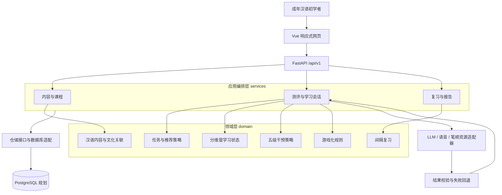

# 汉语学习网页：系统架构

> 版本 v2.0 · 2026-10-15 · 当前为架构骨架与产品设计，另有拼音与声调固定题目 Demo。后端业务组件均为规划，尚未接入数据库或 AI。

## 1. 总体结构

采用模块化单体，保留 Vue 3 + TypeScript 前端、FastAPI 后端和规划中的 PostgreSQL。初期单服务部署，避免为尚未验证的功能引入微服务。前端按用户能力拆分，后端按领域、应用编排和基础设施分层。

## 2. 前端模块

| 目录 | 职责 | 对应页面 |
| --- | --- | --- |
| `src/app/` | 应用初始化、路由、全局状态 | 全局布局 |
| `src/features/profile/` | 目标、水平、辅助语言与偏好 | 引导与个人设置 |
| `src/features/assessment/` | 分维度测评流程 | 入门测评、结果 |
| `src/features/phonetics/` | 拼音、声调、变调的训练交互 | 声调训练 |
| `src/features/characters/` | 汉字识读、部件、后续笔顺交互 | 汉字学习 |
| `src/features/scenarios/` | 校园与生活情境练习 | 课程地图、学习关卡 |
| `src/features/culture/` | 文化卡与关联例句 | 文化探索 |
| `src/features/review/` | 错题、到期复习 | 今日复习 |
| `src/features/progress/` | 多维进度与学习报告 | 我的进度 |
| `src/shared/` | 组件、接口、类型与工具 | 跨模块复用 |

页面只负责呈现与交互；后续由应用状态维护会话，API 客户端统一处理错误。掌握度、任务计分与权限最终由服务端确认。英文辅助作为首版界面语言方案，不把中文阅读能力作为入门前提。当前 `App.vue` 挂载拼音与声调测评 Demo，其余模块保持规划占位。该 Demo 在前端内存完成固定题目的作答、反馈和计分，不调用后端。

## 3. 后端分层与领域

| 层 | 目录 | 允许的依赖与职责 |
| --- | --- | --- |
| 接口 | `app/api/v1/`、`app/schemas/` | 校验请求、身份、序列化；调用 services |
| 应用 | `app/services/` | 编排内容、会话、复习与报告；控制事务和幂等 |
| 领域 | `app/domain/` | 纯语言模型与规则；不依赖 FastAPI、数据库或供应商 SDK |
| 基础设施 | `app/db/`、`app/integrations/` | 持久化、外部模型、音频与字形资源适配 |
| 配置 | `app/core/` | 环境配置、日志、安全与运行约束 |

领域模块：`content` 负责课程、汉语条目、文化卡及审核；`learner` 负责声调、识字、词汇、情境理解状态；`task` 负责任务与选题；`intervention` 负责五级帮助；`review` 负责到期复习；`gamification` 负责奖励约束。用户账户通过接口与应用层维护，不和学习者能力状态混为一个对象。

LLM 只生成候选提示和解释。策略层决定干预级别；校验失败返回已审核模板。语音评分与书写识别分别作为可选适配器，不能用浏览器朗读冒充评分。外部服务缺失不应阻断文本练习。

## 4. 数据与接口

实体和数据关系见 [data-model.md](data-model.md)，版本化接口规划见 [api-contract.md](api-contract.md)。当前不创建迁移、不接数据库、不提供虚构业务响应。正式实现前先确认各功能的验收条件，再按纵向流程补齐 schema、services、domain、repository 和页面。

学习事件记录作答、耗时、求助、干预级别与策略版本；奖励和提交按幂等键去重。模型不得直接修改权限、分数或数据审核状态。正式内容必须有版本、来源、许可与审核记录。

## 5. 部署与实施顺序

本地可独立启动静态前端入口；FastAPI 入口可独立运行并提供框架文档。Docker Compose/Nginx 延用既有基础设施骨架，生产部署另行验证。

实施顺序：课程与内容审核 → 学习会话和基础练习 → 分维度测评与进度 → 渐进干预与复习 → 授权音频/笔顺 → 经验证的语音评分与 AI 增强。当前阶段的验收为目录职责明确、文档一致、前端可构建、后端语法通过。
