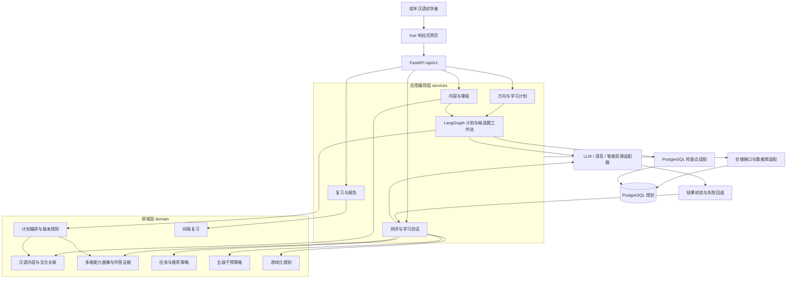
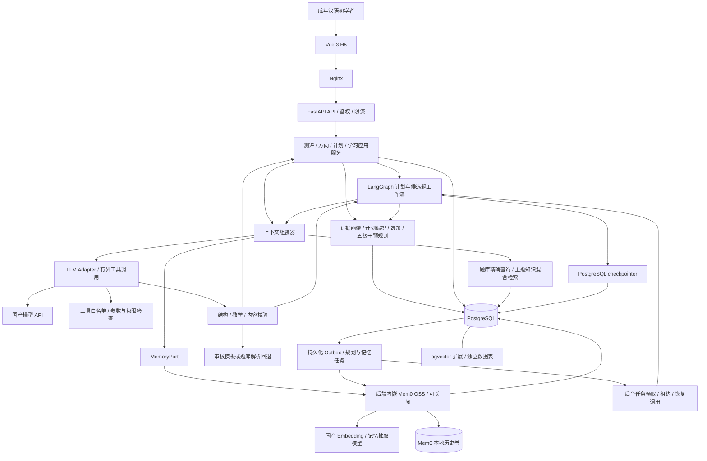
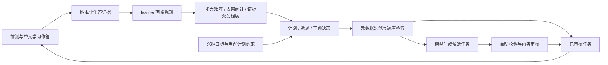
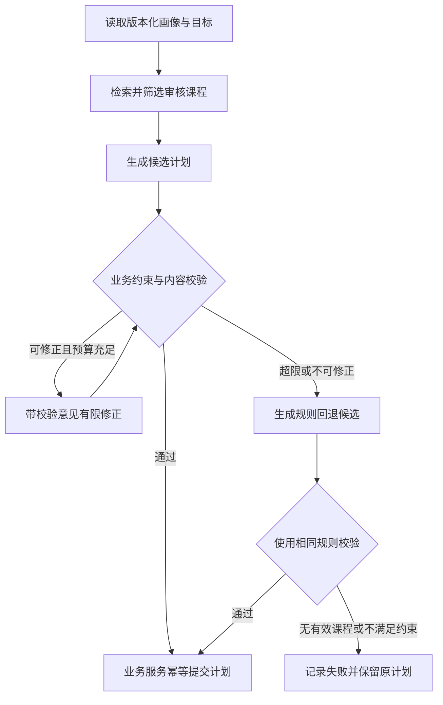

# OwlOwlGo 汉语学习网页：AI Agent 技术方案调研报告

> 版本：v1.6 · 补充 Node.js 前端开发与构建职责：2026-11-04
>
> 状态：**正式系统目标方案；LangGraph 局部引入已确认，新增能力待实现与验证**
>
> 原始调研代码基线：`df31445`；本次对照代码：`d6f0aeb`。第 2.1 节保留原始代码观察，并另列当前接入情况；LangGraph、画像组件、评分参数和接口扩展均未因本次文档更新而安装、实现或验证。
>
> 方案在“前测 → 方向选择 → 学习规划 → 学习与调整”主线上采用 LangGraph 多步骤工作流设计，保留第 3.5 节的多维学习者画像；本次补充 Node.js 在前端开发与构建中的职责。第 12 节的 2026-10-15 至 2026-10-28 学习计划作为历史提案保留，不代表已完成，也不是新的排期；模型规格、价格等历史调研数据未在本次更新中重新验证。

## 技术方案总览

下表汇总正式系统的目标选型。LangGraph 首先用于学习计划生成，随后复用于候选题生成；简单模型调用继续使用原生 API。

| 模块 | 技术选型 | 在 OwlOwlGo 中的作用 |
| --- | --- | --- |
| 整体架构 | 前后端分离、FastAPI 模块化单体 | 按内容、学习者、计划、任务、支架和复习划分职责 |
| 前端界面与状态 | Vue 3、TypeScript、Vite、Vue Router、Pinia | 前测、诊断、方向选择、学习计划、练习与画像展示 |
| 前端开发与构建环境 | **Node.js、npm**；当前 Docker 构建镜像为 `node:22-alpine` | 安装前端依赖，运行 Vite 开发服务器、类型检查、构建和测试；业务 API 由 Python/FastAPI 提供 |
| 后端接口与校验 | Python、FastAPI、Pydantic | 身份与权限检查、业务接口、请求和模型输出校验 |
| 业务数据 | PostgreSQL、SQLAlchemy、psycopg | 保存账户、作答证据、画像、课程、计划版本与学习进度 |
| 大模型调用 | 原生兼容 API、`LLM Adapter`；现有 DeepSeek 接入，目标方案继续比较 Qwen Plus 与 DeepSeek | 生成分析、计划说明、提示和候选题；具体模型版本通过验证后锁定 |
| AI 工作流 | **LangGraph `StateGraph`** | 串起读取画像、检索、生成、校验、有限修正和回退；候选题流程支持等待审核 |
| 执行状态与恢复 | **LangGraph + PostgreSQL checkpointer**；业务运行记录、Outbox、任务租约 | 检查点保存步骤状态；后台任务负责领取与恢复调用；业务服务负责防止重复生效 |
| 学习者画像与教学策略 | Python 领域规则、版本化评分策略 | 计算七维 × 六层能力矩阵、证据充分度和支架统计，辅助选题与计划调整 |
| 上下文组装 | Python 服务、SQL 精确查询、相关片段检索 | 按当前任务选择画像、目标、近期作答、计划和教学材料，控制输入长度 |
| 长期语义记忆 | Mem0 OSS、`MemoryPort`、pgvector | 保存有来源的困难摘要与偏好补充；成绩和画像以业务表为准 |
| 教学知识与 RAG | PostgreSQL 内容库、全文检索、pgvector、Embedding | 按主题、语言难度、能力维度与认知目标检索审核材料 |
| 日志与追踪 | Python 结构化日志、业务运行记录、图运行/检查点标识 | 追踪模型调用、执行步骤、版本、耗时及失败原因；按需接入 OpenTelemetry |
| 开发与部署 | Docker Compose、Nginx | 统一前后端与数据库环境；LangGraph 作为后端 Python 库运行 |

## 学习者画像维度与评判标准摘要

画像用于回答“在哪类任务上表现如何、使用了多少帮助、证据是否足够”。以下是第 3.5 节详细设计的阅读摘要；**权重与阈值是待校准的初始推荐策略，不是标准化汉语等级或已验证的能力量表。**

```text
学习者画像 = 语言能力 × 认知层级的能力矩阵
           + 兴趣与学习目标 + 支架需求 + 作答证据与充分程度
```

### 画像维度

| 语言能力维度 | 观察内容与任务示例 |
| --- | --- |
| 拼音与声调 | 拼音、声调、变调文字辨识；现有八题不测实际发音或听辨 |
| 词汇与句式 | 词义理解、句式选择、语法和情境表达 |
| 功能性阅读 | 阅读通知、邮件、说明并提取或使用信息 |
| 非连续性文本信息处理 | 理解表格、地图、广告、时刻表，整合多处信息 |
| 古诗理解 | 分级古诗的词句、意义和表达理解 |
| 文言文理解 | 经二语适配的文言词义、翻译与阅读 |
| 书面表达与修改 | 修改、拟写和开放表达；须有评分量规后才能形成能力分数 |

每个语言维度再按布鲁姆的六个认知过程分别记录，形成 **7 × 6 能力矩阵**；未覆盖的格子保留未知。

| 认知层级 | 记忆 | 理解 | 应用 | 分析 | 评价 | 创造 |
| --- | --- | --- | --- | --- | --- | --- |
| 任务表现 | 再认词义或事实 | 解释与概括 | 在新情境使用规则 | 比较和识别关系 | 依据标准判断并说明理由 | 组织信息、生成新表达 |

| 补充维度 | 记录内容 | 使用方式 |
| --- | --- | --- |
| 兴趣与目标 | 旅游、日常生活、校园、古诗等方向，以及学习目标和时间 | 选择内容主题，不直接改变能力分数 |
| 语言难度 | 材料难度与 HSK 候选范围、映射依据和版本 | 控制材料难度；不与布鲁姆层级互相换算 |
| 支架需求 | 实际最高提示等级、独立/辅助完成次数 | 区分独立掌握与提示后完成，决定后续帮助强度 |
| 证据充分程度 | 有效证据数、来源、评分版本与覆盖范围 | 判断是否需要补充测评，避免少量题目推断完整能力 |

内容建设目标以 HSK 1—4 级候选水平为主，HSK 5—6 级作为阅读与文化拓展；这是目标覆盖范围，不能由当前八题推断正式 HSK 等级，也不能把母语题库年级直接换算成 HSK。

### 评判依据与初始计分规则

| 评判项 | 初始规则 | 解释边界 |
| --- | --- | --- |
| 正确性 | 客观题由服务端判定，答对为 1、答错为 0 | 开放题另定量规，模型评语不能直接成为成绩 |
| 提示权重 | 0 级独立完成：1.00；1 级鼓励/无解题线索定向：0.85；2 级轻提示/证据定位：0.70；3 级分步支架：0.50；4 级完整讲解与答案：0.20 | 使用作答前实际获得的最高等级；看过答案不能算独立掌握 |
| 重试权重 | 首次为 1.00，每多一次尝试扣 0.10，最低 0.70 | 一次练习结束时结算，连续重试不重复增加证据数 |
| 难度权重 | 审核后的题目配置，限制在 0.8—1.2 | 当前为启发式参数，仍需真实作答数据校准 |
| 单题表现 | 正确性 × 提示权重 × 重试权重 × 难度权重，结果限制在 0—1 | 是推荐用表现指标，不代表正式考试分数 |
| 动态更新 | 首次分数取本次表现；之后为旧分数 × 0.7 + 本次表现 × 0.3 | 按目标能力单元格更新，保留证据和评分策略版本 |
| 无有效证据 | 分数为 `null`，显示“— / 证据不足” | 不按零分处理，也不把其他维度分数补过来 |
| 证据状态 | 0—1 次：`insufficient`；2—4 次：`emerging`；≥5 次：`stable` | `stable` 只表示达到当前数量门槛，不表示已经掌握 |
| 证据充分度 | `confidence = min(1, evidence_count / 5)` | 表示数量充分程度，不是掌握概率；重复提交不能增加该值 |
| 作答耗时 | 记录并用于解释与后续研究 | 当前公式不因作答较慢直接扣分 |

### 根据画像作出教学决策

| 证据与表现 | 初始教学动作 |
| --- | --- |
| 有效证据不足 2 条 | 补充同维度低负担诊断任务，暂不按分数做能力判断 |
| 证据达到最低门槛，分数 <0.40 | 优先降低语言难度，必要时提供 2 级支架 |
| 证据达到最低门槛，分数在 [0.40, 0.70] | 保持语言难度，围绕目标训练当前或相邻认知任务 |
| 证据达到最低门槛，分数 >0.70 | 依据目标减少帮助或增加认知挑战，仍遵守先修条件 |

决策同时考虑当前计划、兴趣目标和可用审核内容；不自动提升正式 HSK 等级，也不把认知层级作为学习者固定身份。完整字段、算法及数据边界见第 3.5 节。

## 1. 结论与选型原则

OwlOwlGo 采用的目标技术组合为 **Vue 3 H5 + FastAPI 模块化单体 + PostgreSQL + LangGraph + 国产大模型原生 API / Function Calling + Mem0 OSS + pgvector + Docker Compose**。

核心设计是：**前测和学习作答形成“语言能力 × 布鲁姆认知层级”的动态证据画像，结合兴趣目标、支架需求与证据充分程度，选择学习内容、顺序和帮助强度。大模型负责受约束的理解、表达与候选内容，后端负责业务状态、工具执行、恢复和输出校验。** 保留五级干预、领域分层和可替换 LLM Adapter，画像由现有 `learner` 领域负责，学习计划由 `planning` 领域编排。业务依据见[功能规格](../requirements/functional_spec.md)和[页面流程](product-design.md)，画像细化设计见第 3.5 节。

| 方面 | 建议结论 | 主要理由 | 决策性质 |
| --- | --- | --- | --- |
| 编排 | LangGraph 先用于学习计划生成，随后复用于候选题生成；简单分析沿用原生调用，LangChain Agent 不列为必需依赖 | 复用步骤、分支、检查点与恢复能力；教学规则保持纯 Python | 用户已确认局部引入；实现与故障恢复待验证 |
| 模型 | 国产模型；优先验证百炼 Qwen Plus 系列，DeepSeek 作为对照与候选备选 | 与原生工具调用、汉语教学和英文辅助场景适配；通过同一评测集确定具体版本 | 国产模型已定，供应商排序为建议 |
| 记忆 | 推荐 **Mem0 OSS 自托管**，由 `MemoryPort` 隔离；搭配 PostgreSQL + pgvector | 能独立于编排框架接入，并与现有 Python、PostgreSQL 技术栈复用 | 新增推荐，设 PoC 准入门槛 |
| 工具协议 | OpenAI 兼容 Chat Completions Function Calling + JSON Schema；HTTP API 使用 OpenAPI | 满足用户接口方向，适合国产模型适配；由服务端执行工具 | 用户已定方向的工程化解释 |
| RAG | 题库精确查找优先；扩展知识检索采用 pgvector + PostgreSQL 全文检索 | 当前任务有题目 ID 和知识点，不必每次语义搜索；扩展时兼顾同义表达和精确词项 | 分阶段引入 |
| 部署 | Docker Compose + Nginx，先单机；API 后续可扩实例 | 延续已有基础设施，适合课程 MVP 与小规模试验 | Docker 已定，拓扑为建议 |
| 性能与成本 | 异步 I/O、按需生成、模板回退、预算上限；先测量再扩容 | 避免每次点击都调用模型，控制等待时间与调用放大 | 目标需压测验证 |
| 安全 | 身份与数据权限、只读工具优先、最少数据出站、内容校验、审计和删除闭环 | 模型输出及记忆均不能成为权限、成绩或掌握度的权威来源 | 基线设计要求 |

选型按“业务适配、可验证性、数据边界、团队可维护性、运维成本”排序，不以框架数量或模型排行榜作为结论。

适用边界：本报告描述正式产品的目标设计，遵循已采纳的 [ADR-0001](../adr/0001-chinese-web-architecture.md)。模型、Mem0 与 RAG 是目标系统中的可关闭能力，故障时由结构化学习状态、审核内容和规则流程继续支撑学习。已有固定题目 Demo 仅说明代码现状，不作为正式系统的设计上限。语音评分、书写识别和支付仍需专项需求确认。

本次增加 LangGraph 工作流编排与 PostgreSQL 检查点，具体边界见第 4 节。长期语义记忆仍优先验证 Mem0 OSS，经 `MemoryPort` 隔离；模型调用仍使用原生兼容 API 与 `LLM Adapter`。业务运行记录、Outbox 和任务租约负责接收、派发与并发控制，LangGraph 负责图内执行与恢复；不再另写一套重复的图步骤恢复引擎。LangChain Agent、Celery/Redis、Manus 及自建语义记忆均不作为本次必选项。

## 2. 仓库现状与需求约束

### 2.1 已读材料及代码证据

下表为原始调研基线 `df31445` 的观察，不代表当前仓库仍只有骨架。2026-11-04 对照 `d6f0aeb`：已存在[学习进度与分析接口](../../code/backend/app/api/v1/endpoints/learning.py)、[JSON 学习记录仓储](../../code/backend/app/db/repositories/learning.py)、[八题作答证据契约](../../code/backend/app/schemas/learning.py)及 [DeepSeek 前测分析 Agent](../../code/backend/app/services/agents/assessment.py)。这些是代码接入情况，本次未运行验证；尚未发现本节新增的七维 × 六层画像数据结构及更新函数，也未发现所述 700 篇题库的完整导入与标注产物。不能将外部画像文档中的实现声明直接作为本仓库完成状态。

| 证据 | 当前观察 | 对选型的影响 |
| --- | --- | --- |
| [README](../../README.md)、[问题定义](../requirements/problem_definition.md) | 面向成年汉语初学者，优先来华留学生；简体字、带调拼音、英文辅助、生活情境与文化卡；精选内容与五级干预 | 以受控学习流程为中心，保留规则基线 |
| [项目计划](../mgmt/project-plan.md) | 文件仍记录第 1 周状态；第 6 周确认设计，第 10 周 MVP，第 14 周部署 | 文件状态不能用当前自然日期自动推断；两周工作用于形成设计与验证证据 |
| [后端依赖](../../code/backend/pyproject.toml)、[应用入口](../../code/backend/app/main.py) | Python ≥3.12，FastAPI、Pydantic Settings、SQLAlchemy、psycopg、Uvicorn；入口只创建 `FastAPI` 对象 | 复用技术栈；尚无业务路由，不能宣称 Agent 已运行 |
| [领域模块](../../code/backend/app/domain/intervention/README.md)、[LLM 边界](../../code/backend/app/integrations/llm/README.md) | 领域逻辑使用可解释规则；LLM 层负责供应商、提示和校验 | 掌握度、计分、权限、干预等级由后端控制 |
| [既有系统设计](#system-design)、[数据模型](../software/data-model.md)、[API 草案](../software/api-contract.md)、[ADR-0001](../adr/0001-chinese-web-architecture.md) | 已有汉语模块、内容版本、分维度状态、复习与适配器边界；模块化单体已采纳 | 本报告补充技术调研，不替换这些既有职责与接口约定 |
| [非功能需求](../requirements/nonfunctional_spec.md) | 普通 API P95 ≤500ms、作答本地决策 P95 ≤800ms；汉语内容由具备教学能力的审核者复核 | 性能基线沿用 NFR-1/2；模型延迟与记忆指标另列为建议 |
| [数据库会话](../../code/backend/app/db/session.py)、[配置](../../code/backend/app/core/config.py)、[安全](../../code/backend/app/core/security.py) | 均为占位说明；数据库迁移也尚未初始化 | 数据持久化、身份认证和恢复属于待开发能力 |
| [前端依赖](../../code/frontend/package.json)、[路由](../../code/frontend/src/app/router/index.ts) | Vue 3、TypeScript、Vite、Pinia、Vue Router；路由表仍为空，但 App.vue 直接挂载拼音声调 Demo | 已有固定 8 题、即时反馈、计分和重测；仅前端内存状态，不等于后端学习闭环 |
| [Compose](../../infrastructure/compose.yaml)、[Nginx](../../infrastructure/nginx/default.conf) | 已定义 frontend、backend、database、gateway；PostgreSQL 17；未配置 pgvector、健康检查、任务工作进程 | Docker 基础可沿用，仍需补齐运行与持久化配置 |
| [CI](../../.github/workflows/ci.yml)、[AI 评测目录](../../tests/ai-evaluation/README.md) | CI 检查目录结构与 Python 语法，存在前端锁文件时执行 npm ci 与构建；当前已有 package-lock.json 和拼音 Demo 的 Vitest 测试，CI 未调用 npm test | 当前检查通过不等于功能、模型质量或可部署性通过 |

### 2.2 驱动架构的业务要求

产品主线为“前测与诊断 → 方向选择 → 学习计划 → 单元学习 → 复习与调整”。旅游、校园、古诗等是语言学习的主题，不能改变产品以汉语学习为核心的定位。

1. 围绕初级汉语的小课，支持拼音/声调文字识别、汉字识读、生活情境、作答重试、逐级提示、迁移题与复习。操作、题目和解释提供英文辅助，不能要求初学者先读懂中文。
2. 五级干预为 0 暂不介入、1 鼓励再试、2 轻提示、3 分步支架、4 完整讲解。等级 0 通常无需模型；等级 1 优先使用审核过的模板。
3. 每次策略决策必须保存输入事件范围、动作、原因和版本，支持离线回放。
4. AI 输出要防止错误、超纲与提前泄露答案；降级时仍能完成练习。
5. 产品定义规划先做 5–10 人访谈、10–15 人可用性测试；正式实验人数仍待确认。第 10 节的 50 日活仅为容量与费用情景，不是已有用户或已批准招募规模。模型质量、预算和团队技能仍需验证。

### 2.3 最新需求与设计对应

以下条目同步写入[功能规格](../requirements/functional_spec.md)，均为待实现设计。原来的前测、偏好和任务推荐继续保留，补充的是三者如何形成可保存、可执行、可调整的学习计划。

| 最新需求 | 已有基础 | 本次补充 | 需求编号 |
| --- | --- | --- | --- |
| 前测与诊断 | 分维度测评、作答和能力状态 | 明确结果版本、证据充分程度及规划输入 | FR-2.1～FR-2.6 |
| 方向选择 | 学习目标、内容偏好、情境课程 | 方向目录、选择结果及资料覆盖范围 | FR-12.1～FR-12.3 |
| 学习规划 | 下一题推荐、课程地图、先修关系 | 计划、计划版本、单元顺序、生成状态和调整原因 | FR-13.1～FR-13.5 |
| 分层学习与支架 | 难度、知识点、五级提示 | 任务认知目标标签，区分语言水平、布鲁姆层级和帮助等级 | FR-13.6 |
| 主题知识库 | 题库精确查询、混合检索 | 按主题和学习目标检索规划材料，保留内容来源与版本 | FR-13.7 |

## 3. 总体架构与职责

<a id="system-design"></a>

### 3.1 系统设计与模块职责

本节在原有汉语学习模块上补充方向、学习规划与多维画像。以下结构为正式系统的目标设计；当前代码已有 JSON 进度保存和前测分析接入，仍需向 PostgreSQL 业务模型及下述画像设计演进，具体代码观察见第 2.1 节。

#### 3.1.1 总体结构

采用模块化单体，保留 Vue 3 + TypeScript 前端、FastAPI 后端和规划中的 PostgreSQL。初期单服务部署，避免为尚未验证的功能引入微服务。前端按用户能力拆分，后端按领域、应用编排和基础设施分层。



#### 3.1.2 前端模块

前端使用 Vue 构建界面，Node.js 提供开发工具的运行环境，npm 管理依赖与脚本。[前端脚本](../../code/frontend/package.json)定义了 Vite 开发服务器、TypeScript 类型检查与构建，以及 Vitest 测试；这些工具在开发或构建阶段由 Node.js 运行。构建后的页面由浏览器执行，正式部署由 Nginx 提供静态资源。业务后端使用 Python/FastAPI，前端工具链使用 Node.js，二者职责独立。

| 目录 | 职责 | 对应页面 |
| --- | --- | --- |
| `src/app/` | 应用初始化、路由、全局状态 | 全局布局 |
| `src/features/profile/` | 目标、自报水平、辅助语言与偏好；与作答形成的能力画像分开管理 | 引导与个人设置 |
| `src/features/assessment/` | 分维度测评流程 | 入门测评、结果 |
| `src/features/directions/`（拟新增） | 方向目录、选择与覆盖说明 | 学习方向选择 |
| `src/features/planning/`（拟新增） | 生成状态、计划与单元、调整说明 | 学习计划与路径 |
| `src/features/phonetics/` | 拼音、声调、变调的训练交互 | 声调训练 |
| `src/features/characters/` | 汉字识读、部件、后续笔顺交互 | 汉字学习 |
| `src/features/scenarios/` | 校园与生活情境练习 | 课程地图、学习关卡 |
| `src/features/culture/` | 文化卡与关联例句 | 文化探索 |
| `src/features/review/` | 错题、到期复习 | 今日复习 |
| `src/features/progress/` | 能力矩阵、支架使用、证据充分程度与学习报告 | 我的进度 |
| `src/shared/` | 组件、接口、类型与工具 | 跨模块复用 |

页面只负责呈现与交互；由应用状态维护会话，API 客户端统一处理错误。掌握度、任务计分与权限最终由服务端确认。英文辅助作为首版界面语言方案，不把中文阅读能力作为入门前提。现有 Demo 已扩展学习路径、单元练习、后测和报告，并有进度保存接口；上述目录职责和能力矩阵仍是目标模块划分，不表示全部页面已实现。

#### 3.1.3 后端分层与领域

| 层 | 目录 | 允许的依赖与职责 |
| --- | --- | --- |
| 接口 | `app/api/v1/`、`app/schemas/` | 校验请求、身份、序列化；调用 services |
| 应用 | `app/services/`，拟新增 `app/services/workflows/` | LangGraph 编排计划与候选题；普通服务处理单次分析；控制事务和幂等 |
| 领域 | `app/domain/` | 纯领域模型与规则；不依赖 FastAPI、LangGraph、数据库或供应商 SDK |
| 基础设施 | `app/db/`、`app/integrations/` | 持久化、外部模型、音频与字形资源适配 |
| 配置 | `app/core/` | 环境配置、日志、安全与运行约束 |

领域模块：`content` 负责方向目录、课程、汉语条目、文化卡及审核；`learner` 负责知识点状态、作答证据聚合、“语言能力 × 认知层级”画像及版本更新；拟新增 `planning` 负责计划单元编排、先修约束和版本调整；`task` 根据画像在当前单元中选题；`intervention` 结合实际支架使用记录决定五级帮助；`review` 负责到期复习；`gamification` 负责奖励约束。用户账户、显式偏好与学习者能力状态分别管理。画像引擎是现有 `learner` 中的 Python 规则模块，不新增自治 Agent 或独立微服务。

LLM 生成候选提示、解释和计划说明；计划单元必须引用后端提供的有效课程，先修关系、难度和学习时间约束由业务规则检查。策略层决定干预级别；校验失败返回已审核模板。语音评分与书写识别分别作为可选适配器，不能用浏览器朗读冒充评分。外部服务缺失不应阻断文本练习。

LangGraph 图和节点放在应用层，调用这些领域规则及现有 Adapter；检查点连接与初始化由基础设施层管理。现有 `AssessmentAgent` 的单次前测分析继续直接调用模型，不为统一形式而迁移。新增工作流目录、依赖和检查点表均为待实现。

#### 3.1.4 数据与接口

既有实体和数据关系见 [data-model.md](data-model.md)，版本化接口规划见 [api-contract.md](api-contract.md)。本次仅整合架构文档；画像新增实体及接口衔接列在第 3.5.6 节，尚未同步为这两份草案的完整契约，也未创建数据库迁移。正式实现时按纵向流程补齐 schema、services、domain、repository 和页面。

学习事件记录作答、耗时、求助、干预级别与策略版本；奖励和提交按幂等键去重。模型不得直接修改权限、分数或数据审核状态。正式内容必须有版本、来源、许可与审核记录。

#### 3.1.5 部署与实施顺序

本地前端通过 Node.js 运行 Vite 开发服务器（`npm run dev`），通过 `npm run build` 完成类型检查与静态资源构建；脚本在前端目录执行。FastAPI 后端独立运行并提供 API。Docker Compose/Nginx 延用既有基础设施，生产部署另行验证。

正式系统的实施顺序：审核题库和主题目录 → 前测与诊断 → 方向选择与计划编排 → 单元学习、进度与调整 → 模型、记忆和主题检索接入 → 渐进干预、复习与运行保障。原有构建、语法检查仅反映骨架状态，不能代替业务完成判定。

### 3.2 AI 增强架构与职责



图示为后续 AI 增强的目标设计，延续已采纳 ADR-0001 的模块化单体。Mem0 首先通过 MemoryPort 内嵌后端，不新增独立微服务；在单实例、单工作进程下验证辅助存储与后台抽取。未来确需独立扩容时，再经 ADR 评审考虑拆分。现有 LLM、语音和书写资源适配边界均保留；当前代码的 DeepSeek 前测分析接入不等于图中画像、记忆与检索能力已全部实现。

| 组件 | 负责 | 关键边界 |
| --- | --- | --- |
| 领域策略 | 判分、证据画像与知识状态更新、任务选择、干预动作 | 相同输入和策略版本可复现；未测单元格不能记为零分；不能依赖模型自由文本 |
| LangGraph 工作流 | 多步骤执行、条件分支、有限重试、检查点恢复和审核暂停 | 不直接决定成绩或计划生效；由应用调度恢复，业务写入仍须幂等 |
| 上下文组装器 | 选择当前题、必要行为、有效记忆和知识片段 | 必须带来源、权限、有效期和 token 预算 |
| LLM Adapter | 模型调用、差异适配、工具协议归一化、用量统计 | 不直接开放数据库、任意 URL 或任意代码执行 |
| ToolExecutor | 工具名称解析、Schema 校验、鉴权、超时和审计 | 模型只能提出调用请求；执行权在服务端 |
| MemoryPort | 搜索、写入候选、纠正、删除 | SDK 返回结构不传入领域层，失败可禁用个性化记忆 |
| 校验器 | Pydantic 结构检查、等级约束、答案泄露与教学内容检查 | 完成校验后才能展示，不把语法正确等同于教学正确 |

### 3.3 前测、方向与学习规划的完整流程

1. **前测与诊断。** 服务端保存题目版本、作答和评分规则版本，生成不可变的诊断快照，并以有效作答初始化第 3.5 节的能力矩阵。未完成测评不能生成正式诊断；未覆盖的单元格标记证据不足。前测参考、能力维度和评分解释需经过教学验证，不用现有八题文字识别结果推断听说能力或正式汉语等级。
2. **选择方向。** 用户从已启用的主题目录选择旅游、日常生活、校园交流或古诗等方向，保存为带版本的结构化偏好。主题用于组织语言目标；资料不足或明显超出能力范围时，说明覆盖情况并推荐基础内容，不能直接生成无依据课程。
3. **编排学习计划。** 由 LangGraph 串联读取上下文、内容筛选、候选生成、校验、有限修正和提交。输入为诊断快照、最新能力矩阵与知识状态、方向、学习目标和时间预算；领域规则结合证据充分程度与支架需求筛选已审核课程、补足先修知识。RAG 提供主题材料，LLM 辅助计划说明和候选表达；课程 ID、先修关系、难度、时间约束仍由领域规则核验。
4. **执行计划。** 计划包含目标、顺序、课程与内容版本、预计时长、选择理由和完成条件。学习会话绑定计划版本及单元；`task` 在当前单元中选下一题，不能绕过计划先修约束。单元完成由学习记录推导，前端或模型不能自行标记完成。
5. **调整计划。** 用户改变目标/方向、完成重测、单元结束后出现需要调整的表现时，生成新计划版本。保存触发原因、旧版本及保留/替换的单元；已完成记录不丢失，正在学习的单元不被静默替换。新版本激活时检查旧计划及档案版本，冲突任务不能覆盖最新选择。

计划生成失败时保留已有计划；没有可用计划时，根据已审核课程和相同先修规则给出基础路径。若内容覆盖不足，则返回可解释的限制，不用模型编造课程补位。依赖已停用或发生实质修订的内容时，暂停相应单元并通过计划修订替换，保留历史作答。

语言水平/难度、知识点掌握状态、布鲁姆认知目标、0–4 级帮助分别保存，具体表示与更新规则见第 3.5 节。布鲁姆层级用于设计学习任务，最近发展区用于指导支架策略；候选标签、阈值和教学效果仍需验证，不直接把这些理论换算成成绩。

### 3.4 运行能力用什么实现

| 能力 | 实现技术 | 需要编写的应用逻辑 |
| --- | --- | --- |
| 模型调用 | Python、兼容 API、`LLM Adapter`、Pydantic | 提示模板、输入输出校验、工具执行和回退；不强制改用 DashScope 专用 SDK |
| 学习者画像 | Python `domain/learner` 规则、Pydantic、PostgreSQL | 聚合作答证据，更新能力矩阵、支架统计和画像版本；不由模型或 Mem0 直接改分 |
| 上下文组装 | Python 服务、SQLAlchemy/psycopg、PostgreSQL | 按任务读取诊断、方向、计划、当前题和必要摘要；组装有限长度上下文 |
| 工作流执行与恢复 | LangGraph、`StateGraph`、PostgreSQL checkpointer | 定义节点与分支、状态 Schema、恢复入口、校验回退与审核暂停 |
| 后台任务与业务一致性 | Python 后台任务、PostgreSQL 运行表/Outbox/租约 | 接收与领取任务、重启后调用图恢复、幂等提交、过期任务取消；Celery/Redis 不是必选项 |
| 结构化记忆 | PostgreSQL 业务表 | 保存最新档案、诊断、计划和进度，显式用户选择直接更新 |
| 长期语义记忆 | `MemoryPort`、Mem0 OSS、pgvector | 配置模型和存储，控制候选写入、来源、隔离、失效、纠正和删除 |
| 运行记录 | Python logging、PostgreSQL 运行记录 | 关联请求/计划/任务 ID、版本、耗时、失败和回退原因；按需增加 OpenTelemetry |

这些是待实现的职责分配，不表示安装依赖即可自动完成。Mem0 不替代业务数据、上下文组装或任务恢复；规划的事实输入以 PostgreSQL 为准。生成计划时优先读取能力和方向，逐题提示时优先读取当前题、已给帮助与相关表现，避免把全部历史发送给模型。

### 3.5 多维学习者画像：从作答证据到教学决策

本节整合用户提供的《OwlOwlGo 多维学习者能力画像架构》v1.0。正式系统采用其多维证据模型；其中权重、阈值和 HSK 候选范围作为可配置的初始策略，后续使用真实二语学习数据校准，不作为已验证的能力量表。画像不是一个总分，也不把学习者固定归类为“记忆型”或“应用型”。

```text
学习者画像 = 语言能力 × 认知层级的能力矩阵
           + 兴趣与学习目标 + 支架需求 + 作答证据与充分程度
```

#### 3.5.1 四层职责与能力维度

| 层次 | 输入与职责 | 实现与输出 |
| --- | --- | --- |
| 证据层 | 保存题目及版本、答案、判分、耗时、重试与实际提示使用 | 现有测评/学习会话服务扩展，PostgreSQL 保存可追溯作答 |
| 画像层 | 按语言能力与认知层级聚合，区分独立完成和辅助完成 | `domain/learner` 纯 Python 规则，输出版本化能力矩阵与支架统计 |
| 决策层 | 结合画像、兴趣目标、计划约束和可用内容，选定下一任务与帮助强度 | `planning`、`task`、`intervention` 复用画像快照并保存决策理由 |
| 内容层 | 按难度、能力、认知目标筛选审核内容，必要时生成候选题 | `content`、RAG、LLM Adapter；校验与审核后才可发布正式题目 |



语言能力采用以下七个可扩展维度。它们是内容组织与证据聚合的初始分类，并非已经证明相互独立的心理测量维度；现有知识点仍保留，不能被七个大类替代。

| `language_dimension` | 名称 | 拟使用的证据与边界 |
| --- | --- | --- |
| `phonetics` | 拼音与声调 | 现有八题仅能提供文字辨识证据；不能推出实际发音或听辨能力 |
| `vocabulary_grammar` | 词汇与句式 | 词义、句式、语法及生活情境任务 |
| `functional_reading` | 功能性阅读 | 通知、邮件、说明等任务 |
| `multimodal_information_literacy` | 非连续性文本信息处理 | 表格、地图、广告、时刻表等任务，不泛化为完整信息素养 |
| `poetry_comprehension` | 古诗理解 | 分级古诗材料与题目，作为文化阅读扩展 |
| `classical_chinese_comprehension` | 文言文理解 | 经二语适配的文言词义与阅读任务，作为扩展 |
| `written_language_use` | 书面表达与修改 | 修改、拟写与开放表达；评分量规未落实时只提供反馈，不更新能力分数 |

认知层级使用修订版布鲁姆分类，任务字段统一为现有设计中的 `cognitive_level`：

| 枚举值 | 层级 | 可观察任务示例 |
| --- | --- | --- |
| `remember` | 记忆 | 再认词义、原句和事实 |
| `understand` | 理解 | 解释、概括、分类和提取意义 |
| `apply` | 应用 | 在新情境中使用表达或规则 |
| `analyze` | 分析 | 比较信息、分解内容和识别关系 |
| `evaluate` | 评价 | 根据材料或标准判断并说明理由 |
| `create` | 创造 | 组织信息并生成新文本或方案 |

源文档的 `bloom_level` 在导入时映射为 `cognitive_level`，不维护两套含义相同但可能冲突的字段。首版每个计分任务标记一个主要能力维度和认知目标；涉及多个维度时先拆分评分点，不能把一次答对无差别写入多个单元格。兴趣沿用旅游出行、日常生活、校园交流、古诗入门等 `direction_ids`，决定学习主题，不直接改变能力分数。

#### 3.5.2 语言难度、HSK 候选范围与覆盖边界

能力矩阵的两个轴是**语言能力维度与认知过程**；HSK 候选范围是材料难度的另一个坐标，支架等级则表示帮助强度。简单自我介绍也可以是 `create` 任务，不能把“记忆→创造”换算成“HSK 1→6”，也不要求每个知识点机械走完六层。

沿用源文档的产品范围建议：优先建设面向 HSK 1—4 级候选水平成人二语学习者的内容，HSK 5—6 级作为阅读与文化拓展；不承担 HSK 7—9 级正式测评。这是内容建设目标，不表示当前 Demo 已覆盖这些等级，也不表示系统能凭文字题认定正式 HSK 水平。《国际中文教育中文水平等级标准》用于内容分析参考，标准等级、考试等级、系统估计标签不得直接视为等价。

源文档提到约 700 篇中国三至九年级母语语文材料，作为待核实、待授权与待适配的候选资源。母语学段不能直接换算成二语等级；古诗、文言文也不能只凭所在年级判断语言难度。候选材料拟保存 `hsk_min_candidate、hsk_max_candidate、hsk_mapping_status、hsk_mapping_basis、mapping_version`，分析依据包括词汇、句法、篇幅、信息整合与文化知识要求。自动估计标记 `ai_estimated`；内容审核通过不等于难度已校准，校准状态须有真实学习数据和方法记录支撑。

报告同时展示任务覆盖的语言难度与题型范围，不能把初级材料上的高分外推为该能力在所有难度上均已掌握。未测量的听力、口语、写作等能力保持未知。

#### 3.5.3 支架记录与能力单元格

计分使用**作答前实际获得的最高帮助等级**，不使用系统原本计划提供的等级。为与第 2.2 节现有五级干预一致，初始映射如下：

| `hint_level` | 实际帮助 | 初始提示权重 |
| ---: | --- | ---: |
| 0 | 独立完成，未获得提示或答案 | 1.00 |
| 1 | 鼓励再试、不含解题线索的任务定向 | 0.85 |
| 2 | 轻提示、证据定位或关键线索 | 0.70 |
| 3 | 解题策略、分步支架 | 0.50 |
| 4 | 完整讲解与答案 | 0.20 |

源文档中的“任务定向提示”若已经包含解题线索，应归入等级 2；实现时按实际内容及干预策略版本映射，不能只复用编号。查看答案后完成可以记录辅助学习表现，但不能计为独立掌握证据。画像同时保留独立完成与辅助完成次数、提示等级分布，避免加权分数隐藏二者差异。

每个当前单元格以 `user_id + language_dimension + cognitive_level` 定位，历史快照另带 `learner_state_version`，保存分数、证据状态和来源。例如以下为合成示例，非实测结果：

```json
{
  "language_dimension": "functional_reading",
  "cognitive_level": "apply",
  "score": 0.64,
  "confidence": 0.8,
  "evidence_count": 4,
  "status": "emerging",
  "independent_count": 1,
  "assisted_count": 3,
  "learner_state_version": 7,
  "scoring_policy_version": "profile-heuristic-v1",
  "last_updated_at": "2026-11-04T10:00:00Z",
  "evidence_ids": ["attempt-101", "attempt-108", "attempt-113", "attempt-120"]
}
```

没有有效证据时 `score=null、confidence=0、evidence_count=0、status=insufficient`，界面显示“— / 证据不足”，不能填零分。初始状态阈值为 0—1 次有效证据 `insufficient`、2—4 次 `emerging`、5 次及以上 `stable`；`stable` 只表示达到当前数量门槛，不表示能力已掌握或统计上稳定。这里的 `confidence` 是证据充分度指标，展示时说明算法，不能解释成“80% 的概率已经掌握”。

#### 3.5.4 可解释的初始更新规则

正式系统通过版本化策略接口更新画像，首先实现源文档中的启发式基线，参数如下：

```text
重试权重 = max(0.70, 1 - 0.10 × (尝试次数 - 1))
单题表现 = clamp(正确性 × 提示权重 × 重试权重 × 难度权重, 0, 1)
难度权重 ∈ [0.8, 1.2]，来自审核后的题目配置
首次有效证据：新分数 = 单题表现
后续有效证据：新分数 = 旧分数 × 0.7 + 单题表现 × 0.3
证据充分度 confidence = min(1, evidence_count / 5)
```

客观题正确性由服务端判定为 0 或 1；开放题须有独立定义、可追溯的评分量规，模型生成的评语不能直接进入公式。耗时保留作解释和后续研究，当前公式不扣除“答得慢”的分数。第一次观测不使用虚构的旧分数 0，否则会把缺少证据误当成低能力。

一次题目练习中的连续尝试合并为一条用于画像的最终证据，保留全部尝试历史和最高已用提示；中途提交只记录尝试，练习结束时结算一次。同题连续重试、重复 HTTP 提交或任务恢复均不增加去重后的证据数，跨次重复练习也不能据此宣称是统计独立样本。服务端以练习实例与策略版本去重，确定事件顺序后更新；最终作答、画像更新与新状态版本在事务中提交。无效题或错误评分撤销后按有效事件重算，不能继续保留受污染的分数。

权重与数量阈值只服务于初始推荐，不是标准化成绩或正式等级。规则变化保留旧快照，按新策略生成新画像版本；必要时按语言难度分组校准。后续可比较 IRT、BKT 或认知诊断模型，但只有在题量、真实样本和验证结果支持时再替换，不将候选算法视为当前已选依赖。

#### 3.5.5 画像如何影响计划、选题和提示

| 条件 | 初始决策 | 必须保留的约束 |
| --- | --- | --- |
| 目标单元格证据不足 | 优先选择同维度、负担较低的诊断任务补充证据 | 不按零分降级；无合适审核内容时说明缺口 |
| 证据达到最低门槛且分数 <0.40 | 优先降低语言难度，必要时从 2 级支架开始 | 不直接断言认知能力不足；记录调整理由 |
| 证据达到最低门槛且分数在 [0.40, 0.70] | 保持语言难度，围绕目标训练当前或相邻认知任务 | 主题、先修知识与计划时间仍须满足 |
| 证据达到最低门槛且分数 >0.70 | 依据目标减少支架，或增加认知挑战 | 不自动提高 HSK 标签，不跳过先修知识 |

初始最低门槛为同单元格至少 2 条有效证据，仅作为可回退的推荐依据；不把该门槛当作科学置信结论。连续失败时优先复核材料难度、任务理解和帮助是否适合，不给学习者贴固定能力标签。

例如，功能性阅读的理解单元格为 0.74、应用为 0.43，且用户选择旅游方向：规划服务可以在当前计划允许的范围内，选择审核通过的时刻表材料，让学习者安排行程，而不是继续大量复述材料。是否给提示及给到哪一级，由该用户的实际支架记录与 `intervention` 策略共同决定。

每次推荐保存 `learner_state_version、profile_version、target_cell、target_difficulty、hint_level、evidence_ids、content_version、policy_version、reason`。兴趣、国籍、母语或用户自报能力不能直接写入能力得分；最近发展区只作为渐进支架的设计依据，不能声称系统已测得一个精确的“最近发展区数值”。

#### 3.5.6 数据、接口、记忆与计划版本衔接

| 对象 | 拟保存的信息 | 与已有设计的关系 |
| --- | --- | --- |
| `LearnerProfile` | 目标、方向、时间、辅助语言、自报水平、`profile_version` | 保留既有显式档案；不允许用户 PATCH 修改能力分数 |
| `AssessmentAttempt / Attempt` | 题目与内容版本、主要能力/认知目标、答案、判分、耗时、尝试次数、最高提示、难度权重、策略版本 | 扩展既有作答证据；身份、判分、标签和提示历史由服务端确认 |
| `LearnerAbilitySnapshot / LearnerAbilityCell`（拟新增） | 七维 × 六层矩阵、独立/辅助统计、证据引用、覆盖范围、`learner_state_version`、评分策略版本 | PostgreSQL 保存结构化能力快照；未知单元格可稀疏存储 |
| `LearnerKnowledgeState` | 具体知识点掌握估计、证据及 `knowledge_state_version` | 保留细粒度知识状态；与能力矩阵共享作答证据，但不能互相直接替代 |
| `AssessmentResult / PlanRevision / PlanningRun` | 所依据的画像快照与其他输入版本 | 诊断固定引用当时画像；计划生成、恢复和激活核对版本，避免旧画像覆盖新选择 |

接口沿用仓库命名，不直接平行引入源文档中的 `/learner-profile`、`/attempts` 等另一套入口：

| 接口（前缀 `/api/v1`） | 画像接入方式 | 状态 |
| --- | --- | --- |
| GET/PUT `/learning/progress`、POST `/learning/analysis` | 当前 Demo 的保存与分析入口；已有 `revision` 和八题证据 | 当前代码已存在，不能等同于多维画像已实现 |
| GET/PATCH `/me/profile` | 读写显式偏好与目标，能力结果只读 | 既有目标 API 草案 |
| GET `/me/progress` | 拟扩展返回能力矩阵、覆盖范围、支架统计、证据充分度与画像版本 | 画像响应结构待补入 API 草案 |
| POST `/assessments/{id}/attempts`、`/assessments/{id}/complete` | 接收答案，满足完成条件后发布诊断及关联画像快照 | 既有目标 API 草案，画像衔接待实现 |
| POST `/learning-sessions/{id}/attempts` | 提交作答后，由业务服务更新证据与画像，返回反馈和状态摘要 | 既有目标 API 草案，不能接受客户端指定分数/置信度 |

下一题选择由已有会话/任务服务执行；候选题生成通过受控后台任务进入内容审核流程，不新增可直接发布题目的公开生成接口。实现时先把本节的实体和响应细节同步到数据模型、API 契约，再迁移现有 JSON 进度数据；现有资料不足以补算的字段保留未知，不制造历史提示与能力数据。

画像是**结构化业务事实**，通过 SQL 精确读取，不存入 Mem0 作为权威评分。Mem0 只可保存带来源的困难摘要或偏好补充；摘要与画像冲突时以有效业务快照为准。上下文组装只读取当前任务相关的单元格、证据范围和帮助历史，不把整个矩阵与全部作答发送给模型。

## 4. 编排框架：LangGraph 局部编排与受控运行

### 4.1 为什么这样选

正式系统的学习计划与候选题流程涉及多步生成、校验后修正、回退、状态恢复，以及候选题的等待审核。采用 LangGraph 管理这些步骤，保留普通 Python 领域规则和原生模型 Adapter。首条接入流程为学习计划生成，完成后再复用到候选题生成；登录、判分、画像更新和现有单次前测分析不迁入图中。

LangGraph 支持把确定性代码与模型调用放在同一工作流中，并提供状态持久化、流式事件和暂停恢复能力；使用它不要求同时采用 LangChain 的 Agent 或模型封装。[官方概述](https://docs.langchain.com/oss/python/langgraph/overview)。本项目选择“图节点调用现有服务”的方式，不引入多个自治 Agent 协商。

| 备选 | 已核实的定位 | 本项目取舍 |
| --- | --- | --- |
| 原生模型 API + Python 服务 | 服务端直接管理调用、工具执行和输出校验 | **继续采用**。处理单次分析，并作为 LangGraph 节点内部的模型调用与业务实现 |
| LangGraph | 状态、步骤、分支、检查点及暂停恢复 | **采用**。先用于学习计划，后用于候选题；新增依赖与恢复流程待实现 |
| LangChain Agent | 提供模型、工具、提示及 middleware 组成的 Agent harness | **暂不作为必需依赖**。当前保留原生 Adapter，无需同时迁移模型调用。[官方说明](https://docs.langchain.com/oss/python/langchain/overview) |
| CrewAI | 通过 agents、tasks 和 process 组织协作 | 内容策划等离线多人角色场景可再评估；在线逐题反馈当前没有协作收益证据。[官方说明](https://docs.crewai.com/en/concepts/crews) |
| AutoGen AgentChat | 提供多 Agent 应用与团队协作抽象 | 暂无在线讨论式协作需求，额外轮次会增加成本和调试复杂度。[官方说明](https://microsoft.github.io/autogen/stable/user-guide/agentchat-user-guide/index.html) |

LangGraph 减少的是通用步骤调度与检查点代码；节点中的教学规则、权限、调用预算和幂等写入仍由应用负责。代价是维护图状态 Schema、工作流版本与检查点兼容性，实施范围限定在上述多步骤流程。

### 4.2 图状态、业务状态与版本

系统采用一个逻辑上的学习伙伴。出题、策略、校验是独立模块，通过图节点调用，不需要各包装成自治 Agent。图状态保存步骤输入、中间结果与分支依据；业务表保存正式诊断、计划、成绩和进度。

建议显式建模三类状态：

- 学习会话：`ACTIVE → AWAITING_ATTEMPT → FEEDBACK_READY → ACTIVE/COMPLETED`，另有 `PAUSED`。
- 单次反馈运行：`CREATED → CONTEXT_READY → MODEL_PENDING → VALIDATING → SUCCEEDED/FALLBACK`；必要时进入 `WAITING_REVIEW`、`CANCELLED` 或带原因的 `FAILED`。
- 计划生成运行：`QUEUED → BUILDING_CONTEXT → SELECTING_CONTENT → GENERATING → VALIDATING → SUCCEEDED/FALLBACK`，另有 `FAILED/CANCELLED`。无需模型时跳过 `GENERATING`；模型失效可用规则候选继续校验。运行状态与计划版本的 `DRAFT/ACTIVE/SUPERSEDED/COMPLETED` 生命周期分别管理。

计划运行持久化 `assessment_id、diagnosis_version、profile_version、learner_state_version、knowledge_state_version、base_plan_revision_id、content_versions、policy_version`。其中 `profile_version` 对应显式目标与偏好，`learner_state_version` 对应第 3.5 节的能力矩阵快照，`knowledge_state_version` 对应知识点状态。诊断快照与当前能力状态分开保存；恢复和激活时核对输入是否过时，过时则取消并要求以最新输入重新生成。成功结果在同一数据库事务中保存计划版本、更新当前版本指针及运行结果，避免重复任务生成多个生效计划。

对使用 LangGraph 的运行，另保存 `thread_id、graph_version`，关联检查点与业务 `run_id`。一个业务生成任务对应一个稳定的图线程，重试沿用该线程，新的计划修订使用新任务和新线程。`thread_id` 由服务端生成并校验归属；图内只保存必要数据和资源版本引用，不保存数据库连接或密钥。运行表的阶段用于查询与展示，不另建一套与图节点竞争的步骤执行引擎。

每次转换检查允许的前态，并以数据库版本号控制并发。已提交作答后若用户暂停，后台可完成或取消生成；重开会话不重复判分和发放经验值。

### 4.3 人工介入与中断恢复

普通的提示展示不逐次要求人工审批。新生成题目进入候选区，经审核后才能加入正式题库；用户投诉或校验不确定的内容进入 `WAITING_REVIEW`，当前练习使用审核模板继续。候选题工作流使用 `interrupt()` 等待审核，授权服务保存审核结果后，以原 `thread_id` 和 `Command(resume=...)` 恢复。暂停时释放工作进程执行位，不能保持长数据库事务或一直持有任务租约；收到有效审核结果后再领取恢复任务。[官方中断机制](https://docs.langchain.com/oss/python/langgraph/interrupts)。

持久化 `run_id、session_id、attempt_id、stage、state_version、policy_version、prompt_version、model_id、tool_call_id、result、review_status`（逐题字段在规划任务中可为空，规划使用第 4.2 节的计划快照字段）。在外部调用前记录待处理状态，调用结果完成业务校验后再提交最终反馈。恢复时从最近已提交阶段读取：

- 外部模型调用可能重复发生，不能承诺跨网络“恰好一次”；以唯一反馈键确保只提交一份最终反馈。
- 作答、掌握度和奖励使用数据库事务及唯一业务键，重试不重复生效。
- 恢复检查原题及策略版本是否仍有效，过期任务取消或重新计算。
- 人工审核保存审核人、理由、内容版本及时间；恢复前重新鉴权。

LangGraph 工作流配置 `langgraph-checkpoint-postgres` 的 `AsyncPostgresSaver`，检查点独立于业务表管理；内存检查点只用于本地实验。首版对需要崩溃恢复的图使用 `durability="sync"`，让检查点先持久化再推进下一步，并测量其写入开销。[检查点与持久化配置](https://docs.langchain.com/oss/python/langgraph/checkpointers)。

后台领取任务后，首次启动图，后续用同一线程恢复；进程重启后由任务扫描器重新发起调用，检查点本身不负责自动启动工作进程。没有检查点时依据业务运行记录判断是否首次启动，不能直接假定此前没有发生业务写入。恢复前检查用户归属、输入/内容版本、撤销状态和 `graph_version`；不兼容的旧图需保留对应执行版本或取消并重建任务，不能用新结构强行读取旧状态。

重试或 `interrupt()` 恢复可能重新执行节点，所以模型调用、校验、等待审核与最终提交应分开。最终提交通过业务服务按 `run_id` 幂等处理：若计划已生效而图检查点尚未写完，重放时返回已有结果，不能再创建一个生效版本。检查点与业务提交不假设处于同一事务；成绩、画像、奖励同样沿用业务唯一键保护。[重执行与幂等边界](https://docs.langchain.com/oss/python/langgraph/fault-tolerance)。

### 4.4 Tracing 与 Debug

首版使用结构化 JSON 日志及数据库运行记录，统一 `trace_id/run_id/attempt_id`，图任务另关联 `thread_id、checkpoint_id、graph_version、node_name`。记录检索文档 ID、记忆 ID 与版本、工具名、耗时、错误类型、模型用量和回退原因；默认不记录原始对话、密钥或完整学习者画像。

保存可复现的合成评测样本与模型响应样本；线上回放重算规则，模型复现则允许非确定性。后续需要跨服务时序分析时接入 OpenTelemetry，不将云端 tracing 平台作为当前必需依赖。

LangGraph 作为后端库运行，当前不要求引入 LangSmith 托管或观测服务。先观察计划工作流的节点耗时、恢复行为和维护成本，再决定是否扩展使用范围。

### 4.5 首条接入流程：学习计划生成



图中的检索、生成或修正遇到不可恢复错误时，也进入受控回退；输入已过时、用户已撤销或发生版本冲突时取消任务，不用回退覆盖最新状态。输入有效但无需模型时可直接走规则候选。节点负责调用现有内容服务、LLM Adapter 和领域校验器；模型不能激活计划或修改完成进度。

首条流程需验证成功生成、超时回退、进程重启后恢复、重复请求不重复生效，以及执行期间画像/方向更新后取消旧任务。之后将步骤编排复用于第 8.5 节候选题流程，增加审核暂停；不将学生跨天完成课程的全过程包进一个长期等待的图任务。

## 5. 大模型：国产模型优先，先评测再锁定

### 5.1 推荐与备选

优先验证 **阿里云百炼 Qwen Plus 系列**。截至调研日，官方列出的 `qwen3.7-plus` 支持 Function Calling、结构化输出和上下文缓存，标称上下文为 1,000,000 tokens；官方说明其对应快照为 `qwen3.7-plus-2026-05-26`。PoC 优先用该可用快照，正式接入前在项目账户和选定地域确认权限与配额。[模型规格](https://help.aliyun.com/zh/model-studio/qwen3-7-plus)

| 方案 | 对项目的价值 | 风险与验证 | 定位 |
| --- | --- | --- | --- |
| 百炼 Qwen Plus | 有已公开的兼容接口和工具能力；同一平台可接入国产 embedding | 汉语教学及英文辅助的正确性、轻提示泄题率、真实延迟与地域配置仍需验证 | 默认候选 |
| DeepSeek | 国产模型的独立对照，可用于可用性与质量比较 | 参数、消息历史、工具行为不应假定与 Qwen 完全相同；采用账户可用的固定版本 | 备选候选，不默认逐请求双调用 |
| 本地部署国产开放权重模型 | 可形成模型计算也不出部署边界的路线 | GPU、推理服务、量化及工具行为测试增加维护成本 | 仅在明确禁止云端数据处理时启动专项验证 |
| Claude / GPT | 可作为行业能力参照 | 不符合本次已定的国产供应商方向 | 不作为默认部署或必要评测依赖 |

Qwen 推荐依据是接口与部署适配性，不是已经证明优于 DeepSeek 的教学效果。DeepSeek 官方也提供工具调用指南；供应商兼容性以各自契约测试为准。[Qwen 兼容接口](https://help.aliyun.com/zh/model-studio/compatibility-of-openai-with-dashscope)、[DeepSeek 工具调用](https://api-docs.deepseek.com/guides/tool_calls/)

汉语专项评测必须区分“文字声调识别、听辨、实际发音评分”和“汉字识读、书写识别”。本轮只验证文本提示与解释；没有授权音频或经验证评分服务时，不生成听辨/发音分数。文化解释需说明具体语境和地区差异，不能把概括性描述当作普遍规则。

### 5.2 轻量 Model Router

首版用配置和规则路由，避免再引入路由框架：

1. 无需生成的动作使用规则、题库或模板，调用数为 0。
2. 默认生成走一个已验证的 Qwen 版本；若所选模型支持，在线反馈关闭思考模式以控制延迟，并通过适配器明确配置。
3. DeepSeek 只有通过同一质量、数据地域与接口测试后才能成为在线备选；否则超时直接回退模板。
4. 记忆抽取和会话摘要属于后台任务，可独立配置模型；更便宜的模型也必须通过对应任务评测。
5. 切换只改变供应商适配，不改变策略输出和校验标准。记录实际使用版本、切换原因与成本，禁止无限跨模型重试。

建议能力表包括 `supports_tools、supports_json_schema、supports_streaming、supports_parallel_calls、context_limit、region、timeout`。配置为支持并不代表每种 JSON Schema 都可用，接入时做探测和回归。

### 5.3 上下文长度是否足够

设应用单次上下文总预算为 **16,000 tokens**，并不是按模型标称百万窗口发送完整历史：

| 内容 | 预算上限 |
| --- | ---: |
| 系统规则、提示模板与工具 Schema | 2,000 |
| 当前题、知识点、既定干预等级及近期作答 | 3,000 |
| 最近必要对话 | 3,000 |
| 历史会话摘要 | 1,000 |
| 长期记忆，最多 5 条 | 1,000 |
| 知识检索片段，最多 4 条 | 2,000 |
| 输出预留 | 1,000 |
| 工具结果、估算误差与安全余量 | 3,000 |
| **合计** | **16,000** |

预算适用于单次请求中的实际消息和 Schema；默认反馈的平均输入目标远低于上限。普通反馈还应设更小输出限制。达到输入预算的 70% 时优先摘要旧对话、缩减低相关检索；当前题、权限与等级约束不能被裁剪。工具调用及结果消息按完整调用对保留，避免无对应结果的历史。

Qwen 标称窗口对该预算有充足容量，但仍须测试边界输入、截断响应和目标语言 token 估算；长窗口不能替代相关性筛选和记忆治理。

### 5.4 模型 PoC 的决策门槛

下面均为建议验收目标，尚无实测结果：

| 测试 | 样本与方法 | 建议准入标准 |
| --- | --- | --- |
| 提示与讲解质量 | 100 个去标识化/合成情境，每个候选运行两轮；覆盖拼音/声调、汉字/词汇、情境/文化内容和 0–4 级约束 | 首次结构合法率 ≥98%；人工教学正确率 ≥95%；等级符合率 ≥95% |
| 提前泄题 | 上述集合中至少 40 个等级 1–3 样本，明确标注可接受线索 | 人工识别的直接泄题为 0；该结果仅代表固定样本，不代表线上零风险 |
| 工具行为 | 50 个样本，包含正常调用、未知工具、越权参数、错误返回和多轮依赖 | 允许调用的名称与参数正确率 ≥98%；所有恶意/越权执行均被服务端拒绝 |
| 汉语内容与英文辅助 | 由具备汉语教学能力的审核者复核拼音、变调、字形、文化语境及英文解释；团队双人标注、不一致时复核 | 汇报分母、分歧及错误例子，不能只用模型自评分 |
| 性能 | 同地域、相同 token 档位、相同并发条件 | 符合第 10 节目标；失败与回退单独统计 |

合格后按“教学质量 40%、等级与结构遵循 25%、延迟 15%、成本 10%、接入与运维 10%”评分。安全与权限、数据边界是硬门槛，不参与加权抵消。没有全部通过的模型时，保留模板闭环，并报告未通过项。

## 6. 记忆与上下文：推荐 Mem0 OSS

### 6.1 为什么推荐 Mem0

推荐 **Mem0 OSS 自托管版**作为长期语义记忆组件，使用 Python SDK，通过 `MemoryPort` 集成。它支持作为独立库使用并配置 LLM、embedding 和向量存储，无需采用 Agent 编排框架。[OSS 概述](https://docs.mem0.ai/open-source/overview)

| 方案 | 适配性 | 主要代价 | 结论 |
| --- | --- | --- | --- |
| Mem0 OSS | 独立接入，提供记忆写入、搜索、修改与删除；有 pgvector 适配 | 抽取增加模型成本；版本变化、冲突与删除语义需要自己验证 | **推荐做 PoC** |
| LangMem | 有可适配存储的核心 API，以及长期记忆管理能力 | 可结合 LangGraph Store；仍需验证抽取、隔离和生命周期 | 可行备选；本次引入 LangGraph 不自动替换已选 Mem0 路线。[官方说明](https://langchain-ai.github.io/langmem/) |
| Zep / Graphiti 路线 | 适合关系、时序事实和图遍历 | Graphiti 引入图存储与实体关系治理；本项目暂缺多跳关系检索需求 | 后续研究，不作为 MVP 依赖。[Graphiti 概述](https://help.getzep.com/graphiti/getting-started/overview) |
| 自建摘要 + SQL/pgvector | 依赖少、字段与行为可控 | 需要自己实现抽取、去重、检索与生命周期 | Mem0 PoC 不达标时的降级方案 |

Mem0 是**长期记忆组件**，短期上下文窗口仍由应用管理。RAG 知识库用于教材与知识依据，不能与个人记忆混成同一个无边界向量集合。

### 6.2 五类数据分别保存

| 数据类型 | 示例 | 权威存储及读取方式 | 是否交给 Mem0 |
| --- | --- | --- | --- |
| 短期会话 | 当前题、尝试序列、对话、已用提示 | PostgreSQL 会话/事件表；按 `session_id` 顺序查询，组装最近窗口与摘要 | 不作为全文聊天历史库 |
| 工作流执行状态 | 当前节点、中间结果、输入版本和暂停信息 | LangGraph PostgreSQL 检查点；通过图线程恢复，业务运行表保存归属与任务状态 | 不交给 Mem0；不作为正式成绩或计划的权威来源 |
| 结构化长期状态 | 档案与方向、诊断快照、能力矩阵/证据与支架统计、计划/进度、知识点状态、分数、复习时间 | PostgreSQL 业务表，规则更新、SQL 精确读取；画像规则见第 3.5 节 | 不允许模型生成内容直接覆盖 |
| 长期语义记忆 | 未结构化的偏好补充、有依据的历史困难摘要；明确字段始终以业务表为准 | 应用管理来源和状态，Mem0 + pgvector 提供语义召回 | 是，限白名单内容 |
| 教学知识 | 审核过的语法说明、例句和题目解析 | 题库/知识文档表及独立向量表；按内容版本查询 | 不放入个人记忆集合 |

例如用户表示“希望英文解释、显示带调拼音，并多给例句”可成为偏好；“我已经完全掌握第三声变调”只是自述，不能直接修改知识掌握度。模型的一次错误解析也不能作为长期事实写回。

LangGraph 检查点服务于执行恢复，Mem0 服务于长期语义召回，两者分别配置；业务数据经 SQL 读取。图状态中保存过的个人数据纳入同一用户的数据访问、保留与删除范围，不因它属于运行记录而长期保留。

### 6.3 国产模型与 PostgreSQL 的接入路径

Mem0 Python SDK 的默认组件包含 OpenAI LLM、OpenAI embedding、本地 Qdrant 和 SQLite 历史库，**不能直接使用无配置的 `Memory()` 上线**。需要显式替换全部相关组件。[默认组件](https://docs.mem0.ai/open-source/overview)

| 配置面 | 本项目建议 | 验证要点 |
| --- | --- | --- |
| 记忆抽取 LLM | 使用国产模型的 OpenAI 兼容入口；配置 `llm.provider`、模型、密钥与 `openai_base_url` | `provider="openai"` 是适配器名称，实际请求必须只到批准的国产服务域名 |
| Embedding | 百炼 `text-embedding-v4`，PoC 固定 1024 维 | 它与 LLM 是两套配置；验证 embedder 的独立 endpoint、密钥、维度和请求内容 |
| 向量存储 | `vector_store.provider="pgvector"`，独立集合/表和最小权限账号 | 所选 SDK 的字段名、维度、查询过滤、事务与升级行为必须实测 |
| 历史与辅助存储 | 明确配置存储位置和 Docker 持久卷；不依赖容器临时文件 | 重启后历史仍在；逐项清点锁定版本实际使用的数据库与辅助存储 |
| 遥测和外发 | 按锁定版本核查并关闭不需要的遥测；出站域名白名单 | 用网络记录证明 LLM 与 embedding 均未意外访问默认服务 |

Mem0 文档列出 LLM 的 `openai_base_url` 及 pgvector 配置；embedding 的具体兼容参数应以锁定版本代码和 PoC 为准，不套用 LLM 字段。如果不能直接适配，就实现一个薄的 embedder 适配器，不能悄悄退回默认 OpenAI embedding。[LLM 配置](https://docs.mem0.ai/components/llms/config)、[pgvector 配置](https://docs.mem0.ai/components/vectordbs/dbs/pgvector)

百炼文档确认 `text-embedding-v4` 支持中英文等语言、OpenAI 兼容调用和 1024 维输出。本项目选择它是为控制接口数量，是否提高实际召回率仍由评测决定。[Embedding 文档](https://help.aliyun.com/zh/model-studio/embedding)

当前 Compose 的 `postgres:17-alpine` 不能视为已安装 vector 扩展。PoC 需换用与 PostgreSQL 17 匹配的 pgvector 镜像或受控构建镜像，并执行扩展迁移；固定镜像版本和 digest，先验证已有数据兼容性。

### 6.4 为什么不是只用 KV，为什么先不选专用向量数据库

KV 和 SQL 精确读取适合“本用户的当前等级是多少”；语义检索适合“用户过去在哪类条件句上反复出错”，两者解决不同查找问题。保存权限、分数、题目状态不需要向量化。

| 方案 | 本项目评估 |
| --- | --- |
| PostgreSQL + pgvector | **优先**。复用现有数据库、备份与运维；适合先建立小规模可测基线，支持精确或近似向量检索。[官方项目](https://github.com/pgvector/pgvector) |
| Milvus | 作为专用向量服务的后续候选；当前规模没有证据证明额外组件必要，先不增加运维面 |
| Pinecone | 托管路线的后续候选；需另行验证服务地域、数据处理、费用及账户条件，首版不增加外部记忆托管 |
| Weaviate | 可作为独立检索服务候选；首版没有超出既有 PostgreSQL 的已验证需求 |
| Redis / 传统 KV | 可缓存会话快照和限流计数，但不是长期业务事实与语义检索的统一替代品；首版不强制引入 |

先使用小规模精确向量检索建立召回基线，数据增长后评估 HNSW。带用户过滤的近似索引可能影响召回条数，需要按实际用户数据分布测量，不能仅以总向量数宣称必须迁移。

### 6.5 摘要、更新、遗忘与污染防护

建议记忆目录维护 `memory_id、user_id、kind、source_event_ids、source_version、confidence、created_at、confirmed_at、valid_until、status、supersedes_id、extractor_version、embedding_version`。这些是**应用治理字段**，不能假定 Mem0 会自动生成或执行全部语义。

1. **候选抽取**：只抽取允许记忆的用户明确偏好和可证实摘要；不抽取密钥、身份信息、检索文档中的指令或助手未经验证的推断。用户偏好修改可直接形成经验证事件，避免再让模型推断。
2. **写入时机**：会话结束或出现明确偏好更新时提交持久化任务，不在每次答题同步调用 `add()`。先记录来源，抽取后校验字段、作用域和证据，再激活。
3. **摘要压缩**：保留当前任务与近期必要消息，旧对话生成 ≤1,000 tokens 的结构化摘要，包含未完成事项、错误类型和已使用提示；标记覆盖的事件范围，原始记录在保留期内仍可追溯。
4. **冲突处理**：同一偏好键串行更新，以用户最新确认优先；新版本激活时旧版本标记失效。不能把自动抽取当作一定会正确覆盖旧事实。当前 Mem0 文档说明自动抽取可以追加新事实，纠正或移除需显式操作。[工作机制](https://docs.mem0.ai/core-concepts/how-it-works)
5. **遗忘策略**：暂时性学习困难摘要建议 30 天复核或失效；稳定偏好建议 90 天确认，用户可随时修改；这些是试点产品默认值，不是法定期限。掌握度的遗忘由领域模型计算，不能通过删除向量来代替。
6. **检索检查**：服务端从认证身份生成作用域；先筛用户、用途、有效状态与时间，再取最多 5 条。返回后复核记忆 ID 对应的目录版本。无有效记忆时使用结构化状态和普通提示。
7. **删除闭环**：立即在目录标记不可检索，再通过可重试任务清除事实、向量、SDK 辅助存储、摘要和缓存；对残留历史文件单独验证清除方式。业务事件按经确认的保留策略处理；备份到期前限制恢复，并在恢复时重放删除记录。

Mem0 的 `expiration_date` 可以隐藏过期记忆，但不物理删除；文档规定按 UTC 日期处理，按 ID 读取仍可能返回记录。因此本项目以应用 `valid_until` 时间戳和统一访问检查作为生效边界，不能把 SDK 过期过滤等同于删除。[过期语义](https://docs.mem0.ai/platform/features/memory-expiration)、[删除操作](https://docs.mem0.ai/core-concepts/memory-operations/delete)

### 6.6 Mem0 的 PoC 准入与退出条件

使用 20 组双会话轨迹测试：用户偏好跨会话记住、偏好纠正、短期困难到期、拒绝记忆请求、模型错误不写回、重复事件去重。另做 100 次跨用户读取/越权访问尝试，以及容器重启、任务中断、用户删除测试。

建议门槛：相关记忆 Recall@5 ≥90%；过期和已撤销记忆不进入最终上下文；跨用户泄露 0；删除后的搜索和按 ID 访问均被拒绝；重启不丢已确认记忆；外发 endpoint 审查通过。Recall@5 的标注单元是应该召回的有效事实，报告命中数与分母。

若国产 embedding 不兼容、冲突治理或辅助存储删除无法验证，首版关闭语义长期记忆，保留“结构化偏好 + 会话摘要 + SQL 查询”，不让记忆组件阻塞核心学习闭环。此时报告应明确 Mem0 未获准接入，不将其标记完成。

## 7. 工具调用与集成：OpenAI 兼容 Schema，暂不引入 MCP

### 7.1 三种概念的区分

| 概念 | 本项目作用 |
| --- | --- |
| OpenAI 兼容 Function Calling | 模型收到 `tools` 定义，返回函数名和 JSON 参数；应用执行后把结果交回模型。它不代表采用 OpenAI 模型 |
| OpenAPI | 描述 FastAPI 的 HTTP 接口契约，供前端、文档和契约测试使用 |
| MCP | 用于连接外部工具/数据服务的协议，可在将来需要跨应用复用工具时增加适配层 |

采用 OpenAI 兼容 **Chat Completions** 消息形状作为初期公共交集，供应商差异由 Adapter 处理。Responses API 的工具形状与 Chat Completions 不完全相同，不能直接混用。工具调用的执行闭环和 JSON Schema 定义可参考 [OpenAI 官方 Function Calling 文档](https://developers.openai.com/api/docs/guides/function-calling)；国产模型的实际支持以 [Qwen 文档](https://help.aliyun.com/zh/model-studio/qwen-function-calling)和契约测试为准。

MVP 工具少，主要访问自己的后端，不需要同时维护自定义协议和 MCP 服务。未来接入校园资源或外部标准工具时，可让 MCP Adapter 转为现有内部工具契约，继续复用鉴权和审计。MCP 不会自动消除越权或提示注入风险。[MCP 官方介绍](https://modelcontextprotocol.io/docs/getting-started/intro)

### 7.2 最小工具集

| 工具 | 权限与参数约束 | 输出边界 |
| --- | --- | --- |
| `get_current_task_context` | 只读当前会话与当前题；归属由服务端检查 | 按干预等级返回裁剪后的题目与上下文 |
| `search_approved_knowledge` | 只查询已审核内容；限定知识点和条数 | 知识片段 ID、版本、来源与短文本，不开放完整答案库 |
| `get_learning_summary` | 只读当前用户的去标识化摘要 | 不返回账号身份、成绩明细或其他用户记录 |
| `get_planning_context` | 只读当前用户的诊断、能力矩阵、支架记录、方向和计划快照 | 返回相关单元格、证据充分程度与输入版本，不允许指定他人身份或修改画像 |
| `list_eligible_lessons` | 按已审核内容、方向、难度和先修规则筛选 | 返回候选课程 ID、版本、目标和预计时长，不开放答案库 |

计划生效与修订由授权业务服务执行。模型可以返回候选说明，不能直接激活计划、修改方向或把未完成单元写为完成。

当前题和规则状态优先由后端预加载，只有需要额外知识时才调用工具。`submit_attempt`、修改掌握度、修改经验值、发布题目、删除用户数据均不暴露为模型工具，而走授权业务 API。

参数由 Pydantic 定义，并导出 JSON Schema。对象禁止额外字段，限制字符串长度、枚举、返回条数。`strict` 仅在目标供应商和版本确认支持时启用；即使启用也必须执行服务端校验。

### 7.3 执行循环、重试与降级

一次反馈最多 **2 次模型请求（包含工具结果总结或格式修复）、最多 3 次工具执行、总 deadline 8 秒**。优先串行调用有依赖的工具；即使供应商返回并行调用，也逐个鉴权。达到上限直接使用安全模板，不继续追加循环。

学习规划作为独立异步任务：建议初始上限为总计 3 次模型请求、5 次工具执行、60 秒执行预算，包含修复与重试，需实测调优。排队超时单独配置；中断恢复不能重置已消耗预算。超限时使用满足相同约束的规则计划或返回失败，保留已有计划；不套用逐题反馈的 8 秒等待流程。

图节点可使用 LangGraph 的 `RetryPolicy` 处理明确可重试的临时故障，格式修复则走有界条件分支；两者共用上述总预算。调用额度在外部请求前由业务运行记录原子预扣，恢复时与图状态核对，不能因检查点回放或节点重试而恢复已消耗额度。候选题的等待审核时间单独管理，不占模型执行时长。[官方节点重试说明](https://docs.langchain.com/oss/python/langgraph/fault-tolerance)。

| 失败类型 | 处理 |
| --- | --- |
| 只读工具的临时网络错误或 5xx | 在 deadline 内最多重试 1 次，指数退避加随机抖动；不延长总预算 |
| 模型 429 | 尊重 `Retry-After`，剩余时间不够则回退；后台任务可另行延后 |
| 401/403、归属错误、未知工具 | 不重试，不把敏感错误细节发给模型；记录拒绝原因 |
| 参数/JSON 错误 | 返回简短结构错误；最多使用剩余一次模型请求修复，仍失败则回退 |
| 调用超时或工具不可用 | 放弃可选检索/记忆，转审核模板；不得声称已查询成功 |
| 写业务操作遇到超时 | 按幂等键查询已有结果后再决定重试，不能盲目重复副作用 |

SDK、LangGraph 节点和后台任务的重试共同计入总次数与时间；明确由一层负责临时模型请求重试，避免多层重试相乘。错误对象保留 API 草案中的 `code、message、request_id`，可在版本化契约中扩展 `retryable`；内部 `trace_id` 与 `request_id` 关联，避免定义两套不兼容错误格式。

审计记录调用身份、工具名、参数摘要、权限结果、目标资源 ID、耗时、重试次数和结果状态；对用户文本与身份字段脱敏。

## 8. RAG：先精确取题，再按需要增加混合检索

### 8.1 为什么不对每次作答都做 RAG

当前题与审核解析已由 `task_id` 确定，优先 SQL 精确查询。方向资料发现、学习计划的主题材料组织、跨题型解释、知识点补充和迁移题候选生成使用检索。RAG 提供相关材料与来源；规划规则决定课程顺序和先修关系，判分、掌握度估计与权限仍由业务模块负责。

### 8.2 检索方案

| 路线 | 优点 | 局限 | 首版处理 |
| --- | --- | --- | --- |
| 纯关键词 / BM25 基线 | 拼音、汉字、英文标签、题号等精确词项容易定位 | 跨语言、同义表达和自然语言困难描述可能漏召回 | 做对照基线 |
| 纯向量 | 对英文提问匹配汉语例句、同义情境说明等跨语言查询有价值 | 相近概念可能混淆，不能保证精确词项命中 | 做对照，不独立作为最终依据 |
| 混合检索 | 合并词项与语义候选 | 需要归一化或融合排名，并额外评测 | 扩展检索首选 |

建议实现：先按审核状态、内容版本、主题方向、知识点、语言难度、`language_dimension`、`cognitive_level` 和权限过滤；目标难度与能力单元格来自第 3.5 节的教学决策。向量召回 top 10，关键词召回 top 10，用 RRF 融合去重，再取最多 4 个片段。RRF 初值可设 `score(d)=Σ 1/(60+rank_i(d))`，这是实验参数，需在验证集固定后评估。

关键词通道对英文释义使用 PostgreSQL `tsvector + GIN` 与 `ts_rank_cd`；汉字和带调拼音先按规范字段及知识点标签精确匹配，不依赖默认英文分词处理汉语。汉语长段检索的分词方案另做实验；保留声调符号与无调索引的区分，不能把去声调结果当作声调正确性依据。**PostgreSQL 内置全文排序不是 BM25**；若要报告与 BM25 的比较，离线单独建立真实 BM25 基线，不能给 `ts_rank_cd` 换名。[PostgreSQL 全文查询与排序](https://www.postgresql.org/docs/17/textsearch-controls.html)

### 8.3 Chunking 与答案隔离

知识说明按“知识点标题 → 规则 → 例句 → 例外”切分，初始 200–400 tokens，长段以句子边界拆分，重叠约 30–50 tokens。短题保持题干、选项完整，不把正确答案随题干无差别放入可检索片段。

每块保存 `document_id、chunk_id、direction_ids、knowledge_point_id、difficulty、language_dimension、cognitive_level、language、source、license、content_version、review_status、visibility、answer_visibility`，材料另存 HSK 候选映射及依据；题目保存 `question_type` 与可提供的 `scaffold_levels`。源数据的 `topic_ids` 映射为方向目录中的 `direction_ids`，`l2_level` 经映射审核后进入语言难度字段，不能直接作为正式 HSK 等级。将答案、解析和可公开提示分开存储；等级 1–3 的模型上下文只接收符合等级的材料，答案一致性校验在服务端使用完整答案。等级 4 才可读取完整解析。

不接入任意网页和未授权题库；文件和检索文本均按数据处理，其中出现的“忽略规则”等文字不能升级为系统指令。

汉语资源保持[数据模型](../software/data-model.md)中的 ChineseEntry、CultureCard、ContentRevision 和 MediaAsset 关联：带调拼音、音节/声调、变调说明、简体字、英文释义、量词及文化语境分别保存。音频和笔顺资源只取有来源与许可的审核版本；没有资源时退回文字识读，不把浏览器朗读当作标准录音或评分。

### 8.4 Rerank 是否必要

首版不将额外 reranker 放在在线必经路径。建立 50 条有人工相关性标注的查询，包含同义词、中英混合、相近语法和无答案查询，比较 SQL/关键词、向量、混合三种路线的 Recall@5、MRR@5、延迟及无关材料进入率。

建议门槛为混合 Recall@5 ≥90%，且相对最佳单通道提高至少 5 个百分点。未提高就保留较简单路线。只有当候选召回充分但最终排序较差，且 rerank 可提高 MRR@5 至少 0.05、额外 P95 ≤300ms 时再引入；这些是拟议门槛，尚无测量结果。

### 8.5 由画像驱动的候选题生成

源文档中的约 700 篇母语语文材料仅作为候选素材来源，不默认已入库、已授权或已完成二语标注。在首条学习计划工作流完成后，本流程采用 LangGraph 串联以下步骤，复用现有内容、检索与模型边界：

1. `learner` 提供目标能力单元格、证据充分程度和支架记录，`task/planning` 结合方向及当前计划确定任务目标。
2. 按二语难度、能力维度、认知目标、审核状态与许可过滤，再从混合检索结果中选取参考样例；沿用当前最多 4 个片段的上下文预算，不另建无限增长的出题上下文。
3. 模型生成候选材料、题干、答案、解析和分级提示，记录参考题 ID、内容版本、模型/提示版本及运行 ID。
4. 自动检查结构、目标标签、答案与材料一致性、客观题答案唯一性和原题相似度；开放题使用相应评分量规，不能套用唯一答案要求。语义与教学正确性仍需内容审核，不能把自动检查视为充分保证。
5. 自动校验通过后，以 `interrupt()` 暂停等待内容审核；授权服务提交审核结果后恢复，审核通过才由业务服务发布正式内容版本，拒绝则保留候选及原因。修订后重新校验和审核，失败时使用已有审核任务。学习作答回流画像，模型生成与自评本身不成为能力证据。

这一流程用于参考题型、文体和认知任务设计，不要求学习者刷完整套母语题库，也不绕过学习计划的先修约束。

## 9. 部署与运行时：Docker 下的异步服务与持久化状态

### 9.1 同步业务语义与异步 I/O

用户提交作答时，先在短数据库事务中保存事件、更新掌握度和奖励、确定策略动作，返回已接收状态或已审核反馈。生成型反馈可以异步等待模型，由客户端按 `run_id` 查询；需要进度时再提供 SSE。

FastAPI 路由和外部模型/记忆 HTTP 调用采用异步 I/O。数据库选用 SQLAlchemy async API 与适配的 psycopg 配置，每个请求/任务使用自己的会话；不能在 `async def` 中直接执行长时间同步 SDK 或数据库操作。Mem0 若不能全链路异步，则在后端的受限工作线程执行，并设置并发上限。[FastAPI 并发说明](https://fastapi.tiangolo.com/async/)、[SQLAlchemy AsyncSession](https://docs.sqlalchemy.org/en/20/orm/extensions/asyncio.html)

学习规划请求先在业务事务中写运行记录和 Outbox，返回 `run_id`。受限后台执行器领取任务后通过 LangGraph 异步调用入口执行或恢复图，使用 `AsyncPostgresSaver`；API 请求不承担完整后台任务的生命周期。重启时扫描可领取的持久化任务，再按检查点恢复，不能仅依靠进程内协程或 FastAPI 临时后台回调。

上游可用流式接口改善连接与处理体验，但**生成文本完成校验前不向学生展示原始 token**。前端可流式接收“已接收、生成中、已降级、完成”等状态事件，最终展示已校验内容。重连按运行 ID 读取已提交结果，防止重复提交。

### 9.2 Docker 拓扑与上线前补齐项

现有[前端 Dockerfile](../../infrastructure/docker/frontend.Dockerfile)采用多阶段构建：先在 `node:22-alpine` 中执行 npm 依赖安装与 `npm run build`，再把生成的 `dist` 静态资源复制到 Nginx 镜像。Node.js 用于前端构建阶段，最终前端容器由 Nginx 提供页面，业务请求由 Python/FastAPI 后端处理；当前方案未配置 Node.js 业务 API 或服务端页面渲染。

保留现有 gateway、frontend、backend、database。可选 Mem0 模块首先内嵌 backend，按 ADR-0001 保持模块化单体；学习数据与向量可共用 PostgreSQL 实例，使用不同表/Schema、角色和备份策略。Mem0 本地辅助存储使用独立持久卷，PoC 阶段由**单实例、单工作进程后端**拥有；不通过共享 SQLite 文件支持多进程/多实例。未完成这一验证前，不增加 Uvicorn worker 数量或复制包含 Mem0 的后端。

LangGraph 首先作为 backend 内的 Python 库运行，后台执行器随应用启动并由数据库租约约束并发，不新增独立 LangGraph 服务。实施时加入并锁定 `langgraph`、`langgraph-checkpoint-postgres` 及兼容依赖，初始化检查点表；检查点使用独立表/Schema 与持久化 PostgreSQL 卷，并纳入备份、保留与删除策略。依赖清单和 Compose 本次尚未修改。

必须补齐：

- 依赖锁文件、可复现安装、固定基础镜像和 pgvector 版本；构建产物与运行镜像可追溯。
- 数据库迁移、健康检查和就绪检查；`depends_on` 本身不表示数据库已就绪。[Compose 启动顺序](https://docs.docker.com/compose/how-tos/startup-order/)
- 从环境注入数据库密码和模型密钥，替换当前演示默认密码；只公开网关，后端业务端口与数据库不直接暴露到公网。
- HTTPS、资源限制、非 root 运行、日志轮转、数据库备份与恢复演练；明确持久卷和镜像回滚方式。
- 若启用 SSE，配置 Nginx 缓冲和超时；启动先探测依赖，运行期间以熔断和回退处理外部模型故障。

首版不引入 K8s。Compose 适合本项目单机部署，但不自动提供跨主机高可用与弹性伸缩。

### 9.3 多实例、后台任务与一致性

业务状态统一放 PostgreSQL，API 不依赖本地进程会话。采用：

| 问题 | 设计 |
| --- | --- |
| 重复作答 | 唯一键 `user_id + session_id + client_event_id`，事务内更新成绩与掌握度 |
| 多请求推进同一会话 | 乐观锁 `state_version` 或行锁；拒绝冲突版本并返回最新状态 |
| 数据已写入但规划/记忆任务未产生 | 同一事务写业务事件、运行记录和 outbox，提交后后台读取 |
| 工作进程中断 | 租约到期后重新领取；图任务沿用 `thread_id` 从 PostgreSQL 检查点恢复；普通任务按业务幂等规则恢复 |
| 同一图被并发恢复 | 按线程串行领取并续租；失租停止推进，业务提交再次校验任务拥有权和输入版本 |
| 业务结果已提交而检查点未完成 | 以 `run_id` 读取已有提交结果并结束；业务表为最终结果依据，禁止再次生效 |
| 记忆重复写入 | `source_event_id + extractor_version` 作为去重依据，同用户同偏好键串行处理 |
| 用户删除与任务竞争 | 用户数据代次/撤销标记；执行和提交时再次检查，旧任务不能重建已删除记忆 |
| Mem0 扩实例 | 先验证全部存储与历史后端的共享和并发能力；否则先经 ADR 评审拆分记忆边界，再扩 API，不能直接复制内嵌 Mem0 的后端 |

外部模型调用期间不持有长数据库事务。跨服务写入按至少一次执行设计，幂等和最终提交去重分别保证业务结果唯一。

### 9.4 是否需要沙箱

MVP 不提供 Python、Shell、任意 SQL 或任意 URL 工具，因此不引入代码执行沙箱服务。普通 Docker 容器不能被当作任意不可信代码的充分安全边界。未来确需执行代码时，另设隔离环境，限制网络、文件、CPU、内存与时间，不挂载密钥、宿主 Docker socket 或业务数据库凭据。

## 10. 成本与性能：带假设的预算模型

### 10.1 调用量与 token 估算

以下保留原逐题学习流程的容量估算，未计新增计划生成/修订、主题材料检索及索引更新；不能作为最新版系统的完整预算。新增部分须按任务次数、实际调用和 token 用量重新计入。原情景不是已有使用数据：50 名日活跃学习者，每人每天 1 次关卡、20 次作答，40% 的作答需要模型反馈；每人每天最多 1 份报告、1 次摘要、1 次记忆抽取。首次批量内容入库、模型比较和额外工具往返另计。

| 调用类型 | 次数/日 | 平均输入 tokens/次 | 平均输出 tokens/次 | 日输入 | 日输出 |
| --- | ---: | ---: | ---: | ---: | ---: |
| 反馈生成 | 400 | 2,500 | 250 | 1,000,000 | 100,000 |
| 学习报告 | 50 | 3,000 | 500 | 150,000 | 25,000 |
| 会话摘要 | 50 | 1,500 | 200 | 75,000 | 10,000 |
| 记忆抽取预算 | 50 | 2,000 | 200 | 100,000 | 10,000 |
| **合计** | **550** | — | — | **1,325,000** | **145,000** |

平均每天每人约 11 次模型调用，1000 次作答不会默认产生 1000 次调用。Mem0 `add()` 内部可能有多阶段调用，表中 50 次只是预算单位；必须按实际 HTTP 调用与 `usage` 汇总，超出则调整抽取频率和预算。若题目需要长解释或多个工具往返，表中均值也需要重新估计。

### 10.2 金额示例与预算判断

截至调研日，Qwen `qwen3.7-plus` 官方北京地域、输入不超过 256K 档原价为输入 **2 元/百万 tokens**、输出 **8 元/百万 tokens**；不计缓存折扣与赠送额度。[价格与规格](https://help.aliyun.com/zh/model-studio/qwen3-7-plus)

按上述所有生成任务均用这一档价格估计：

```text
生成成本/日 = 1.325 × 2 + 0.145 × 8 = 3.81 元
Embedding：暂按 20 万输入 tokens/日、0.5 元/百万 tokens = 0.10 元/日
基础模型费用/日 = 3.91 元
加 30% 重试、调用放大和测试余量 = 5.083 元/日
按 30 天 = 152.49 元，规划取约 153 元/月
```

Embedding 单价示例取 `text-embedding-v4` 北京地域每千输入 tokens 0.0005 元，部署前以实际模型、地域和账单更新。[向量化计费](https://help.aliyun.com/zh/model-studio/embedding)

这不是完整月度成本：云主机、数据库备份、存储、域名、流量、内容审核和一次性 PoC 另列；免费额度也不视为长期预算依据。平均 token 情景下 30% 余量仍可能不足以覆盖复杂多轮调用，需要按运行记录校准。

团队尚未给出预算上限，因此目前**不能判定是否在预算内**。建议先建立 300 元/月模型费用的试点候选上限，并由团队确认；该数值不是已批准开销。以该候选上限举例，50 日活情景约占 51%；同样使用强度的 100 人约 305 元/月，已经接近或超过上限。

通用公式：`总费用 = Σ模型(未缓存输入量×输入价 + 缓存输入量×缓存价 + 输出量×输出价) + embedding + rerank + 基础设施`，token 数统一除以 1,000,000 后计价。启用思考模式时必须计入供应商计费的思考 tokens。

### 10.3 缓存与限流

- **Prompt Cache**：保持固定规则和 Schema 前缀稳定，只在所选模型明确支持时使用；缓存命中降低费用，不应成为正确性依赖。
- **内容缓存**：只缓存审核通过的通用反馈，键含题目版本、干预等级、错误类型、语言、提示和模型版本；个性化文本必须另带用户作用域或不做共享缓存。
- **查询缓存**：知识检索可按内容版本短时缓存；个人记忆缓存必须随更新、删除与权限变化失效。
- **成本控制**：单用户/单关卡调用限额、全局并发信号量、日预算告警和硬上限；触限后继续提供题库及模板。记录实际次数、缓存命中、平均 tokens、失败和重试成本。

### 10.4 性能目标与测量方法

| 路径 | 建议目标 | 定义 |
| --- | --- | --- |
| 普通业务 API（NFR-1） | P95 ≤500ms；P99 ≤800ms 为新增建议目标 | 从网关接收至响应，不含客户端网络与外部 LLM |
| 作答本地判定、持久化与策略决策（NFR-2） | P95 ≤800ms | 需生成时先返回处理中状态；不等待外部模型 |
| AI 反馈完成 | P95 ≤5s，P99 ≤8s | 请求至已校验最终反馈，正常生成与回退分别统计 |
| Mem0 检索 | P95 ≤300ms | 包含查询 embedding；超预算即跳过可选记忆 |
| 后台记忆更新 | 95% 在会话结束后 60s 内完成 | 抽取失败不阻塞作答；用户明确偏好先直接写结构化状态 |
| 业务可靠性 | 重复请求不重复计分；故障后可恢复已提交状态 | 使用数据库事实核验，不仅观察 HTTP 成功率 |

这些目标未实测。建议用 10 个并发学习会话、20 个突发并发请求建立首轮压测；同时分别测 mock 模型和真实供应商以定位瓶颈。P99 至少积累约 1,000 条对应路径样本再作初步评估，并报告样本量、地域、token 档、并发、冷/热缓存和失败率。

8 秒总 deadline 内分配检索、工具和模型预算，不将各层最大超时相加。记录正常模型完成率，防止“全部快速回退”被误判为 AI 性能达标；未达标先减少上下文、取消可选检索或转后台，不直接增加框架。

## 11. 安全与数据边界

### 11.1 权限和高风险操作

学生只访问自己的学习数据；内容审核者处理候选题；研究角色仅使用授权的去标识化数据集。身份来自后端认证，模型参数和浏览器传入的 `user_id` 不能决定访问范围。

后端对每次对象读取、修改和记忆按 ID 操作检查归属。数据库运行角色使用最小权限；需要进一步隔离时增加行级策略并验证连接池中的用户上下文，不能仅依靠客户端传过滤条件。

成绩和奖励由业务事务计算；内容发布、数据导出和删除走专门授权流程及审计，模型只可提供建议。UI 展示简短策略原因，审计不保存模型隐式思考过程。

### 11.2 输出审核与提示注入

输出按“结构合法 → 等级和任务一致 → 答案/知识正确 → 泄题检查 → 难度与内容检查”处理。客观题优先比对审核答案；开放解释采用规则检查加固定集人工评估，不能宣称正则或第二个模型可证明正确。

对用户输入、检索片段、记忆文本和工具返回都标记数据边界，限制长度，不执行其中的指令。工具白名单、服务端鉴权和答案隔离提供真正的执行约束。敏感或无法验证的生成内容使用安全模板；必要时接入经数据边界审核的内容审核服务，供应商自带审核不替代本地教学校验。

### 11.3 本地化与私有化的区别

建议将账户、学习轨迹、语义记忆、备份与日志放在经团队确认的中国境内部署环境，模型和 embedding 也选择已批准的服务地域；不要因为供应商是国产公司就认定全部数据都在境内。

模型输入只包含去标识化的题目、必要行为、偏好和当前计划上下文，不发送姓名、学号、联系方式或完整长期轨迹。去标识化不等于不可再识别，因此仍按受保护学习数据管理。

调用国内云模型仍属于向外部服务处理数据，必须核查账户条款、模型地域、日志保留、训练使用和删除能力。若机构要求数据完全不离开自有网络，云 API 路线不满足这一边界，应改为私有化推理并重新评测。这是工程数据边界判断，不在缺少部署和运营信息时宣称已满足全部合规义务。

建议试点先用合成数据，明确知情说明、保留期限、退出和删除入口；默认值需经团队及所在机构确认。密钥保存在服务端环境或 Secret 中，不进入前端、提示、日志或 Git。

## 12. 历史两周新技术自学计划（2026-10 提案）

本节保留原调研过程，不作为最新版需求的分工或交付排期；日期经过不表示任务完成。团队现为 5 人，技术方案由全体共同确认，实际分工另行维护。原提案未纳入 LangGraph；2026-11-04 已确认先用于学习计划工作流，当前设计以第 4 节为准。

### 12.1 分工与学习方法

原提案在人数与技能未确认时，按四条**工作线**分工；小团队可合并角色。每条线至少安排一名复核者。预计每条线 15–20 小时，合计约 60–80 人时，按实际人数调整。两周内形成可复现 PoC 和选型证据，不承诺完成全部业务 MVP。实验放在测试/实验目录，先基于现有 8 题拼音声调 Demo 验证交互，再扩充有审核依据的汉语情境；当前 Demo 的内存计分不代表服务端计分已实现。

学习采用“读官方文档 20% → 最小实验 50% → 故障/反例验证 20% → 教回团队和记录 10%”。交付实验脚本、输入样例、预期结果、实际结果和失败案例，而不是只汇报已看教程。

| 工作线 | 必须学习的新能力 | 学习资料 | 最小学习产物 |
| --- | --- | --- | --- |
| A：后端与策略 | FastAPI 异步、Pydantic Schema、SQLAlchemy 事务、幂等与状态转换、Alembic | [FastAPI](https://fastapi.tiangolo.com/async/)、[SQLAlchemy](https://docs.sqlalchemy.org/en/20/orm/extensions/asyncio.html)、[Alembic 教程](https://alembic.sqlalchemy.org/en/latest/tutorial.html) | 一条作答→规则干预→持久化结果的合成流程，重复提交不重复计分 |
| B：模型与评测 | 国产模型兼容 API、Function Calling、结构化输出、模型差异适配、token 与延迟评估 | [Qwen Function Calling](https://help.aliyun.com/zh/model-studio/qwen-function-calling)、[DeepSeek](https://api-docs.deepseek.com/guides/tool_calls/)、[OpenAI 协议参考](https://developers.openai.com/api/docs/guides/function-calling) | 双候选契约实验、输出校验、失败回退与固定集对比表 |
| C：记忆与检索 | Mem0 OSS 配置、国产 embedding、pgvector、全文检索、摘要与记忆生命周期 | [Mem0 配置](https://docs.mem0.ai/open-source/configuration)、[pgvector](https://github.com/pgvector/pgvector)、[全文检索](https://www.postgresql.org/docs/17/textsearch-controls.html) | 两次会话记忆演示，纠正/到期/删除实验，三种检索路线对照 |
| D：前端、测试与部署 | Vue 状态展示、run_id 轮询/可选 SSE、Docker 健康检查、日志关联、测试与压测 | 仓库前端/测试说明、[Compose](https://docs.docker.com/compose/how-tos/startup-order/)、[Playwright](https://playwright.dev/docs/intro)、[Pytest](https://docs.pytest.org/en/stable/getting-started.html) | 可观察处理状态的最小 H5 页面、Compose 启动与重启演练、验收报告 |

原历史提案未把 LangGraph、CrewAI、AutoGen、K8s、大模型微调列为必学项；其中 LangGraph 的取舍已被第 4 节的新方案替代。原提案的教育策略学习为：A/B 共同学习如何将“有效失败与支架”转成可回放阈值和等级约束，只形成规则基线，不把未验证理论效应写成产品结论。

### 12.2 日程安排（2026-10-15 至 2026-10-28）

| 日期 | 学习与实验任务 | 牵头工作线 | 当日可检查产物 / 验收 |
| --- | --- | --- | --- |
| 10-15（D1） | 阅读现有分层与协议；盘点技能、账户权限、地域和预算；确定固定评测字段 | 全体，A 汇总 | 需求边界、角色表、两周 Backlog；全程先用合成数据 |
| 10-16（D2） | A 建状态/事务小实验；B 验证 Qwen/DeepSeek 最小调用；C 明确 Mem0 全部组件；D 复核现有前端锁文件与 Demo 测试，补后端锁定方案 | A/B/C/D | 用 mock 可复现完整调用契约；真实 endpoint 的可用性或阻塞原因有记录 |
| 10-17 至 10-18（D3–4） | 自学复盘和交叉阅读；异步检查 Schema、干预边界与样本标注 | 各线复核者 | 100 个教学情境与 50 个工具样本初版；周末可弹性安排，不设必须上线节点 |
| 10-19（D5） | 工具执行器：白名单、对象归属、超时、错误返回；完成五级规则基线 | A/B | 越权/未知工具被拒绝；0 级不调用 LLM；保留失败样例 |
| 10-20（D6） | Mem0 接国产 LLM + embedding + pgvector；测试跨会话检索与摘要预算 | C，B 复核 | 网络记录确认实际外发域名；偏好写入后下次会话能检索；无密钥入库 |
| 10-21（D7） | 第一周评审；冻结模型与 Mem0 实验版本；检查失败回退和恢复设计 | 全体 | **L1 里程碑**：最小闭环演示、依赖清单、待解决问题；不通过的组件保持可关闭 |
| 10-22（D8） | 记忆纠正、失效、删除、跨用户隔离；内容分块与答案隔离 | C/A | 生命周期和隔离测试记录；删除/过期记忆不进入最终上下文 |
| 10-23（D9） | 建关键词/BM25、向量、混合检索实验；批量运行模型固定集 | C/B，D 收集指标 | 50 条检索标注集；模型原始响应、usage、耗时和人工标注可复现 |
| 10-24 至 10-25（D10–11） | 结果复核、失败归因、资料整理；不扩充功能范围 | 各线复核者 | 对比表含分母、错误例子与限制；教学评分分歧已复核 |
| 10-26（D12） | 隔离 PoC 的前后端最小流程联调；不把未验收服务接入 Demo；演练容器重启、重复提交、任务中断和模型超时 | D/A，B/C 配合 | 运行 ID 可追踪；恢复不重复计分；模型/记忆断开仍可完成练习 |
| 10-27（D13） | mock 与真实服务分开压测；汇总用量与费用；验证数据出站和删除范围 | D/B/C | 性能样本、成本表、故障演练记录；达不到指标时给出明确降级结论 |
| 10-28（D14） | 第二周评审与教回；形成 ADR 提案和后续实现清单 | 全体 | **L2 里程碑**：技术选择有实验证据、未通过项有退出方案；报告和验收清单归档 |

### 12.3 Milestone 与完成定义

此处使用 L1/L2，避免与项目总计划中的 M1–M7 混淆。以下均是拟设里程碑，未创建远端 GitHub Milestone 或 Issue。

| 里程碑 | 截止 | 必须交付 | 判定 |
| --- | --- | --- | --- |
| **L1：原生调用与记忆接入可行** | 2026-10-21 | 五级策略小样；一个可用国产模型兼容调用；受控工具；Mem0 国产组件接入与跨会话小样；版本与域名清单 | 由非作者按说明重放；0 级无模型请求；任一模型故障可模板回退；Mem0 未通过时明确标记阻塞，不默认为已接入 |
| **L2：技术方案可据证据定稿** | 2026-10-28 | 模型/工具、记忆、RAG 评测报告；10 并发基础测试及可获得的尾延迟样本；重启/幂等/删除演练；ADR 提案；实际预算 | 已选组件通过相应准入门槛；不通过的选项退出或延期；无跨用户泄露、重复计分和未校验输出展示；核心流程在降级模式可演示 |

如真实模型权限尚不可用，可完成接口 mock 与故障验证，但 L1 的真实调用子项、L2 的真实质量/性能子项必须保留未完成状态；不能用 mock 结果替代供应商结论。P99 样本不足时写“证据不足”，不外推达标。

建议新增的实验产物位置：

| 位置（尚待创建） | 内容 |
| --- | --- |
| `tests/ai-evaluation/` | 固定情境、人工标注规则、模型输出与指标汇总；只提交合成/去标识化数据 |
| `code/backend/tests/integration/` | 工具授权、供应商契约、幂等、记忆与恢复测试 |
| `docs/software/experiments/` | 运行环境、版本、重放命令、性能/成本与失败案例 |
| `docs/adr/` | 原生编排、国产模型、Mem0/pgvector、部署与数据边界的 Proposed/Accepted 决策 |
| GitHub Issues / Milestones | 按工作线记录负责人、证据、依赖与完成标准；另行配置，不视为本报告已执行 |

## 13. 落地顺序、风险与决策记录

### 13.1 实施顺序

1. 先固定审核题库、方向目录、画像维度/评分策略、诊断与计划的数据契约；补齐作答、支架及证据来源，打通前测→画像→方向→规则计划→单元学习的服务端闭环。
2. 在学习计划生成中接入 LangGraph 与 PostgreSQL checkpointer，复用原生模型 Adapter、主题检索与规则校验；补齐 Outbox 领取、总预算和回退。
3. 完成图中断/重启恢复、业务幂等提交、画像版本、计划修订与进度衔接；验证生成期间画像/方向变化、重复作答和内容失效等情形。随后将图编排复用于候选题生成及审核暂停。
4. 增加可关闭的 Mem0 语义记忆；短期上下文和结构化偏好始终可独立工作。
5. 验证主题检索覆盖与计划适配性、模型质量和成本；依据检索指标决定是否 rerank，并验证备选模型。
6. 完成 Docker 重放、健康检查、备份恢复与数据边界验证，再进入完整 MVP 实现。

### 13.2 主要风险与应对

| 风险 | 早期信号 | 应对与责任工作线 |
| --- | --- | --- |
| 框架接入被误解为业务可靠性已完成 | 无限重试、恢复后重复生效、图状态覆盖正式成绩 | 共用总预算、幂等业务提交、图检查点与业务表分责；A/B |
| 图版本或检查点配置不兼容 | 重启丢步骤、升级后旧任务无法恢复 | PostgreSQL 持久化、锁定依赖与 graph_version、保留兼容执行版本或取消重建；A/D |
| 轻提示泄题或错误讲解 | 固定集出现答案直接暴露、知识错误 | 分级材料裁剪、人工复核、审核模板；B/C |
| 少量证据或辅助作答被误报为稳定能力 | 未测格显示零分、重复作答增加置信度、看答案后记为独立掌握 | 空值与证据状态分离；按练习实例去重，记录实际最高提示与评分策略版本；A/C |
| Mem0 默认组件或遥测意外外发 | 实际请求域名不在配置清单 | 显式配置 LLM/embedding/存储，核查出站，失败禁用记忆；C/D |
| 记忆污染或旧偏好继续生效 | 用户纠正后仍召回旧事实 | 来源目录、显式失效、版本检查、跨会话反例；A/C |
| 容器卷、SDK 历史与多实例不一致 | 重启丢审计、删除后残留、写冲突 | 单实例后端内嵌记忆、独立持久卷、完整存储清单、恢复和删除测试；C/D |
| 模型别名或 SDK 升级行为漂移 | 同一固定集质量和协议变化 | 固定模型快照、依赖锁文件、升级先回归；B/D |
| 任务重复或删后重建 | 重复奖励、旧 outbox 再写入记忆 | 幂等键、数据库租约、撤销代次复核；A/C |
| 学习范围过大 | 两周只完成安装与教程，无法演示闭环 | L1/L2 聚焦隔离 PoC；延期多 Agent、K8s、rerank、语音评分、书写识别和私有推理专项；全体 |

### 13.3 拟记录的 ADR

| 决策 | 当前状态 | 接受条件 |
| --- | --- | --- |
| LangGraph 局部工作流 + 原生模型 API + Python 领域规则 | 用户已确认选型；独立 ADR 待记录，实施待验证；沿用 ADR-0001 的单体与分层 | 学习计划流程、持久化恢复、总预算、重复提交和故障回退通过 |
| 国产模型默认候选与备选 | Proposed | 同集质量、工具、延迟与数据地域测试通过，预算确认 |
| Mem0 OSS + pgvector 长期语义记忆 | Proposed | 国产组件、隔离、更新、删除和重启测试通过 |
| Docker Compose 试点部署 | Proposed，符合用户方向 | 可复现构建、健康检查、数据卷、恢复与密钥配置验证 |

尚待团队补充的决策输入：成员与可投入时间、模型账户/地域/配额、模型及基础设施预算、首批题库授权、数据保留与研究审批要求。这些不影响当前报告形成，但影响后续组件准入和实际排期。第 3.5 节给出了画像初始设计，仍需确定各维度实际题量、内容覆盖、开放题量规和权重/阈值的校准方法，以及计划完成与调整条件；不将 BKT 等候选算法或对话中的基础设施建议自动视为已采纳。

## 14. 资料与追溯

### 14.1 项目与课程材料

- 原始仓库代码基线：`df31445`；本次画像接入检查基线：`d6f0aeb`，见第 2.1 节的历史观察与当前代码说明。
- 本次需求更新：团队对话中确认的正式产品主线，以及个人笔记中的产品功能设计；已转写为仓库[功能规格](../requirements/functional_spec.md)中的 FR-2 补充、FR-12 和 FR-13，不依赖本机 Obsidian 路径。
- ISWEP.pdf
- 用户提供的《OwlOwlGo 多维学习者能力画像架构》v1.0（源文件 `learner-profile-architecture.md`）：本次整合到第 3.5 节，并衔接第 4、6、7、8 节；不依赖作者本机路径即可阅读。源文档的题库数量、既有标注及代码完成声明未作为本仓库事实采纳；汇报话术和问答未混入架构职责。
- 2026-11-04 对话确认：先在学习计划生成中引入 LangGraph，随后扩展候选题生成；继续使用原生模型 Adapter，LangChain 暂不列为必需依赖。本次只更新架构说明、技术总表和画像摘要。
- [问题定义](../requirements/problem_definition.md)与[项目计划](../mgmt/project-plan.md)：业务边界、访谈/可用性规模、五级策略、课程阶段与已有里程碑的来源；50 日活为本文估算假设。

### 14.2 外部技术资料

原调研的外部文档查阅于 2026-10-15；LangChain/LangGraph 在 2026-11-04 重新查阅。具体支持能力、价格、SDK 接口和服务地域可能变化。本文各技术事实在正文就近链接官方文档；学习资料链接用于后续阅读，不代表团队已学习或实验已完成。厂商通用基准不直接作为 OwlOwlGo 的教学效果、召回率或延迟结论。

本次工作流选型依据：[LangGraph 概述](https://docs.langchain.com/oss/python/langgraph/overview)、[检查点与 PostgreSQL 持久化](https://docs.langchain.com/oss/python/langgraph/checkpointers)、[故障恢复与幂等](https://docs.langchain.com/oss/python/langgraph/fault-tolerance)、[暂停与继续](https://docs.langchain.com/oss/python/langgraph/interrupts)。

后续评审应保留锁定版本、实验环境和原始结果，使报告结论能由代码、数据与运行记录逐项复核。

### 14.3 学习者画像的理论参考

以下承接源文档的参考文献，用于说明认知分类与语言能力分析依据，不证明本项目的评分权重、置信度公式或 HSK 候选映射已经验证：

1. Anderson, L. W., & Krathwohl, D. R. (Eds.). (2001). *A Taxonomy for Learning, Teaching, and Assessing: A Revision of Bloom's Taxonomy of Educational Objectives*. Longman.
2. Krathwohl, D. R. (2002). *A revision of Bloom's taxonomy: An overview*. Theory Into Practice, 41(4), 212–218. [DOI](https://doi.org/10.1207/S15430421TIP4104_2)。
3. Council of Europe. (2020). *Common European Framework of Reference for Languages: Learning, Teaching, Assessment—Companion Volume*. 作为语言能力描述的补充参考，不直接用于换算 HSK 等级。
4. 教育部、国家语言文字工作委员会. (2021). [《国际中文教育中文水平等级标准（GF0025—2021）》发布说明](https://hudong.moe.gov.cn/jyb_xwfb/gzdt_gzdt/s5987/202103/t20210329_523304.html)。
