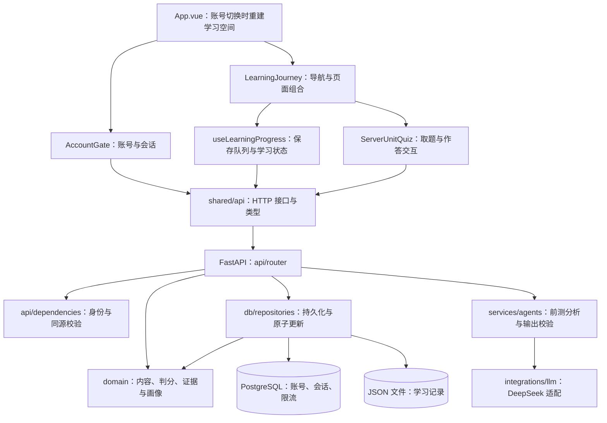

# 当前代码架构与维护边界

核对日期：2026-11-26。本文描述可执行代码；长期选型和未实现能力见[目标架构](architecture.md)。

## 总体判断

当前采用 Vue 3 + TypeScript 前端和 FastAPI 模块化单体后端，适合现有学习原型。
源码、部署、文档、模块测试分开维护是合理的，暂不需要微服务或独立的核心引擎包。
主要问题是部分职责跨层耦合，以及目录说明落后于实现。本轮按职责拆分，保留 HTTP 路径、数据格式和用户流程。



开发时 Vite 代理 `/api` 到后端；容器部署时 Nginx 分流前端静态资源和后端 API。
正式成绩、完成记录和画像都由后端生成；前端保存作答草稿并展示服务端结果。

API 源码直接使用 `api/router.py`、`api/dependencies.py` 和 `api/endpoints/`，不再保留 `v1` 目录层。
现有 HTTP 地址仍为 `/api/v1/...`，以保持前端及接口调用兼容；URL 前缀与源码目录不需要一一对应。

## 仓库和模块职责

| 位置 | 实际职责与入口 |
| --- | --- |
| `code/frontend/src/main.ts`、`App.vue` | Vue 启动、样式和根组件；按用户 ID 重建学习空间，隔离不同账号的局部状态 |
| `features/auth/` | `AccountGate.vue` 处理登录、注册、会话恢复与退出 |
| `features/assessment/` | 学习流程编排、通用测验、分析报告与画像；目前覆盖整个学习旅程，范围大于目录名 |
| `features/assessment/useLearningProgress.ts` | 加载课程和进度、串行保存、revision 冲突、草稿、提交、重测、分析缓存及组件生命周期 |
| `features/home/`、`phonetics/`、`companion/` | 首页、前测入口与伴学界面；伴学目前使用规则和示例内容 |
| `shared/api/`、`shared/components/` | API 调用及类型、共享图标；不维护正式计分规则 |
| `code/backend/app/main.py` | 应用工厂、仓储及 Agent 装配、生命周期、异常与请求日志 |
| `api/router.py`、`api/endpoints/` | 统一挂载账号与学习路由；路由处理 HTTP 输入输出和错误映射 |
| `api/dependencies.py` | 公共账号仓储依赖、可选/必需登录用户与同源检查，路由之间不互相调用 |
| `schemas/` | 账号、进度和测验请求的数据结构与输入一致性校验 |
| `domain/content/` | 统一课程与题库、公开取题、答案校验、客观题判分 |
| `domain/learner/` | 作答证据、缓存指纹、首次作答画像；不依赖 FastAPI、数据库或模型适配器 |
| `services/agents/` | 前测分析事件分派、模型输出结构与证据引用校验；不是已实现的多 Agent 协作系统 |
| `integrations/llm/` | DeepSeek 请求适配和提示词版本 |
| `db/repositories/` | 账号 PostgreSQL/JSON 实现、学习 JSON 实现；学习提交的幂等与 revision 更新在同一锁内完成 |
| `db/json_store.py` | JSON 仓储共用的文件锁和临时文件原子替换，不包含账号或学习业务 |
| `code/*/tests/` | 可执行前后端回归测试；根目录 `tests/` 仍主要是跨系统测试规划 |
| `infrastructure/`、`.github/workflows/ci.yml` | 容器、网关及 CI；CI 执行前端测试/构建和后端测试 |

`app/router` 尚未挂入前端入口，界面导航使用组件局部状态；Pinia 已安装并注册，但尚无实际业务 store。
`domain/intervention`、`gamification`、`review` 等目录以及部分前端 feature 仍是占位。
目录存在不代表功能完成。LangGraph、RAG、语音评分与书写识别也尚未接入运行链路。

## 本轮结构调整

| 原问题 | 调整 | 维护收益 |
| --- | --- | --- |
| 学习路由导入账号端点，并直接调用 `/me` 处理函数 | 将身份、仓储和同源检查移到 `api/dependencies.py`；账号模型移到 `schemas/auth.py` | 各业务路由复用相同鉴权，不依赖另一个 HTTP 端点 |
| 路由文件只有占位，应用入口分别导入端点 | 由 `api/router.py` 聚合，`main.py` 只挂载路由 | 新增资源时有统一挂载入口 |
| `JsonLearningRepository` 继承整个账号仓储，只为复用文件操作 | 抽取 `JsonFileStore`，两个仓储分别继承 | 学习仓储不再带有注册、会话和限流方法，原子写入只有一份实现 |
| 进度 schema 加载题库并计算分析证据和缓存指纹 | 移到 `domain/learner/evidence.py`，复用课程目录的前测题目；提示版本通过参数传入 | schema 专注校验，领域规则无模型供应商依赖，避免重复加载题库 |
| `LearningJourney.vue` 同时负责导航、伴学上下文、保存队列和分析请求 | 抽取 `useLearningProgress.ts`，组件保留展示编排 | 可单独维护进度同步；状态仍属于当前用户的组件实例 |
| 前端已有回归测试，但 CI 只构建且仍允许缺锁文件时跳过 | CI 必须安装锁定依赖，执行 `npm test` 和构建 | 交互回归进入持续检查 |
| 部分 README 仍描述纯前端、刷新丢失的旧 Demo | 更新相关入口并补充本文 | 将当前实现与长期目标分开查阅 |

## 后续扩展边界

1. **学习数据迁移到 PostgreSQL 优先于新增复杂编排框架。** 当前 JSON 文件锁适用于单机原型；账号与学习数据分处两种存储，无法提供跨存储事务。迁移应一起处理历史导入、提交幂等、revision 和证据回放，不能仅替换文件读写函数。已有[数据库接入计划](postgresql-integration-plan.md)可继续细化。
2. **增加学习用例时再完善服务层。** 目前普通读写由路由直接调用仓储，分析由路由连接仓储和 Agent；仓储也保留状态归一化等业务规则。后续出现第二种学习仓储或后台调用时，抽出学习服务和仓储协议，再下沉纯规则；保持幂等检查、判分结果落库、进度更新的原子性，避免为分层把事务拆开。
3. **前端按复用需求继续拆分。** 学习空间扩大后可增加 `features/learning/`，把旅程编排从 `assessment/` 移出；需要深链接和刷新恢复页面位置时再启用 Router。当前 composable 的调用方必须像 `App.vue` 一样，在账号变化时重建组件。只有跨页面共享的状态才需要 store。
4. **渐进完善接口契约和工程检查。** 当前学习接口仍大量使用字典返回，前端手写类型与后端 schema 需同步；后续可增加明确响应模型和契约测试。根目录 E2E、AI 评测及数据库迁移工具也仍待落地，不能把现有组件测试当成完整浏览器端到端验收。

本轮没有迁移业务数据、调整评分规则或引入新运行依赖。

## 验证方式

```bash
# 在 code/backend 中
.venv/bin/python -m pytest -q
.venv/bin/ruff check app tests

# 在 code/frontend 中
npm test
npm run build
```

补充了两种 JSON 仓储在文件替换失败后保留原数据并可重试的测试，以及前端慢请求期间连续改答的串行保存测试。
真实 PostgreSQL 测试需提供 `OWL_TEST_DATABASE_URL`，或按后端说明使用 `--postgres`；未配置时会跳过，不视为数据库集成验证通过。
