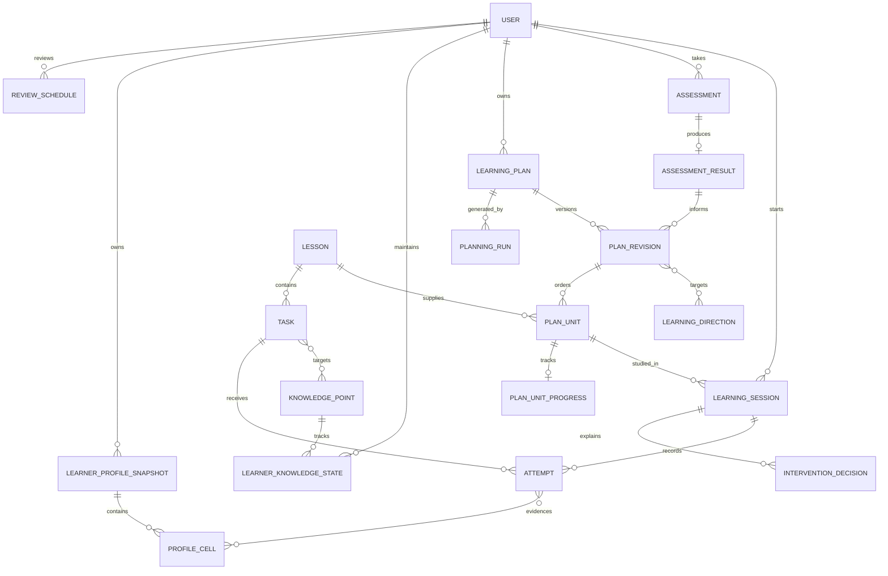

# 数据模型草案

> 概念设计，尚未创建数据库表或迁移。ID 规划采用 UUID，时间统一保存 UTC，展示按用户时区转换。

> 2026-11-02：对齐正式系统的前测、方向选择与学习规划；新增实体为设计，不代表已建表。需求见 FR-2、FR-12 和 FR-13。

| 实体 | 核心字段/关系 | 约束 |
| --- | --- | --- |
| User / LearnerProfile | 账户、学习目标、辅助语言、每日可用时间、自报水平、所选 direction_ids、profile_version | 账户、自报水平与测评证据分离；偏好修改递增版本 |
| LearningDirection | 稳定 ID、名称、语言学习目标、适用范围、内容覆盖、启用状态 | 旅游、古诗等为主题，不作为能力等级 |
| Assessment / AssessmentAttempt / AssessmentResult | 用户、测评状态、题目及版本、作答、评分规则版本、diagnosis_version、分项结果与证据说明 | 未完成不发布诊断；结果快照不可覆盖，重测保留历史；提交幂等 |
| LearningPlan | 用户、当前 plan_revision_id、创建时间 | 只指向该用户本计划的有效版本；首次异步生成时指针可为空 |
| PlanRevision | plan_id、版本号、base_plan_revision_id、诊断快照、知识状态快照、profile_version、方向与目标快照、时间预算、策略版本、状态、调整原因 | DRAFT/ACTIVE/SUPERSEDED/COMPLETED；每个计划最多一个 ACTIVE 版本，激活时核对输入和基准版本 |
| PlanUnit | plan_revision_id、顺序、lesson_id、content_version、目标、预计时长、先修单元、选择理由、完成条件 | 激活的计划至少包含一个单元；单元引用已审核有效内容，顺序无先修循环；历史版本保留 |
| PlanUnitProgress | 用户、plan_unit_id、状态、学习会话/作答证据、进度版本、完成时间 | 由业务规则确认完成；跨修订继承需验证目标和内容等价并保留来源，不直接复制完成标记 |
| PlanningRun | 用户、plan_id、base_plan_revision_id、阶段、输入快照、累计调用预算、幂等键、租约、重试状态、result_revision_id、错误与回退原因 | 数据库持久化；重试不重置预算；旧输入不能激活新版本 |
| KnowledgePoint | 类型（声调/汉字/词汇/情境）、级别、先修点 | 不把课程级别直接当作掌握度 |
| ChineseEntry | 简体字、带调拼音、分音节声调、变调说明、英文释义、例词、量词 | 关联知识点及内容版本 |
| Lesson / Task | 方向标签、场景、目标、知识点、任务序列、预计时长、先修要求、题型、难度、cognitive_level、答案、分级提示 | 正式内容必须审核通过；认知目标、语言难度与帮助等级分别建模 |
| CultureCard | 主题、分级说明、英文辅助、适用语境、关联课程 | 区分通用说明与地区习俗 |
| ContentRevision | 内容 ID、版本、来源、许可、作者、审核者、审核状态 | 答题记录引用具体内容版本 |
| MediaAsset | 类型（音频/笔顺）、地址、语言、来源、许可、审核状态 | 未授权资源不得发布 |
| LearningSession / Attempt | 用户、plan_revision_id、plan_unit_id、任务版本、作答、正误、耗时、尝试序号、幂等键 | 一次提交最多处理一次；关联具体计划单元，独立复习会话可不绑定单元 |
| LearnerKnowledgeState | 用户+知识点、掌握估计、置信度、练习时间、模型版本、状态版本 | 数据不足标记不确定 |
| LearnerProfileSnapshot / ProfileCell | 用户、画像版本、评分策略版本、语言能力维度×Bloom层级、分数、置信度、证据数、支架偏好、证据ID | 未作答为证据不足而非0分；语言难度、认知层级和支架强度分别建模；详见[多维学习者能力画像架构](learner-profile-architecture.md) |
| InterventionDecision | 会话、输入信号、0–4 级帮助、原因、策略版本 | 不介入也记录决策 |
| ReviewSchedule | 用户+知识点、到期时间、复习次数、调度版本 | 去重与延迟测验可追踪 |
| LearningEvent / RewardLedger | 事件类型、时间、会话、奖励依据、幂等键 | 不将重复提交重复计分 |
| KnowledgeDocument / KnowledgeChunk | 来源、许可、方向、知识点、难度、语言、内容版本、审核/可见状态、embedding 版本 | 教学资料与 Mem0 个人记忆独立存储；下线内容不再参与检索或新计划 |

关系：课程包含任务；任务关联多个知识点和可选文化卡；汉语条目关联音频/字形资源；会话包含作答和干预；用户在知识点上维护状态与复习计划。

诊断快照、方向和当前学习状态共同形成计划输入；计划包含多个修订，每个修订包含有序单元，单元关联具体课程内容版本。计划生效、当前版本指针与规划运行结果在同一事务提交。调整后保留旧单元的学习证据，运行失败不删除当前计划。

正式 SQL schema 在选定首个纵向功能后细化。录音若后续引入，单独制定授权、保存期限和删除规则；当前架构不默认采集或保存音频。

