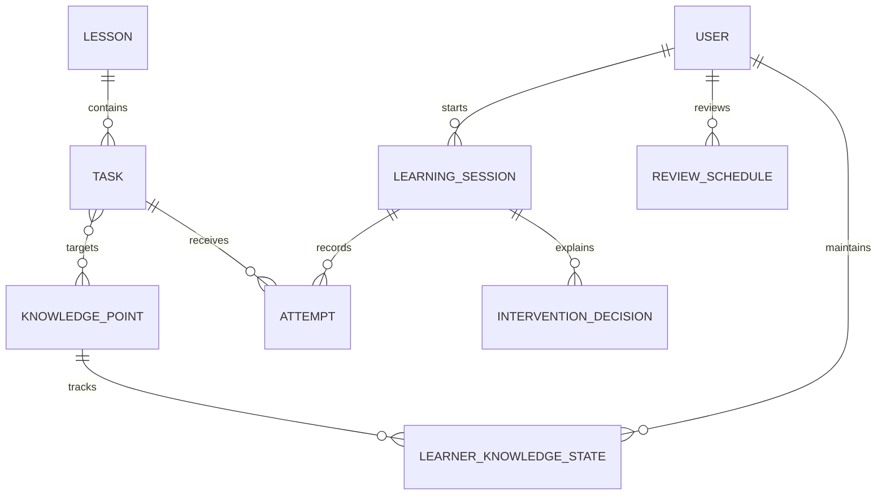

# 数据模型草案

> 概念设计，尚未创建数据库表或迁移。ID 规划采用 UUID，时间统一保存 UTC，展示按用户时区转换。

| 实体 | 核心字段/关系 | 约束 |
| --- | --- | --- |
| User / LearnerProfile | 账户、学习目标、辅助语言、可用时间、起始能力 | 账户身份与能力状态分离 |
| KnowledgePoint | 类型（声调/汉字/词汇/情境）、级别、先修点 | 不把课程级别直接当作掌握度 |
| ChineseEntry | 简体字、带调拼音、分音节声调、变调说明、英文释义、例词、量词 | 关联知识点及内容版本 |
| Lesson / Task | 场景、目标、任务序列、题型、难度、答案、分级提示 | 正式内容必须审核通过 |
| CultureCard | 主题、分级说明、英文辅助、适用语境、关联课程 | 区分通用说明与地区习俗 |
| ContentRevision | 内容 ID、版本、来源、许可、作者、审核者、审核状态 | 答题记录引用具体内容版本 |
| MediaAsset | 类型（音频/笔顺）、地址、语言、来源、许可、审核状态 | 未授权资源不得发布 |
| LearningSession / Attempt | 用户、任务版本、作答、正误、耗时、尝试序号、幂等键 | 一次提交最多处理一次 |
| LearnerKnowledgeState | 用户+知识点、掌握估计、置信度、练习时间、模型版本 | 数据不足标记不确定 |
| InterventionDecision | 会话、输入信号、0–4 级帮助、原因、策略版本 | 不介入也记录决策 |
| ReviewSchedule | 用户+知识点、到期时间、复习次数、调度版本 | 去重与延迟测验可追踪 |
| LearningEvent / RewardLedger | 事件类型、时间、会话、奖励依据、幂等键 | 不将重复提交重复计分 |

关系：课程包含任务；任务关联多个知识点和可选文化卡；汉语条目关联音频/字形资源；会话包含作答和干预；用户在知识点上维护状态与复习计划。

正式 SQL schema 在选定首个纵向功能后细化。录音若后续引入，单独制定授权、保存期限和删除规则；当前架构不默认采集或保存音频。
