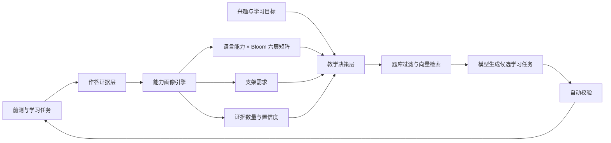
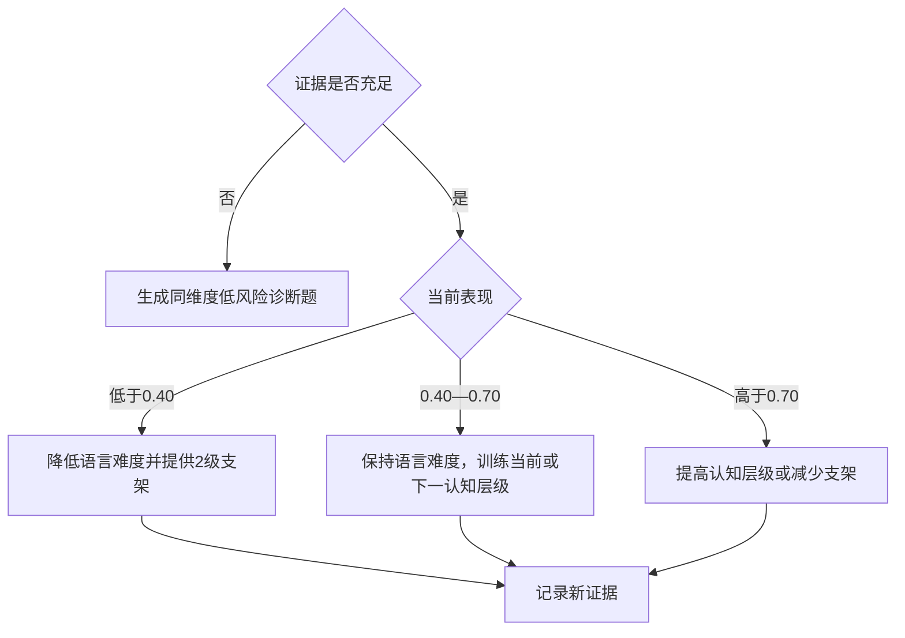

# OwlOwlGo 多维学习者能力画像架构

> 汇报版本：v1.0  
> 适用范围：课程作业原型、后续论文设计与系统迭代  
> 核心观点：学习者画像不是单一“等级”，而是由语言能力、认知表现、兴趣目标和支架需求共同构成的动态证据模型。

## 1. 一页结论

OwlOwlGo 使用“语言能力维度 × 修订版布鲁姆六层”作为能力画像主体，并使用兴趣方向选择学习内容、使用支架记录区分独立完成与辅助完成。系统不把学生固定归类为“记忆型”或“应用型”，也不把一次前测分数当作完整汉语水平。

画像的最小表达为：

```text
学习者画像 = 能力矩阵 + 兴趣目标 + 支架需求 + 证据与置信度
```

该架构解决三个问题：

1. 区分“语言内容不会”和“认知任务过难”；
2. 区分“独立掌握”和“在提示下完成”；
3. 为题库检索、自动出题、学习路径和渐进式帮助提供同一套可解释依据。

## 2. 总体架构



系统分为四层：

| 层次 | 输入/职责 | 主要输出 |
| --- | --- | --- |
| 证据层 | 正误、耗时、尝试次数、提示等级、题目难度 | 可追踪的作答证据 |
| 画像层 | 按能力维度和认知层级聚合作答 | 分数、证据数、置信度、状态 |
| 决策层 | 画像、兴趣、学习目标、可用内容 | 下一任务层级、内容主题、支架强度 |
| 内容层 | 700篇题库、向量检索、生成模型 | 新材料、新题、答案、解析、提示 |

## 3. 四类画像维度

### 3.1 语言能力维度

当前建议采用七个可扩展维度：

| ID | 中文名称 | 当前证据来源 |
| --- | --- | --- |
| `phonetics` | 拼音与声调 | 现有8题前测 |
| `vocabulary_grammar` | 词汇与句式 | 课程单元、功能性文本 |
| `functional_reading` | 功能性阅读 | 通知、邮件、说明、发言稿 |
| `multimodal_information_literacy` | 非连续性文本信息处理 | 表格、地图、广告、时刻表 |
| `poetry_comprehension` | 古诗理解 | 古诗材料与题目 |
| `classical_chinese_comprehension` | 文言文理解 | 文言文材料与题目 |
| `written_language_use` | 书面表达与修改 | 修改、拟写、开放表达任务 |

### 3.2 认知过程维度

采用修订版布鲁姆分类：

| 层级 | 系统中的可观察任务 |
| --- | --- |
| Remember 记忆 | 再认词义、作者、原句和事实 |
| Understand 理解 | 解释、概括、分类和提取意义 |
| Apply 应用 | 在新情境中翻译、修改或使用规则 |
| Analyze 分析 | 比较、分解、识别关系和论证结构 |
| Evaluate 评价 | 根据材料或标准判断并说明理由 |
| Create 创造 | 组织信息并生成新文本或方案 |

布鲁姆层级描述任务要求，不是学生固定身份，也不等于语言难度。

### 3.3 兴趣与目标维度

当前包括旅游出行、日常生活、校园交流和古诗入门。兴趣决定“学什么主题”，不直接决定“能力有多高”。同一能力弱项可以通过不同兴趣主题练习。

### 3.4 支架需求维度

| 等级 | 含义 | 对画像计分的影响 |
| ---: | --- | ---: |
| 0 | 独立完成 | 1.00 |
| 1 | 任务定向提示 | 0.85 |
| 2 | 证据定位提示 | 0.70 |
| 3 | 解题策略或分步帮助 | 0.50 |
| 4 | 完整讲解与答案 | 0.20 |

答对但使用了较强提示，说明学习已经发生，但不能与独立掌握记为同样证据。

## 4. HSK 候选等级与项目覆盖范围

### 4.1 HSK 与布鲁姆的关系

HSK 等级描述学习者能够处理的语言材料复杂度和完成语言交际任务的能力；布鲁姆层级描述题目要求学习者执行的认知过程。两者是相互独立的坐标轴，不能直接写成“记忆等于 HSK 1、创造等于 HSK 6”。

依据《国际中文教育中文水平等级标准》（GF0025—2021），中文水平采用“三等九级”：

| 等别 | 等级 |
| --- | --- |
| 初等 | 1—3级 |
| 中等 | 4—6级 |
| 高等 | 7—9级 |

该标准同时从音节、汉字、词汇、语法等语言要素，以及听、说、读、写、译等语言技能描述中文水平。因此，只完成文字阅读题不能形成完整的正式 HSK 等级判断。

### 4.2 OwlOwlGo 的目标范围

当前项目建议表述为：

> OwlOwlGo 主要面向 HSK 1—4级候选水平的成人二语汉语学习者，支持 HSK 5—6级阅读与文化内容拓展；当前原型不承担 HSK 7—9级正式能力评估。

选择这一范围的原因是，当前系统已经覆盖拼音声调、生活交际、旅游、校园、功能性阅读、非连续性文本、古诗和文言文阅读，但尚未建立完整的听力、口语录音评分、长篇写作、高级翻译和学术职业中文测评。因此，系统架构可以保存 HSK 1—6级候选信息，但当前原型较可靠的产品目标应限定在 HSK 1—4级。

| OwlOwlGo 内容 | HSK 候选范围 | 说明 |
| --- | --- | --- |
| 拼音、声母、韵母、声调 | HSK 1 | 属于汉语学习基础，不能单独据此判断 HSK 等级 |
| 问候、自我介绍、时间、购物 | HSK 1—2 | 基础生活交际 |
| 问路、交通、点餐、校园求助 | HSK 2—3 | 日常任务与简单信息整合 |
| 通知、邮件、说明、时刻表 | HSK 2—4 | 功能性阅读与信息提取 |
| 多材料、图表和规则比较 | HSK 3—5 | 需要整合信息与推理 |
| 古诗基础理解 | HSK 3—5候选 | 属于文化阅读，不能只根据作品所在年级映射 HSK |
| 文言词义、翻译和比较阅读 | HSK 4—6以上候选 | 更接近高级文化阅读，不等同于一般交际能力 |

### 4.3 700篇题库的 HSK 映射边界

700篇材料来自中国三至九年级母语语文题库。母语学生年级与成人二语 HSK 等级不是同一体系，因此不能把“三年级”等同于“HSK 3级”，也不能直接将整套数据称为“HSK 1—6题库”。

题库中的 HSK 信息应保存为自动估计的候选区间，而非精确等级：

```json
{
  "hsk_min_candidate": 3,
  "hsk_max_candidate": 4,
  "hsk_mapping_status": "ai_estimated",
  "hsk_mapping_basis": [
    "文本长度",
    "词汇复杂度",
    "句法复杂度",
    "任务类型",
    "信息整合数量",
    "文化知识要求"
  ]
}
```

其中，功能性和非连续性文本经过筛选后，可为 HSK 2—5级候选学习任务提供参考；古诗和文言文可为 HSK 3—6级文化阅读提供候选参考。所有映射均应保留 `ai_estimated` 状态，直到获得真实二语学习者的作答数据进行校准。

### 4.4 HSK × 布鲁姆二维任务设计

每个 HSK 候选范围都可以设计六种认知任务：

| HSK候选范围 | 记忆 | 理解 | 应用 | 分析 | 评价 | 创造 |
| --- | --- | --- | --- | --- | --- | --- |
| HSK 1—2 | 认读词语 | 理解短句 | 完成点餐 | 比较两句话 | 选择更礼貌的表达并说明原因 | 写两句自我介绍 |
| HSK 3—4 | 回忆材料信息 | 概括通知 | 根据时刻表安排行程 | 比较两条路线 | 评价出行方案 | 编写活动通知 |
| HSK 5—6 | 识别篇章概念 | 概括较长文章 | 迁移表达方法 | 分析篇章结构 | 评价作者观点 | 写完整方案或评论 |

例如，“用‘我叫……，我来自……’写两句自我介绍”属于创造任务，但语言难度仍可处于 HSK 1—2级。由此，系统分别使用：

```text
HSK候选范围 → 控制语言材料难度
布鲁姆层级 → 控制任务认知要求
支架等级 → 控制系统帮助强度
```

汇报时可概括为：OwlOwlGo 不使用布鲁姆层级替代中文水平，而是使用 HSK 候选范围和布鲁姆认知过程构成二维画像，再结合支架需求决定下一项学习任务。

## 5. 能力矩阵

系统为每个“语言能力 × 认知层级”单元格保存独立状态：

| 语言能力 | 记忆 | 理解 | 应用 | 分析 | 评价 | 创造 |
| --- | ---: | ---: | ---: | ---: | ---: | ---: |
| 拼音与声调 | 0.82 | 0.71 | 0.55 | — | — | — |
| 功能性阅读 | 0.80 | 0.68 | 0.47 | 0.35 | — | 0.28 |
| 非连续性文本 | 0.76 | 0.64 | 0.51 | 0.39 | 0.31 | — |
| 古诗理解 | 0.62 | 0.49 | 0.37 | 0.30 | 0.25 | 0.22 |

其中 `—` 表示证据不足，不是零分。每个单元格保存：

```json
{
  "score": 0.64,
  "confidence": 0.8,
  "evidence_count": 4,
  "status": "emerging",
  "last_updated_at": "2026-11-03T10:00:00Z",
  "evidence_ids": ["attempt-101", "attempt-108"]
}
```

证据状态暂定为：1次证据仍为 `insufficient`，2—4次为 `emerging`，5次以上为 `stable`。阈值是原型策略，不是测量学结论。

## 6. 画像更新算法

### 6.1 单题表现

原型阶段采用可解释的启发式计算：

```text
单题表现 = 正确性 × 提示权重 × 重试权重 × 难度权重
```

- 答错为0；
- 提示权重见上表；
- 每多一次尝试暂扣0.10，最低为0.70；
- 难度权重限制在0.8—1.2之间；
- 最终结果限制在0—1之间。

### 6.2 动态更新

```text
新分数 = 旧分数 × 0.7 + 本次表现 × 0.3
置信度 = min(1, 证据数 ÷ 5)
```

该方法使近期表现产生影响，同时避免单题导致画像剧烈变化。其用途是原型推荐，不应表述为正式能力量表。后续可利用真实答题数据改用项目反应理论、贝叶斯知识追踪或认知诊断模型。

## 7. 从画像到教学决策



示例：学习者在功能性阅读的理解层达到0.74，但应用层只有0.43。系统不继续大量生成信息复述题，而是检索旅游主题的初级功能性材料，生成应用任务，并默认提供一级提示。连续失败时先降低语言难度或增强支架，不直接给学生贴“应用能力差”的标签。

## 8. 与700篇题库及自动出题的连接

题库中每道题已经具有：

```text
l2_level + topic_ids + language_dimension + bloom_level
+ question_type + scaffold_levels + review_status
```

出题流程为：

1. 画像引擎确定目标单元格，例如“非连续性文本 × 应用”；
2. 根据兴趣选择旅游、生活或校园主题；
3. 使用二语难度、能力维度、Bloom层级进行元数据过滤；
4. 通过向量检索选取3—5个参考样例；
5. 模型生成新材料、题目、答案、解析和分级提示；
6. 自动检查答案唯一性、材料可答性、层级一致性和原题相似度；
7. 保存生成版本与参考题ID，进入学习流程；
8. 作答结果回流画像。

题库不是直接给学生刷完，而是为模型提供有边界的题型、文体和认知任务参考。

## 9. 数据与接口设计

### 9.1 作答证据

```json
{
  "attempt_id": "attempt-001",
  "item_id": "generated-item-023",
  "language_dimension": "functional_reading",
  "bloom_level": "apply",
  "correct": true,
  "hint_level": 2,
  "response_time_ms": 42000,
  "attempt_count": 2,
  "difficulty_weight": 1.0
}
```

### 9.2 建议接口

| 接口 | 用途 |
| --- | --- |
| `GET /api/v1/learner-profile` | 获取当前画像快照和证据状态 |
| `POST /api/v1/attempts` | 提交作答并更新对应画像单元格 |
| `GET /api/v1/recommendations/next` | 获取下一任务目标和推荐理由 |
| `POST /api/v1/generated-items` | 根据目标画像单元格生成候选任务 |

当前代码已经新增画像数据契约与单元格更新函数，但以上接口尚未接入现有 Demo，避免将设计文档误报为已经实现的功能。

## 10. 可解释性与风险控制

- 每个分数必须能追溯到具体作答 `attempt_id`；
- 不用兴趣、国籍或母语推断能力；
- 不将未作答维度记为0分；
- 不把模型生成的文字解释当作正式成绩；
- 语言难度、Bloom层级与提示强度分别建模；
- 记录评分策略版本，规则变化时生成新画像版本；
- 对教师展示“证据数和置信度”，避免只展示看似精确的百分数；
- 当前标签和分数用于课程作业原型，不宣称已完成心理测量学验证。

## 11. 汇报时可直接使用的表述

> 我们没有把学习者简单分为初级、中级或高级，而是建立了一个动态能力矩阵。矩阵的纵轴是拼音、功能性阅读、非连续性文本、古诗和文言文等语言能力，横轴是修订版布鲁姆分类的记忆、理解、应用、分析、评价和创造。HSK 候选范围用于控制语言材料难度，布鲁姆层级用于控制认知任务要求，支架等级用于控制帮助强度。系统同时记录答题正误、提示使用、重试和证据数量，因此能够区分独立掌握与辅助完成。当前原型重点覆盖 HSK 1—4级，并将 HSK 5—6级作为阅读和文化内容拓展；当前算法是可解释的启发式模型，未来可使用真实学习数据进一步校准。

## 12. 教师可能追问的问题

**为什么不直接使用一个总分？**  
总分无法区分语言知识薄弱与认知任务要求过高，也无法解释下一步应学什么。

**Bloom层级是不是越高越好？**  
不是。层级描述任务认知过程，不等于语言难度或学生价值判断。系统依据学习目标选择适当层级。

**系统相当于 HSK 几级？**  
当前原型重点覆盖 HSK 1—4级候选水平，HSK 5—6级作为阅读和文化拓展。由于暂未完整测量听、说、读、写、译，系统不颁发或推断正式 HSK 等级。

**为什么不把中小学年级直接换算成 HSK？**  
题库年级描述母语教育阶段，HSK 描述成人或国际中文学习者的二语能力，两者的学习对象、任务和评价标准不同，只能经过文本分析和学习者数据校准后形成候选范围。

**没有作答的数据怎么办？**  
标记为证据不足，通过低风险诊断题补充证据，不按零分处理。

**AI生成题如何保证质量？**  
使用元数据过滤、向量检索约束、结构化输出和自动校验，并保存模型版本、参考题ID和生成版本。

**这个画像是否已经科学验证？**  
理论框架有文献依据，但当前评分权重和阈值属于原型策略。论文中应表述为设计与探索性验证，不能表述为正式标准化测评。

## 13. 参考文献

1. Anderson, L. W., & Krathwohl, D. R. (Eds.). (2001). *A Taxonomy for Learning, Teaching, and Assessing: A Revision of Bloom's Taxonomy of Educational Objectives*. Longman.
2. Krathwohl, D. R. (2002). A revision of Bloom's taxonomy: An overview. *Theory Into Practice, 41*(4), 212–218. https://doi.org/10.1207/S15430421TIP4104_2
3. Council of Europe. (2020). *Common European Framework of Reference for Languages: Learning, Teaching, Assessment—Companion Volume*. Council of Europe Publishing.
4. 教育部、国家语言文字工作委员会. (2021). *国际中文教育中文水平等级标准（GF0025—2021）*. https://hudong.moe.gov.cn/jyb_xwfb/gzdt_gzdt/s5987/202103/t20210329_523304.html

