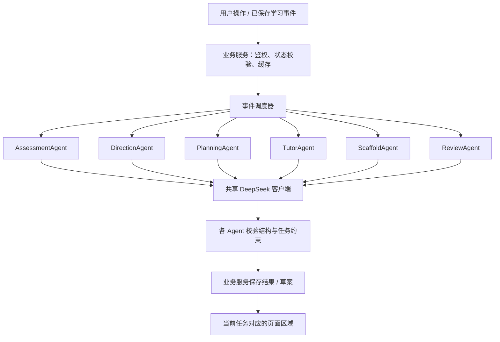

# 学习辅导多 Agent 架构

## 核心决策

按教学职责拆分 Agent。每个 Agent 拥有独立提示词、输入范围、输出契约、校验规则与版本；前端仍按学习流程组织，不给每个 Agent 单独开一个常驻面板。

多个 Agent 可以共用同一个 DeepSeek 模型、HTTP 客户端和配置文件中的 API Key。区别主要在职责和上下文，不要求使用不同模型或独立进程。先使用确定性的事件调度，不让一个大模型自由决定调用其他模型，避免重复调用与职责越界。

## Agent 分工

| Agent | 触发事件 | 必要输入 | 产出与权限 | 页面位置 |
| --- | --- | --- | --- | --- |
| AssessmentAgent 前测诊断 | 前测提交完成；无缓存报告的恢复/重试 | 逐题作答、标准答案、解析、规则得分 | 错题解释、练习建议；不能改分、评定综合语言等级 | 诊断页 / 历史报告 |
| DirectionAgent 兴趣引导 | 用户主动请求比较方向 | 候选主题、场景需求、明确兴趣与目标 | 主题比较及选择理由；缺少目标时问一个问题，不能替用户选择 | 方向卡片旁 |
| PlanningAgent 学习规划 | 用户确认兴趣、目标、时间预算并请求规划 | 诊断的结构化要点、主题、可用单元、先修关系、时间预算 | 课程顺序、练习量、推荐原因；只生成草案，用户接受后由业务服务保存 | 规划预览 |
| TutorAgent 内容讲解 | 用户点词句旁的解释入口 | 当前词句、单元上下文、核验过的课程/检索资料 | 简明解释、拼音、例子与来源；不能编造资料 | 当前词句旁 |
| ScaffoldAgent 渐进提示 | 主动求助或接受出错后的提示邀请 | 当前练习、尝试记录、已用提示层级、题目教学目标 | 一次给一级帮助：线索、异题示例、步骤、完整讲解；不能跳级提前透露答案 | 当前练习题旁 |
| ReviewAgent 复习反馈 | 单元练习提交，或到期复习/跨次持续错误 | 实际作答、知识点、提示使用、时间记录 | 总结与复习建议；建议改计划时交给规划流程，不能直接改计划 | 练习结果 / Home 行动卡 |

ReviewAgent 有 session_review 与 revision_proposal 两个任务，分别使用独立提示词和输出契约。后续若两者的数据和执行流程明显分化，再拆为两个 Agent，避免仅因提示词不同就无限增加角色。

## 调用关系

图中六类 Agent 是目标架构，目前只有 AssessmentAgent 已注册执行。

Agent 之间通过业务服务传递结构化产物，不互相任意调用，也不共享整段聊天历史。例如前测报告的知识点结论可以作为 PlanningAgent 的输入；ReviewAgent 发现持续错误后只生成调整建议，用户确认进入调整流程，业务服务再调用 PlanningAgent。

## 提示词与边界

每个任务的提示词包含六部分：身份与单一目标、允许使用的证据、禁止推断的内容、教学反馈策略、JSON 输出契约、缺失数据和异常时的行为。

- 前测诊断：逐题对比，不按总分套模板。只分析本次前测，不混入后续主题和完成标记。
- 兴趣引导：根据用户明确目标比较主题，不将分数当作兴趣证据。
- 学习规划：只使用真实单元 ID，满足时间预算和先修约束，逐项解释推荐理由。
- 内容讲解：区分课程事实与补充解释，提供来源；检索不足时明确说明资料不足。
- 渐进提示：读取当前提示层级；线索与异题示例不得泄露本题答案。强约束需业务逻辑和输出检查共同执行，不能只依赖提示词。
- 复习反馈：区分独立作答与辅助完成；自行标记完成不能证明掌握度，不据此生成能力提升结论。

提示词版本与 Agent ID 分开记录。变更一个 Agent 的提示词只失效它负责的缓存。用户内容与检索内容均作为数据传入，不得覆盖系统指令。

## 调度、存储与确认

1. 先验证用户身份和事件是否满足条件，按任务构造最小证据，不传账号、密码或密钥。
2. 按 agent_id、task_type、source_event_id、evidence_hash、prompt_version 查询缓存。
3. 命中缓存直接返回；未命中只运行该事件对应的 Agent，不串行跑完所有 Agent。
4. Agent 校验字段、题目/单元引用和业务边界；失败返回可重试状态，不让其他 Agent 凭空补结果。
5. 保存前核对来源证据是否改变；过期结果不能覆盖新状态。
6. 讲解、诊断、提示可直接展示；课程调整只保存提案，业务服务在用户接受后更新正式计划。

后续统一任务记录建议字段：task_id、agent_id、task_type、source_event_id、evidence_hash、prompt_version、status、result、created_at、accepted_at。用户隔离由仓储业务键保证，不依赖模型理解用户 ID。

当前仅保存前测报告，已有 evidence fingerprint、prompt_version、provider、model、created_at，本次增加 agent_id。统一任务表、跨进程请求去重、队列、独立任务重试及其他 Agent 尚未实现。

## 当前代码与下一步

已实现：

- `app/integrations/llm/deepseek.py`：共享模型客户端，处理配置、超时、HTTP 和完整响应检查；不再包含前测专属提示词和输出契约。
- `app/services/agents/assessment.py`：AssessmentAgent，负责前测提示词、输出结构、逐题证据校验和来源元信息。
- `app/services/agents/dispatcher.py`：显式注册和事件路由，只允许已实现的前测任务。未支持事件报错，不回退到通用分析。
- `app/api/endpoints/learning.py`：仍负责身份、是否完成前测、缓存与过期结果保护，再调用调度器。
- `app/integrations/llm/prompts/assessment.py`：独立的前测提示词。

前端行为保持阶段化：前测完成自动请求，诊断/报告页展示，方向和规划页不显示这份报告。现有接口无需让前端指定任意 Agent ID，路由由服务端决定。

后续按依赖推进：先补时间预算与课程结构，再实现 PlanningAgent；有学习与练习交互后实现 TutorAgent、ScaffoldAgent；累计实际练习证据后实现 ReviewAgent。DirectionAgent 作为用户主动求助的可选能力，不阻塞首次设置。
