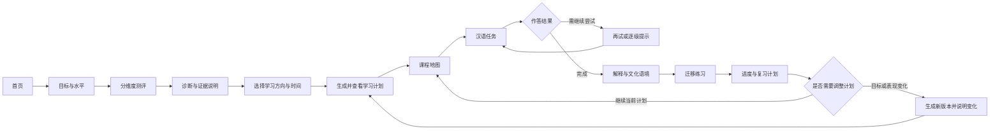

# 页面与交互设计

> v1.1 · 2026-11-02 · 正式系统产品设计稿，以下完整业务流程待实现；已有单模块 Demo 的状态另列于文末。

产品主线为 **前测与诊断 → 选择汉语学习方向 → 获得学习规划 → 单元学习 → 复习与调整**。主题服务于语言学习；技术实现沿用[架构方案](architecture.md)，功能要求见 FR-2、FR-12 和 FR-13。

## 页面结构

| 页面/规划路径 | 用户目的 | 主要内容与动作 | 空状态/异常 |
| --- | --- | --- | --- |
| 首页 `/` | 理解价值并进入学习 | 开始前测、继续当前计划、语言与文化介绍 | 无计划时进入引导与前测 |
| 学习引导 `/onboarding` | 设置学习起点 | 学习目的、已有能力、每日时间、辅助语言 | 可跳过自评，采用保守起点 |
| 测评 `/assessment` | 了解分项能力 | 声调、识字、词汇、情境理解小测 | 暂停恢复；未完成不生成正式结论 |
| 诊断 `/assessment/:id/result` | 查看能力起点 | 分项表现、证据范围、建议；进入方向选择 | 未完成则继续测评，未覆盖维度标记证据不足 |
| 方向 `/directions` | 选择感兴趣的汉语情境 | 旅游、日常生活、校园交流、古诗等；目标与时间 | 说明资料覆盖与能力要求；无覆盖时建议基础方向 |
| 计划 `/plans/:id` | 查看学习路径并开始学习 | 生成状态、计划目标、顺序、单元详情、原因和进度 | 失败保留已有计划；回退明确说明；旧输入需重新生成 |
| 课程地图 `/learn` | 按计划选择下一单元 | 当前计划、先修知识、预计时长、复习入口 | 无计划引导生成；无可用内容说明限制 |
| 学习关卡 `/learn/:lessonId` | 完成一次练习 | 汉字+拼音+英文、作答、重试、渐进提示、文化卡 | 服务失败保留作答，允许重试 |
| 声调训练 `/phonetics` | 区分音节与声调 | 拼音识别、音频听辨，后续跟读 | 无音频不使用“听辨完成”状态 |
| 汉字学习 `/characters` | 识读与理解字形 | 字形、部件、例词，后续笔顺描摹 | 授权资源缺失时保留识读内容 |
| 文化探索 `/culture` | 理解表达的文化语境 | 分级卡片、情境例句、关联课程 | 有争议/未审核内容不展示 |
| 今日复习 `/review` | 巩固到期知识点 | 到期任务、错题迁移、复习结果 | 无到期项时提示稍后回来 |
| 我的进度 `/progress` | 了解进步与下一步 | 分维度能力、复习计划、提示依赖 | 数据不足时明确显示“尚不足以评估” |
| 设置 `/settings` | 管理偏好与数据 | 辅助语言、主动提示、声音、隐私 | 保存失败反馈，不静默丢失 |

## 核心旅程

## 交互原则

1. 每屏聚焦一个语言目标；文化信息作为短卡与课程关联，避免初学者认知负担过高。
2. 显示简体汉字、带调拼音与英文辅助；允许后续关闭拼音，适应能力提升。
3. 首次错误先鼓励重试；主动求助逐级增加支架；完整讲解必须有明确入口。
4. 将声调识别、听辨和发音评分区分为不同任务，进度不得相互冒充。
5. 汉字笔顺使用有来源的资源；识读结果不能当作书写能力结果。
6. 手机采用单列任务，桌面可显示课程侧栏；操作支持键盘与明显焦点。
7. 规划说明以语言学习目标和选择理由表达；区分认知目标、语言难度和帮助等级。
8. 方向与目标修改可触发计划修订；显示变化原因，保留已完成单元，不静默替换正在进行的学习任务。

## 正式产品功能分组

| 分组 | 功能 | 完成方向 |
| --- | --- | --- |
| 主学习流程 | 档案、前测与诊断、方向选择、计划生成与单元详情、学习、复习和调整 | 从能力起点到学习进度形成可恢复的完整流程 |
| 教学支持 | 审核题库、汉字/拼音/英文、分层任务、渐进提示、情境与文化材料 | 内容适配用户能力，生成失败时仍可学习 |
| 个性化与追踪 | 服务端进度、规划规则、主题 RAG、结构化档案、Mem0 语义记忆、报告 | 计划与帮助可解释，记录有来源，修改和删除可追踪 |
| 汉语专项扩展 | 授权听辨资源、笔顺资源、经验证的语音评分与书写识别 | 分项能力分别验证；缺少资源时保留文字流程 |

以上是产品职责与目标，不能视为已实现清单。商业付费另行确认；本次不新增支付需求。现有代码完成范围见下节。

## 拼音与声调演示迭代

在架构骨架上实现单模块固定测评 Demo：8 道文字辨识题、即时反馈与解析、百分制总分、三类分项结果、逐题回顾和重新测评。数据仅在页面内存保存。此演示不包含听辨、录音或发音评分；其他模块仍按既有产品规划待实现。
