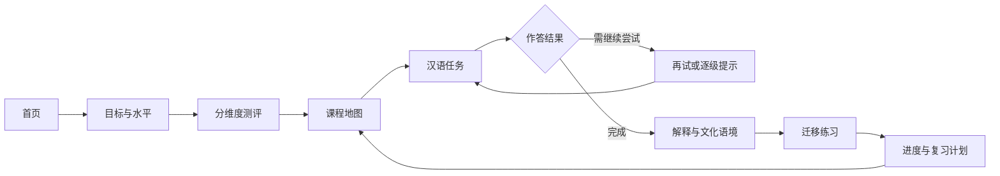

# 页面与交互设计

> v1.0 · 2026-10-15 · 产品设计稿，以下页面与交互均待实现。

## 页面结构

| 页面/规划路径 | 用户目的 | 主要内容与动作 | 空状态/异常 |
| --- | --- | --- | --- |
| 首页 `/` | 理解价值并进入学习 | 入门路径、语言与文化介绍、开始入口 | 当前仅为静态项目入口 |
| 学习引导 `/onboarding` | 设置学习起点 | 学习目的、已有能力、每日时间、辅助语言 | 可跳过自评，采用保守起点 |
| 测评 `/assessment` | 了解分项能力 | 声调、识字、词汇、情境理解小测 | 暂停恢复；未完成不生成正式结论 |
| 课程地图 `/learn` | 选择适合的小课 | 生活情境、级别、先修知识、预计时长 | 无推荐时展示审核后的入门课程 |
| 学习关卡 `/learn/:lessonId` | 完成一次练习 | 汉字+拼音+英文、作答、重试、渐进提示、文化卡 | 服务失败保留作答，允许重试 |
| 声调训练 `/phonetics` | 区分音节与声调 | 拼音识别、音频听辨，后续跟读 | 无音频不使用“听辨完成”状态 |
| 汉字学习 `/characters` | 识读与理解字形 | 字形、部件、例词，后续笔顺描摹 | 授权资源缺失时保留识读内容 |
| 文化探索 `/culture` | 理解表达的文化语境 | 分级卡片、情境例句、关联课程 | 有争议/未审核内容不展示 |
| 今日复习 `/review` | 巩固到期知识点 | 到期任务、错题迁移、复习结果 | 无到期项时提示稍后回来 |
| 我的进度 `/progress` | 了解进步与下一步 | 分维度能力、复习计划、提示依赖 | 数据不足时明确显示“尚不足以评估” |
| 设置 `/settings` | 管理偏好与数据 | 辅助语言、主动提示、声音、隐私 | 保存失败反馈，不静默丢失 |

## 核心旅程

## 交互原则

1. 每屏聚焦一个语言目标；文化信息作为短卡与课程关联，避免初学者认知负担过高。
2. 显示简体汉字、带调拼音与英文辅助；允许后续关闭拼音，适应能力提升。
3. 首次错误先鼓励重试；主动求助逐级增加支架；完整讲解必须有明确入口。
4. 将声调识别、听辨和发音评分区分为不同任务，进度不得相互冒充。
5. 汉字笔顺使用有来源的资源；识读结果不能当作书写能力结果。
6. 手机采用单列任务，桌面可显示课程侧栏；操作支持键盘与明显焦点。

## 功能优先级

| 阶段 | 功能 | 验收方向 |
| --- | --- | --- |
| P0 基础闭环 | 目标设置、精选题库、汉字/拼音/英文、选择与填空、情境课程、错误重试、分级提示、文化卡、学习记录 | 可完成一个端到端小课，正式内容经过审核 |
| P1 个性化 | 账户、分维度测评、服务端进度、推荐、错题复习、报告、五级干预 | 状态可追踪；跨会话不丢进度；策略可回放 |
| P1 汉语专项 | 授权音频听辨、基础笔顺动画/描摹、量词和同音字辨析 | 语言资源准确，失败时有文字回退 |
| P2 增强与商业验证 | 语音评分、书写识别、AI 候选反馈、多语、文化专题、机构试点 | 先验证准确性、成本与需求，再开放 |

所有阶段当前均为待实现。付费仅为后续商业验证方向，当前不开发支付。

## 拼音与声调演示迭代

在架构骨架上实现单模块固定测评 Demo：8 道文字辨识题、即时反馈与解析、百分制总分、三类分项结果、逐题回顾和重新测评。数据仅在页面内存保存。此演示不包含听辨、录音或发音评分；其他模块仍按既有产品规划待实现。
